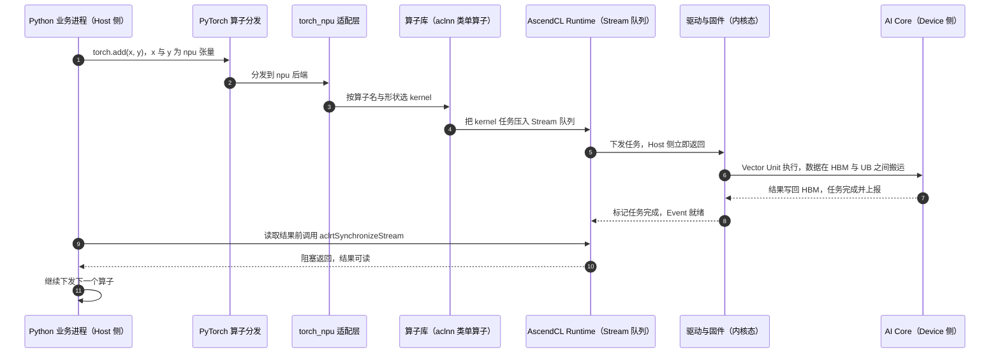

# 第 1 章 硬件与软件栈全景

## 本章目标

- 能用 `npu-smi info`、`npu-smi info -l` 与版本文件读出一台 Atlas 服务器的卡数、芯片名称、显存占用，以及驱动与 CANN（Compute Architecture for Neural Networks，昇腾的异构计算软件栈）的版本。
- 能画出一次 `torch.add` 从 Python 进程到 AI Core（芯片内的计算核心，内含矩阵计算单元与向量计算单元）的调用链，并标出 AscendCL（Ascend Computing Language，CANN 对外提供的 C/C++ 编程接口）、Runtime、Driver 三层的职责与输入输出。
- 能把 CPU 多核与 SIMD（Single Instruction Multiple Data，单指令多数据）、多级缓存与主存、RDMA（Remote Direct Memory Access，远程直接内存访问）网卡分别对应到 AI Core 与 Cube Unit（矩阵计算单元）/ Vector Unit（向量计算单元）、UB（Unified Buffer，统一缓冲区）/ L1 / GM（Global Memory，全局内存）、HCCS（Huawei Cache Coherence System，服务器内多卡之间的高速互联链路）/ RoCE（RDMA over Converged Ethernet，基于融合以太网的远程直接内存访问）。

## 先说结论

- 昇腾 AI 处理器（NPU，Neural Processing Unit，专门执行矩阵与向量计算的处理器）按芯片、板卡、服务器三层供货：Ascend 910 与 Ascend 310 系列是芯片，Atlas 300T 训练卡与 Atlas 300I 推理卡是板卡，Atlas 800 训练服务器与 Atlas 900 PoD 是整机。
- CANN 分层里，AscendCL 向应用暴露设备管理接口，Runtime 把任务排进 Stream（执行流，设备上的一条任务队列），Driver 在内核态访问物理卡，GE（Graph Engine，图引擎，把计算图做融合与编译后下发）与算子库决定下发什么计算，HCCL（Huawei Collective Communication Library，集合通信库，提供多卡集合通信原语）决定多卡之间怎么交换数据。
- Host 进程调用 `torch.add` 后立即返回，AI Core 上的 Vector Unit 在 Stream 里异步执行，读取结果前要插入同步点。
- `npu-smi info` 输出里的 `Health` 字段判断设备是否可用，`HBM-Usage(MB)` 字段给出显存占用，`AICore(%)` 字段给出计算核心利用率。
- 驱动、固件、CANN、torch_npu 的版本组合由官方版本配套表决定，混用版本会出现 `npu-smi info` 正常而 `import torch_npu` 失败。

## 硬件、软件栈与执行模型

### 三个硬件层次：芯片、板卡、服务器

产品形态分三层。芯片层是 Ascend 910、Ascend 310 及后续 910B、310P、310B 等型号，提供 AI Core、HBM（High Bandwidth Memory，高带宽内存，板载显存）与互联接口。板卡与模块层把芯片、HBM、供电与 PCIe 接口做在一块板上，例如 Atlas 300T 训练卡、Atlas 300I Pro 推理卡；Atlas 200I A2 是焊在底板上的加速模块。整机层把多张板卡、Host 侧 CPU、内存、网卡与电源装进机箱，例如 Atlas 800 训练服务器、Atlas 900 PoD、Atlas 500 智能小站。

昇腾社区《昇腾产品形态说明》按 `soc_series` 对应产品系列与芯片代号，下表取其中可查证部分。A2、A3 系列整机的芯片代号以该页字段为准。

| 芯片系列 / `soc_series` | 板卡与加速模块 | 整机、套件与集群 | 典型用途 |
|---|---|---|---|
| Ascend 910 / `ascend910` | Atlas 300T / 300T Pro 训练卡（型号 9000） | Atlas 800 训练服务器（9000、9010）、Atlas 900 PoD（9000）、Atlas 900T PoD Lite | 训练 |
| Ascend 310P / `ascend310p` | Atlas 300I Pro、300V、300V Pro、300I Duo 卡，Atlas 200I SoC A1 核心板 | Atlas 800 推理服务器（3000、3010）、Atlas 500 Pro 智能边缘服务器 | 推理、视频解析 |
| Ascend 310B / `ascend310b` | Atlas 200I A2 加速模块 | Atlas 200I DK A2 开发者套件、Atlas 500 A2 智能小站 | 边缘推理、开发 |
| Ascend 310 | Atlas 200 AI 加速模块、Atlas 300I 推理卡（3000、3010） | Atlas 500 智能小站 | 早期推理产品 |

Gitee `Ascend/pytorch` 仓库的「硬件配套」一节另列出 A2、A3 整机：Atlas 800T A2 训练服务器、Atlas 900 A2 PoD 集群基础单元、Atlas 200T A2 Box16 异构子框、Atlas 800T A3 训练服务器、Atlas 900 A3 SuperPoD 超节点、Atlas 800I A2 推理服务器。

调用链位置：硬件层，由 Driver 管理。由谁决定：型号与固件。输入 → 输出：任务请求 → 结果与中断。

### 芯片内部：AI Core、计算单元、存储层级与互联

AI Core 由计算单元、存储单元与 DMA（Direct Memory Access，直接内存访问）搬运单元组成。计算单元有三类：Cube Unit 执行矩阵乘加，Vector Unit 执行逐元素运算与归约，Scalar Unit 做地址计算与指令发射。搬运单元含 MTE2（搬入）与 MTE3（搬出），在片外与片上存储之间搬运数据。

存储分两级。GM 是 AI Core 可访问的片外存储，载体是 HBM，存放权重、激活与中间结果；Local Memory 是片上存储，含 L1、L0A / L0B / L0C 与 UB。《Ascend C 简介》给出的两条数据流：Cube 计算走 `GM → L1 → L0A/L0B → [Cube] → L0C → FixPipe → GM`，Vector 计算走 `GM → UB → [Vector] → UB → GM`。两类计算各有片上缓冲，数据先从 GM 搬入，算完搬回 GM。

Cube Unit 承担矩阵乘加。[华为企业支持社区达芬奇架构文档](https://forum.huawei.com/enterprise/en/ascend-ai-computing-engine-da-vinci-architecture/thread/667245938260983808)给出的初代规格是一次完成 $16 \times 16 \times 16 = 4096$ 次 FP16 乘加（官方公开规格：面向初代 Ascend 910，换型号需重新核对）。Vector Unit 一条指令处理一批数据，对应后端的 SIMD 思路。

互联分两段。服务器内多卡走 HCCS，承载单机内张量并行通信；跨机走 RoCE 无损以太网。HCCL 官方文档列出其支持 HCCS、RoCE、PCIe 等链路，提供 AllReduce、AllGather 等原语。

后端对照表：

| 后端概念 | 昇腾侧对应物 | 差异 |
|---|---|---|
| CPU 多核并行 + SIMD 向量指令 | 多个 AI Core，每核内 Cube Unit 与 Vector Unit 并行执行 | CPU 的 SIMD 宽度固定；AI Core 把矩阵乘与向量运算拆成独立单元，各带指令队列，由 Scalar Unit 发射 |
| CPU 的 L1 / L2 / L3 缓存与主存 | 片上 UB / L1 / L0A / L0B / L0C 与片外 GM（HBM） | CPU 缓存由硬件自动换入换出；昇腾侧片上缓冲容量小、地址需显式管理，搬运由 MTE2 / MTE3 完成 |
| RDMA 网卡做跨机直接内存访问 | 服务器内 HCCS 片间链路；跨机 RoCE 网络；由 HCCL 调度 | RDMA 网卡只解决跨机；昇腾侧把机内与跨机分成两层链路，通信原语由 HCCL 封装 |
| 主机内存与进程堆 | Host 内存（`aclrtMallocHost`）与 Device 显存（`aclrtMalloc`） | 两套地址空间独立，数据要经 `aclrtMemcpy` / `aclrtMemcpyAsync` 显式搬运 |
| 线程池任务队列 + `future.get()` | Stream 队列 + `aclrtSynchronizeStream` / `aclrtSynchronizeEvent` | 线程池任务跑在 CPU；Stream 任务跑在 AI Core，Host 侧只持有队列句柄 |
| 消息队列里的水位标记 | Event（`aclrtRecordEvent` 打点，`aclrtStreamWaitEvent` 跨流等待） | 水位标记描述消费进度；Event 描述一条 Stream 上的执行时刻，用于计时与跨流依赖 |

调用链位置：AI Core、HBM 与 HCCS / RoCE 在硬件层，由 Driver 驱动。由谁决定：芯片型号决定 AI Core 数、HBM 容量与拓扑。输入 → 输出：kernel 指令与 GM 数据 → 写回 GM 的结果。

### 张量、算子、权重、模型

张量（Tensor）是一段连续内存上的多维数组，附带形状 shape（各维长度）与数据类型 dtype（单个元素怎么解释）。后端里的结构体数组就是它的等价物：

```cpp
struct Record {
    float feat[4];
};
std::vector<Record> batch;   // batch.size() 条记录，每条 4 个 float
```

`batch` 对应形状为 `[N, 4]`、dtype 为 float32 的张量：`batch.size()` 是第一维，`feat[4]` 是第二维，`float` 决定 dtype。把多条请求打包进一块连续缓冲一次提交，对应把样本合成一个 batch 张量一次下发。

形状为 $[4096, 4096]$ 的 fp16 张量占显存 $4096 \times 4096 \times 2\ \mathrm{B} = 32\ \mathrm{MiB}$（估算：假设 fp16 每元素 2 字节，元素总数 $\prod_i d_i = 4096 \times 4096$）。元素总数与单元素字节数是杠杆；张量放在 Host 内存或 Device 显存只改地址空间，字节数不变。

| 词 | 白话解释 | 后端对照物 |
|---|---|---|
| 算子（Operator / OP） | 一次具体计算，如矩阵乘、加法、激活函数，输入输出都是张量 | 纯函数 `float add(float a, float b)`，或对一批数据做 map |
| 权重（Weight） | 模型里随训练更新的参数，一组持久化的张量 | 服务启动时从快照加载的参数表 |
| 模型（Model） | 一组算子按计算图连接，加一组权重 | 多次函数调用组成的处理流水线，加上依赖的配置数据 |

调用链位置：张量在框架适配层与算子库之间传递。由谁决定：形状与 dtype 由应用代码，存储位置由 `.to('npu')` 决定。输入 → 输出：Host 数组 → Device 张量 → 输出张量。

### CANN 软件栈分层

CANN 官方文档把总体架构自顶向下分为五部分，其中列出昇腾计算语言（AscendCL）、昇腾计算服务层与昇腾计算编译层，并另述运行时与驱动相关部分。按 Host 到 Device 的调用链，从下往上可以拆成下表六层。

| 层（由下往上） | 组件 | 职责 | 由谁决定 | 输入 → 输出 |
|---|---|---|---|---|
| 驱动与固件 | Ascend HDK 的 NPU 驱动、固件 | 内核态管理物理卡：设备发现、DMA、中断、内存映射 | Ascend HDK 版本与硬件型号 | 任务与内存请求 → 设备执行与中断 |
| Runtime | CANN Runtime，对外为 `aclrt*` 接口族 | Device / Context / Stream / Event 管理、显存分配、任务下发与同步 | CANN 版本 | 任务描述 → 完成状态与 Event |
| AscendCL（ACL） | `aclInit`、`aclrtSetDevice`、`aclrtMalloc`、`aclrtMemcpy`、`aclrtSynchronizeStream` | 对应用暴露设备管理、内存管理、模型与算子执行的 C/C++ 接口 | CANN 版本 | 应用调用 → 对 Runtime 的调用 |
| 算子库 / GE / HCCL | 算子库、GE（Graph Engine，图引擎，把计算图融合、切分与编译后下发，产物含 `.om` 离线模型）、HCCL | 提供预优化算子、编译整图、完成多卡集合通信 | CANN 版本与芯片型号（kernels 包名带型号） | 算子名与形状 / 计算图 → kernel 任务 / `.om` |
| 框架适配层 | torch_npu（Ascend Extension for PyTorch，把 PyTorch 的张量与算子注册到 `npu` 后端的适配插件）等 | 把框架调用分发到 aclnn 类单算子 API 或 GE 图 | 框架版本与 CANN 版本 | `torch.add` 等调用 → aclnn 单算子 API |
| 应用 | Python / C++ 业务进程 | 组织数据与业务逻辑 | 开发者 | 输入数据 → 推理或训练结果 |

后端分层对照表：

| 后端概念 | 昇腾侧对应物 | 差异 |
|---|---|---|
| 应用进程 | Python / C++ 业务进程 | 业务逻辑不变，设备相关部分交给框架适配层 |
| SDK / 客户端库 | AscendCL（ACL）与算子库 | SDK 一次链接；CANN 侧还要求驱动、固件、Toolkit、算子包四者版本配套 |
| 系统调用 | `aclrt*` 调用进入 Runtime，再经驱动进入内核态 | 后端由 libc 封装；昇腾侧由 AscendCL 与 Runtime 两级封装 |
| 内核态 | Ascend HDK 驱动与固件 | 除设备管理外还管理 HBM、AI Core 任务调度与 HCCS 链路 |
| 网卡 / RDMA | HCCS 片间链路与 RoCE 网卡，由 HCCL 调度 | 后端由网络库直接操作网卡；昇腾侧集合通信由 HCCL 按拓扑选链路 |
| RPC Stub / ORM 适配 | torch_npu 等框架适配层 | 适配层把算子分发与张量格式转换挡在应用之外 |

### Host / Device 执行模型

Host 指运行业务进程与操作系统的 CPU 与内存。Device 指一张昇腾 AI 处理器及其 HBM、AI Core、Stream，由 Host 进程管理。两者内存是两套独立地址空间：`aclrtMalloc` 分配 Device 显存，`aclrtMallocHost` 分配 Host 锁页内存，`aclrtMemcpy` 与 `aclrtMemcpyAsync` 负责搬运，`aclrtFree` 与 `aclrtFreeHost` 负责释放。把 Device 指针当 Host 指针解引用会读到无效地址。

初始化顺序为 `aclInit` → `aclrtSetDevice(0)` → `aclrtCreateContext` → `aclrtCreateStream`；释放按逆序 `aclrtDestroyStream` → `aclrtDestroyContext` → `aclrtResetDevice(0)` → `aclFinalize`。

任务下发是异步的：调用返回时任务只进了 Stream 队列，同一 Stream 内按提交顺序执行，不同 Stream 可并发。把 kernel 压入 Stream 相当于 `executor.submit(task)` 返回 future，`aclrtSynchronizeStream(stream)` 相当于 `future.get()` 阻塞等待。Event 是流中的时间点：`aclrtCreateEvent` 创建，`aclrtRecordEvent(event, s1)` 打点，`aclrtStreamWaitEvent(s2, event)` 让另一条流等待，`aclrtSynchronizeEvent(event)` 与 `aclrtSynchronizeDevice()` 提供另外两种粒度的同步。同步点出现在读回结果、计时或建立跨流依赖的位置。

一次 `torch.add` 的完整调用链：



调用链位置：同步与队列管理属 Runtime 层，显存搬运属 AscendCL 与 Runtime 层，执行在硬件层。由谁决定：Stream 数量与同步时机由应用代码，任务调度由 Runtime 决定。输入 → 输出：算子任务 → HBM 中的结果张量。

## 动手实操

执行前提：已装好驱动与固件的 Linux 主机，Shell 为 bash；读不到 `version.info` 时改用 `sudo cat`。`npu-smi`（NPU System Management Interface，查看卡状态与显存的命令行工具）的输出随型号与版本变化，关键字段列在下表。

```bash
# 1. 设备清单：卡数、设备 ID、每卡芯片数
npu-smi info -l

# 2. 实时状态：健康、功耗、温度、显存、AI Core 利用率、进程
npu-smi info

# 3. 指定设备的常用信息：芯片数、AI Core 数与频率、功耗
npu-smi info -t common -i 0

# 4. 指定芯片的板级信息：芯片名、固件版本、PCIe 总线
npu-smi info -t board -i 0 -c 0

# 5. 驱动、固件、CANN Toolkit 版本文件
cat /usr/local/Ascend/driver/version.info
cat /usr/local/Ascend/firmware/version.info
cat /usr/local/Ascend/cann/aarch64-linux/ascend_toolkit_install.info

# 6. 检查 set_env.sh 是否已在当前 Shell 生效
echo "ASCEND_HOME_PATH=$ASCEND_HOME_PATH"
echo "LD_LIBRARY_PATH=$LD_LIBRARY_PATH"
echo "PYTHONPATH=$PYTHONPATH"
command -v npu-smi
```

关键行含义：

| 输出行 | 含义 |
|---|---|
| `Card Count : 1` | `-l` 给出的卡数，多卡服务器等于可见卡数 |
| `NPU ID : 0` / `Chip Count : 1` | 设备逻辑 ID 与该卡芯片数；`-i`、`-c` 按设备 ID 与芯片 ID 取值 |
| `npu-smi 25.2.0 Version: 25.2.0` | 表头首行，前半为工具版本，`Version` 为驱动版本 |
| `Name` / `Health` | 芯片名称；健康状态取 `OK`、`Warning`、`Alarm`、`Critical`、`UNKNOWN`，正常为 `OK` |
| `Power(W)` / `Temp(C)` | 功率与温度；`Chip` 为 0 时是该 NPU 总功率 |
| `AICore(%)` / `Memory-Usage(MB)` / `HBM-Usage(MB)` | AI Core 利用率；DDR 占用；HBM 显存占用，格式为「已用 / 总量」 |
| `Bus-Id` | PCIe 总线地址，形如 `0000:01:00.0` |
| `Process id` / `Process name` / `Process memory(MB)` | 占用该卡的进程；无进程时显示 `No running processes found in NPU ...` |
| `Aicore Count : 25` / `Aicore Usage Rate(%)` | `-t common` 给出的 AI Core 个数与占用率；25 是官方示例输出值，随型号变化 |
| `Aicore Freq(MHZ)` / `NPU Real-time Power(W)` | AI Core 标称频率与实时功率 |
| `Firmware Version` / `PCIe Bus Info` | `-t board` 给出的固件版本与 PCIe 总线信息 |
| `Version=24.1.rc1` | 驱动版本；同文件 `compatible_version_fw` 给出兼容的固件范围 |
| `Version=7.1.0.11.220` | 固件版本；`compatible_version_drv` 给出兼容的驱动范围 |
| `version=8.5.0` / `path=...` | Toolkit 安装信息中的 CANN 版本与安装路径 |
| `ASCEND_HOME_PATH=...` | `set_env.sh` 注入的安装根目录；为空说明环境变量未加载 |

Toolkit 路径有两套布局：CANN 9.x 为 `/usr/local/Ascend/cann/<arch>-linux/ascend_toolkit_install.info`，CANN 8.x 为 `/usr/local/Ascend/ascend-toolkit/latest/<arch>-linux/ascend_toolkit_install.info`，`<arch>` 取 `aarch64` 或 `x86_64`。按实际路径替换，查不到时用 `find /usr/local/Ascend -name ascend_toolkit_install.info` 定位。`set_env.sh` 也有 `/usr/local/Ascend/ascend-toolkit/set_env.sh` 与 `/usr/local/Ascend/cann/set_env.sh` 两种布局，非 root 安装的根目录换成 `${HOME}/Ascend`。

## 常见坑

| 现象 | 原因 | 处理 |
|---|---|---|
| `Health` 为 `OK`、`HBM-Usage(MB)` 持续增长、`AICore(%)` 长期为 0 | 数据搬上了 Device，计算仍跑在 Host 侧，例如对 `npu` 张量做 Python 逐元素循环 | 改用框架算子或 aclnn 单算子 API 下发计算，再看 `AICore(%)` |
| 程序崩溃或读到全 0 / 乱码 | 把 `aclrtMalloc` 返回的 Device 指针当 Host 指针解引用，或把 Host 地址直接传给 kernel | 用 `aclrtMalloc` / `aclrtMallocHost` 区分分配位置，用 `aclrtMemcpy` / `aclrtMemcpyAsync` 搬运 |
| `aclrtMemcpyAsync` 后立刻读回 Host 缓冲区，数据不完整 | 异步搬运未完成，缺少同步点 | 调用 `aclrtSynchronizeStream`，或用 `aclrtRecordEvent` + `aclrtSynchronizeEvent` 等待 |
| `npu-smi info` 正常，`import torch_npu` 报 `libascendcl.so` 或 `libhccl.so` 找不到 | 驱动、固件、CANN、torch_npu 版本不配套，或 `set_env.sh` 未加载 | 按官方配套表选定一组版本；`source` 对应路径的 `set_env.sh`，确认 `LD_LIBRARY_PATH` 非空 |

## 自测题

1. 一台 Atlas 800 训练服务器（型号 9000）装有 8 张 Atlas 300T 训练卡（型号 9000）。`npu-smi info -l` 的 `Card Count`、`NPU ID`、`Chip Count` 各描述什么？`npu-smi info -t common -i 0` 回显 `Chip Count : 2`、`Aicore Count : 25`，这两行分别指哪层硬件？
2. 一段 AscendCL 程序调用 `aclrtMemcpyAsync` 把结果从 Device 搬回 Host，紧接着在 Host 读取该缓冲区，中间没有任何等待。写出至少两个可补的 API 名称，并说明属于调用链哪一层。
3. Host 侧有 `std::vector<Record>`，`Record` 含 `float feat[4]`，共 1000 条，一次性批量提交。对应张量的形状与 dtype 是什么？改用 fp16 后按元素总数乘以单元素字节数估算占多少字节？
4. `npu-smi info` 显示 `Health` 为 `OK`、`AICore(%)` 为 0、`HBM-Usage(MB)` 为 `0 / 32768`，应用进程正在运行。该进程是否已把计算下发到 AI Core？应检查哪几层？
5. 某机器 `driver/version.info` 回显 `Version=24.1.rc1`，Toolkit 安装信息文件回显 `version=8.5.0`。仅凭这两条能否断定版本配套？写出依据与应查入口。

## 自测题答案

1. `Card Count` 是卡数，该机为 8；`NPU ID` 是设备逻辑 ID，取值 0 到 7；`Chip Count` 是每卡芯片数。`Chip Count : 2` 指 0 号卡封装 2 个芯片，`Aicore Count : 25` 指其中一个芯片含 25 个 AI Core，属芯片内部计算核心层。
2. 可补 `aclrtSynchronizeStream(stream)`，或 `aclrtRecordEvent(event, stream)` 后 `aclrtSynchronizeEvent(event)`，也可用 `aclrtSynchronizeDevice()`。三者都属 Runtime 层。
3. 形状 `[1000, 4]`，dtype 为 float32。改用 fp16 时占用 $1000 \times 4 \times 2\ \mathrm{B} = 8000\ \mathrm{B}$（估算：假设 fp16 每元素 2 字节）。元素总数与单元素字节数是杠杆，存储位置不改字节数。
4. `AICore(%)` 为 0 说明 AI Core 空闲，显存未占用，计算没有下发到 AI Core。依次检查框架适配层是否用了 `npu` 设备、算子库是否选出 kernel、Runtime 是否把任务压入 Stream，并确认应用做过 `.to('npu')` 迁移。
5. 不能。驱动与 CANN 是否兼容，以官方《CANN 软件版本配套表》或版本配套查询助手给出的组合为准，并核对固件版本落在 `compatible_version_fw` 范围内。两个 `Version` 字段只说明各自装了什么，不构成配套结论。

## 参考来源

- [昇腾产品形态说明](https://www.hiascend.com/document/detail/zh/AscendFAQ/ProduTech/MindStudioFAQ/msfaq_003.html) — 查证于 2026-11-14；芯片系列、板卡整机型号与 `soc_series`
- [Ascend Extension for PyTorch README](https://gitee.com/ascend/pytorch) — 查证于 2026-11-14；A2 / A3 整机型号与 `set_env.sh` 路径
- [CANN是什么](https://www.hiascend.com/document/detail/zh/canncommercial/700/quickstart/quickstart/quickstart_18_0005.html) — 查证于 2026-11-14；CANN 总体架构五部分与各层职责
- [Ascend C 简介](https://www.hiascend.com/document/detail/zh/CANNCommunityEdition/81RC1beta1/opdevg/Ascendcopdevg/atlas_ascendc_10_53.html) — 查证于 2026-11-14；GM / L1 / L0 / UB 与两条计算数据流
- [HCCL Introduction](https://www.hiascend.com/document/detail/en/CANNCommunityEdition/latest/API/hcclug/hcclenvref_07_0004.html) — 查证于 2026-11-14；HCCS、RoCE、PCIe 链路与原语
- [查询基本信息（npu-smi 字段说明）](https://support.huawei.com/enterprise/zh/doc/EDOC1100493501/d62278bf) — 查证于 2026-11-14；`Health`、`HBM-Usage(MB)` 等字段含义
- [查询所有芯片常用信息](https://support.huawei.cn/enterprise/zh/doc/EDOC1100540362/6c7873d0) — 查证于 2026-11-14；`-t common` 字段与官方示例输出
- [Synchronization（AscendCL 同步接口）](https://support.huawei.com/enterprise/en/doc/EDOC1100192607/e06674eb/Synchronization-9.htm) — 查证于 2026-11-14；Stream 与 Event 同步 API
- [NPU Environment Check File After Training or Inference](https://www.hiascend.com/document/detail/en/mindcluster/730/faultdiag/faultdiagug/mindxdlFDUG027.html) — 查证于 2026-11-14；三个版本文件路径与示例输出
- [环境变量参考（CANN 社区版）](https://www.hiascend.com/document/detail/zh/CANNCommunityEdition/latest/maintenref/envvar/envref_07_0041.html) — 查证于 2026-11-14；`set_env.sh` 注入的变量与两套路径布局
