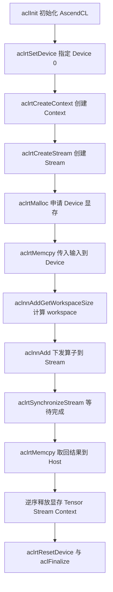

# 第 3 章 AscendCL C++ 入门

## 本章目标

1. 能按顺序列出 AscendCL（Ascend Computing Language，CANN（Compute Architecture for Neural Networks）对外提供的 C/C++ 编程接口，简称 ACL）一次计算的完整生命周期九步，说明每一步在 Host（主机侧，运行业务进程的 CPU 与内存）到 Device（设备侧，一张昇腾 AI 处理器及其显存、计算单元）调用链上的位置，并把它们对应到后端 SDK 的 `init`、连接池、线程池、`future.get()` 与错误码。
2. 能编译并运行一个 CMake 工程，用 `aclnnAddGetWorkspaceSize` 与 `aclnnAdd` 两段式接口在昇腾 AI 处理器上完成二维 `ACL_FLOAT` 张量加法，把结果回传 Host 并做数值校验。
3. 能写出两条 Stream（设备侧一条任务队列）各提交一路任务、用 Event（记录在流中的时间点，用于计时与跨流等待）计时的代码，说清队列内有序、队列间可并发，以及读取耗时前必须同步的原因。

## 先说结论

- AscendCL 的一次算子调用相当于一次带显式内存管理的远程过程调用（Remote Procedure Call，RPC）：`aclrtMalloc` 在 Device 显存开缓冲区，`aclrtMemcpy` 以 `ACL_MEMCPY_HOST_TO_DEVICE` 传参，`aclnnAdd` 把任务下发到 `aclrtStream`，`aclrtSynchronizeStream` 等待完成，`ACL_MEMCPY_DEVICE_TO_HOST` 取回结果。
- `aclnnAdd` 必须配 `aclnnAddGetWorkspaceSize` 两段调用。第一段在 Host 侧做入参校验、Shape 推导与切块（Tiling），返回 workspace 字节数和 `aclOpExecutor`；第二段把 executor 与 workspace 提交到指定 Stream 异步执行。
- `aclrtStream` 是设备侧一条任务队列，队列内按提交顺序执行，队列之间由 Runtime 调度并发；`aclrtEventElapsedTime` 的调用顺序被官方约束为「记录起止 Event → `aclrtSynchronizeStream` → 读取耗时」。
- 编译一个 aclnn 工程需要 `acl/acl.h` 与 `aclnnop/aclnn_add.h` 两组头文件，链接 `ascendcl`（部分版本写作 `libacl_rt.so`）、`nnopbase`、`opapi` 三个库；`set_env.sh` 一类环境脚本未加载时，配置阶段报找不到头文件，运行阶段报找不到动态库。
- `.om`（Offline Model，离线模型）路径入口为 `aclmdlLoadFromFileWithMem` 加载、`aclmdlExecute` 执行、`aclmdlUnload` 卸载，前置产物是 ATC（Ascend Tensor Compiler）编译出的模型文件，适用于整网推理；aclnn 单算子路径适用于 C++ 服务内嵌少量热点计算。

## 生命周期、内存模型与异步执行

### 一次计算在调用链上的位置

CANN（Compute Architecture for Neural Networks）位于驱动与上层框架之间，其中 Runtime 这一层负责把 Host 下发的任务排到设备上执行。ACL 是 CANN 暴露给 C++ 的句柄式接口：应用拿到的 `aclrtContext`、`aclrtStream`、`aclTensor` 都是 Host 侧的描述对象，真正的数据和计算都在 Device。



### 生命周期九步与后端对照表

| 后端概念 | 昇腾侧对应物 | 差异 |
|---|---|---|
| SDK 全局 `init`（如 `curl_global_init`、加载驱动） | `aclInit(nullptr)` / `aclFinalize()` | 进程级一次；`nullptr` 表示使用默认配置，不需要 `acl.json` |
| 连接池里选定一个连接 | `aclrtSetDevice(deviceId)` / `aclrtResetDevice(deviceId)` | 绑定的是当前线程使用的 Device；复位会回收该 Device 上的资源 |
| 会话 / 连接上下文（Connection、Session） | `aclrtCreateContext(&context, deviceId)` / `aclrtDestroyContext` | Context 持有该 Device 的资源视图，销毁顺序在 Stream 之后 |
| 线程池里的一条任务队列（单线程 Executor） | `aclrtCreateStream(&stream)` / `aclrtDestroyStream` | 队列内严格按提交顺序，队列间由 Runtime 调度并发 |
| 堆上申请业务缓冲区（`ByteBuffer.allocate`） | `aclrtMalloc(&devPtr, size, ACL_MEM_MALLOC_HUGE_FIRST)` / `aclrtFree` | 地址在 Device 显存，Host 不能直接解引用 |
| RPC 序列化后把请求体发到对端 | `aclrtMemcpy(devPtr, size, hostPtr, size, ACL_MEMCPY_HOST_TO_DEVICE)` | 同步版阻塞到拷贝动作完成；方向由枚举指定 |
| 提交异步任务拿到 `Future` | `aclnnAdd(workspace, workspaceSize, executor, stream)` | 返回只代表任务下发成功，算子可能尚未执行 |
| `future.get()` 阻塞等待 | `aclrtSynchronizeStream(stream)` | 等待指定 Stream 内全部已提交任务完成 |
| 反序列化响应体回本地 | `aclrtMemcpy(hostPtr, size, devPtr, size, ACL_MEMCPY_DEVICE_TO_HOST)` | 必须排在流同步之后，否则读到未完成的结果 |
| 返回码 / `errno` / HTTP status | `aclError` 与 `ACL_SUCCESS`（0）；`aclnnStatus` 与 `ACLNN_SUCCESS`（0） | 两套返回值；aclnn 异常可再用 `aclGetRecentErrMsg` 取详情 |
| `try-with-resources` / `defer` 归还连接 | `aclDestroyTensor`、`aclDestroyScalar`、`aclrtFree`、`aclrtDestroyStream`、`aclrtDestroyContext`、`aclFinalize` | 每段资源独立生命周期，按创建的逆序释放 |

九步的作用与输入输出：

1. `aclInit(nullptr)`。位于进程与 CANN 运行时之间，由应用决定调用时机。输入是配置文件路径或 `nullptr`，输出是运行时的全局初始化状态。
2. `aclrtSetDevice(0)`。位于 Host 进程与设备枚举之间，把当前线程绑定到 0 号 Device。输入是 `deviceId`，输出是该线程的默认设备。
3. `aclrtCreateContext(&context, 0)`。位于设备绑定与资源申请之间，创建该 Device 的资源上下文。输入是 `deviceId`，输出 `aclrtContext` 句柄。
4. `aclrtCreateStream(&stream)`。位于 Context 之下，创建一条任务队列。无输入参数，输出 `aclrtStream` 句柄。
5. `aclrtMalloc` 与 `aclrtMemcpy(..., ACL_MEMCPY_HOST_TO_DEVICE)`。位于 Host 内存到 Device 显存之间。输入是 Host 数据与字节数，输出是 Device 侧缓冲区地址。H2D（Host-to-Device，主机到设备）、D2H（Device-to-Host，设备到主机）、D2D（Device-to-Device，设备内或设备间）是搬运方向简称。搬运量按数据类型定义估算：`ACL_FLOAT` 每元素 4 字节，形状 $[2,2]$ 共 4 个元素，单份 $4 \times 4 = 16$ 字节，H2D 与 D2H 共 $2 \times 16 = 32$ 字节；元素个数与数据类型字节数是杠杆，`alpha` 取值不改变搬运量。
6. `aclnnAddGetWorkspaceSize` 与 `aclnnAdd`。位于 Runtime 的算子下发层。第一段输入是 `self`、`other`、`alpha`、`out` 四个描述对象，输出 `workspaceSize` 与 `executor`；第二段输入这三样加 Stream，输出是队列中一条异步任务。
7. `aclrtSynchronizeStream(stream)`。位于任务提交与结果读取之间，输入是 Stream，输出是该流内任务全部完成的屏障。
8. `aclrtMemcpy(..., ACL_MEMCPY_DEVICE_TO_HOST)`。输入 Device 结果地址，输出 Host 侧可读取的数组。
9. 逆序释放与 `aclFinalize()`。由应用负责，输入是各句柄，输出是资源归还与运行时去初始化。

### 两段式接口与「形状先定好」的 RPC 语义

`aclCreateTensor` 的原型是 `aclTensor *aclCreateTensor(const int64_t *viewDims, uint64_t viewDimsNum, aclDataType dataType, const int64_t *stride, int64_t offset, aclFormat format, const int64_t *storageDims, uint64_t storageDimsNum, void *tensorData)`。`viewDims` 与 `strides` 描述逻辑形状，`storageDims` 描述物理排布，`tensorData` 必须是 Device 侧地址。标量用 `aclScalar *aclCreateScalar(void *value, aclDataType dataType)` 创建，销毁用 `aclDestroyTensor` 与 `aclDestroyScalar`。

把 `aclnnAdd` 看成一次 RPC。张量（Tensor，按形状组织的多维数组，等价于后端里定长的数值缓冲区）是请求消息的 schema：形状、数据类型、格式、步长在调用前全部定好，输出 Tensor 的 Device 内存也要预先分配并绑定，格式用 `ACL_FORMAT_ND`（ND 指通用 N 维格式）。`aclOpExecutor` 是第一段生成的执行计划句柄，应用不构造。`workspaceSize` 是本次执行额外需要的临时 Device 内存字节数，由第一段按输入组合算出，返回 0 是合法值，此时第二段传 `nullptr` 与 0。

第一段接口全称为 `aclnnAddGetWorkspaceSize(const aclTensor *self, const aclTensor *other, const aclScalar *alpha, aclTensor *out, uint64_t *workspaceSize, aclOpExecutor **executor)`，第二段为 `aclnnAdd(void *workspace, uint64_t workspaceSize, aclOpExecutor *executor, aclrtStream stream)`，两者返回类型都是 `aclnnStatus`。返回码数值为官方公开规格，出自 CANN 商用版 9.0.0 的 aclnn 返回码文档：`ACLNN_SUCCESS` 为 0，`161002` 表示参数校验不通过，`561003` 表示算子二进制包未安装。计算式为 $out = self + alpha \times other$。

### 两条计算路径

| 路径 | 入口接口 | 前置产物 | 适用场景 |
|---|---|---|---|
| aclnn 单算子 | `aclnnAddGetWorkspaceSize` + `aclnnAdd` | CANN 内置算子库（`nnopbase`、`opapi`） | C++ 服务内嵌一两个热点算子、精细控制 Stream 与显存 |
| `.om` 离线模型 | `aclmdlLoadFromFileWithMem` + `aclmdlExecute` + `aclmdlUnload` | ATC 把模型编译成 `.om`，GE（Graph Engine，图引擎）已做图融合与调度 | 整网推理、模型文件已固化、输入输出由 `aclmdlDataset` 组织 |

本章工程走 aclnn 单算子路径，头文件 `aclnnop/aclnn_add.h`，链接 `ascendcl` + `nnopbase` + `opapi`。

### 内存模型

| 接口 | 所在侧 | 说明 |
|---|---|---|
| `aclrtMalloc(&devPtr, size, policy)` | Device 显存（HBM，High Bandwidth Memory，板载高带宽内存） | 返回的地址只能被设备侧访问；`ACL_MEM_MALLOC_HUGE_FIRST` 表示优先大页 |
| `aclrtFree(devPtr)` | Device 显存 | 与 `aclrtMalloc` 配对 |
| `aclrtMallocHost(&hostPtr, size)` / `aclrtFreeHost` | Host 锁页内存 | 内存页被锁定不被换出，设备可直接读写；`aclrtMemcpyAsync` 的 H2D/D2H 要求 Host 内存来自该接口 |
| `aclrtMemcpy` 同步版 | 双侧 | 阻塞到拷贝动作完成；官方文档明确函数内部不做隐式 Device 同步或流同步 |
| `aclrtMemcpyAsync` 异步版 | 双侧 | 立即返回，仅表示任务下发成功；源、目的地址需 64 字节对齐 |

`aclrtMemcpyKind` 的实际枚举名（CANN 社区版 8.0.RC3 文档）：

| 枚举值 | 方向 | 典型用途 |
|---|---|---|
| `ACL_MEMCPY_HOST_TO_HOST` | Host 内 | 同步版可用；异步版传入该值返回 `ACL_ERROR_RT_FEATURE_NOT_SUPPORT` |
| `ACL_MEMCPY_HOST_TO_DEVICE` | H2D | 传输入、传权重 |
| `ACL_MEMCPY_DEVICE_TO_HOST` | D2H | 取回结果、取回耗时数据 |
| `ACL_MEMCPY_DEVICE_TO_DEVICE` | D2D | 设备内或设备间复制 |
| `ACL_MEMCPY_DEFAULT` | 系统判定 | 由源、目的地址推断方向 |

隐含同步与显式同步的边界：

| 操作 | 同步性 | 处理 |
|---|---|---|
| `aclrtMemcpy` 同步版 | 拷贝动作本身阻塞；函数内部不做隐式 Device/Stream 同步 | 读取异步算子结果前另加 `aclrtSynchronizeStream` |
| `aclrtMemcpyAsync` | 否 | 必须 `aclrtSynchronizeStream(stream)` |
| `aclnnAdd` | 否 | 必须 `aclrtSynchronizeStream(stream)` |
| `aclrtMalloc` / `aclrtFree` | Host 侧调用同步完成 | 无额外等待 |
| `aclrtSynchronizeStream` | 显式 | 等待指定流内全部任务 |
| `aclrtSynchronizeEvent` / `aclrtStreamWaitEvent` / `aclrtSynchronizeDevice` | 显式 | 分别等待事件、构造跨流依赖、等待整卡 |
| `aclrtEventElapsedTime` | 依赖前置显式同步 | 官方约束顺序：`aclrtRecordEvent` → `aclrtSynchronizeStream` → 该函数 |

### 异步执行与计时陷阱

Stream 队列内有序：同一条 Stream 上先提交的 `aclrtMemcpyAsync` 一定先于后提交的 `aclnnAdd` 执行。队列间可并发：两条 Stream 上的任务由 Runtime 分别排到 AICore（AI Core，芯片内计算核心），互不阻塞，除非用 `aclrtStreamWaitEvent` 显式插入依赖。

后端里对应的陷阱是提交异步任务后立刻读 `System.currentTimeMillis()`，测到的只是入队耗时。`aclrtEventElapsedTime` 读的是设备写入 Event 的时间戳，未同步时该时间戳尚未写完。官方把调用顺序固定为：用 `aclrtCreateEventExWithFlag(&event, ACL_EVENT_TIME_LINE)` 创建计时 Event，`aclrtRecordEvent` 在同一条 Stream 记录起止，`aclrtSynchronizeStream` 阻塞，再读耗时。起止 Event 记录在同一条 Stream 上；跨 Stream 的依赖用 `aclrtCreateEventExWithFlag(&event, ACL_EVENT_SYNC)` 配合 `aclrtStreamWaitEvent`。

## 动手实操

### 执行前提

- Linux + bash，已安装与驱动固件配套的 CANN Toolkit。CANN 版本、驱动版本、硬件型号之间存在配套关系，以官方 Release Notes 配套表为准（<https://www.hiascend.com/cann/document>）；版本组合不在此处写死。
- 已加载对应 CANN 版本的环境脚本，使 `ASCEND_HOME_PATH` 指向安装目录。脚本路径随版本与安装方式变化，官方环境配置指南列出的形式包括 `/usr/local/Ascend/ascend-toolkit/set_env.sh`、`/usr/local/Ascend/cann/set_env.sh` 与 `${ASCEND_HOME_PATH}/bin/setenv.bash`（<https://github.com/ascend-ai-coding/awesome-ascend-skills/blob/main/external/cannbot/ops/ascendc-env-check/references/env_config_guide.md>）。以实际安装版本提供的脚本为准。
- `npu-smi info` 能列出 0 号 Device 且健康状态正常。唯一实测数字为第三方实测环境 CANN 8.5.2、Ascend 910B4 单卡、aarch64（参考资料第 10 条），本教程未复现。

### 目录结构

```
ascendcl-add-demo/
├── CMakeLists.txt
└── src/
    ├── main.cpp
    └── async_two_stream.cpp
```

### 文件 `CMakeLists.txt`

```cmake
cmake_minimum_required(VERSION 3.16)
project(ascendcl_add_demo LANGUAGES CXX)

set(CMAKE_CXX_STANDARD 17)
set(CMAKE_CXX_STANDARD_REQUIRED ON)

# ASCEND_HOME_PATH 由 CANN 环境脚本注入，不写死版本目录。
if(NOT DEFINED ENV{ASCEND_HOME_PATH})
    message(FATAL_ERROR "请先 source 对应 CANN 版本的环境脚本，使 ASCEND_HOME_PATH 可用")
endif()
set(ASCEND_HOME_PATH "$ENV{ASCEND_HOME_PATH}")

# acl/acl.h 在 include/；aclnnop/aclnn_add.h 在 include/ 或 aclnn/，随版本变化。
find_path(ASCEND_INCLUDE_DIR NAMES acl/acl.h
          PATHS "${ASCEND_HOME_PATH}/include" NO_DEFAULT_PATH)
find_path(ACLNN_INCLUDE_DIR NAMES aclnnop/aclnn_add.h
          PATHS "${ASCEND_HOME_PATH}/include" "${ASCEND_HOME_PATH}/aclnn"
          NO_DEFAULT_PATH)
if(NOT ASCEND_INCLUDE_DIR OR NOT ACLNN_INCLUDE_DIR)
    message(FATAL_ERROR "未找到 acl/acl.h 或 aclnnop/aclnn_add.h，检查 ASCEND_HOME_PATH")
endif()

# 三个链接项：运行时库 + 算子基础库 + 算子 API 库。
find_library(ASCENDCL_LIBRARY NAMES ascendcl PATHS "${ASCEND_HOME_PATH}/lib64" NO_DEFAULT_PATH)
find_library(NNOPBASE_LIBRARY NAMES nnopbase PATHS "${ASCEND_HOME_PATH}/lib64" NO_DEFAULT_PATH)
find_library(OPAPI_LIBRARY    NAMES opapi    PATHS "${ASCEND_HOME_PATH}/lib64" NO_DEFAULT_PATH)
foreach(lib ASCENDCL_LIBRARY NNOPBASE_LIBRARY OPAPI_LIBRARY)
    if(NOT ${lib})
        message(FATAL_ERROR "缺少链接库 ${lib}，检查 ${ASCEND_HOME_PATH}/lib64")
    endif()
endforeach()

foreach(target aclnn_add_demo async_two_stream)
    add_executable(${target} src/${target}.cpp)
    target_include_directories(${target} PRIVATE ${ASCEND_INCLUDE_DIR} ${ACLNN_INCLUDE_DIR})
    target_link_libraries(${target} PRIVATE
        ${ASCENDCL_LIBRARY} ${NNOPBASE_LIBRARY} ${OPAPI_LIBRARY})
    # 与 CANN 发布包 ABI（Application Binary Interface，应用二进制接口）保持一致；
    # 本机工具链为新版 ABI 且报 std::__cxx11 链接错误时去掉 -D_GLIBCXX_USE_CXX11_ABI=0。
    target_compile_options(${target} PRIVATE -O2 -Wall -D_GLIBCXX_USE_CXX11_ABI=0)
    set_target_properties(${target} PROPERTIES BUILD_RPATH "${ASCEND_HOME_PATH}/lib64")
endforeach()
```

链接项口径：CANN Runtime 开源仓库 `0_hello_cann` 的 `CMakeLists.txt` 直接写 `${ASCEND_CANN_PACKAGE_PATH}/lib64/libacl_rt.so`、`libnnopbase.so`、`libopapi.so`；商用版文档与实测工程用 `find_library` 取 `ascendcl`、`nnopbase`、`opapi`。本工程采用后者，切换 CANN 版本只需重新加载环境脚本。

### 文件 `src/main.cpp`

```cpp
// 用 aclnnAdd 两段式接口完成 out = self + alpha * other，并回传结果校验。
#include <cmath>
#include <cstdint>
#include <cstdio>
#include <vector>

#include "acl/acl.h"
#include "aclnnop/aclnn_add.h"

namespace {

constexpr int32_t kDeviceId = 0;

struct Resources {
    void* selfDev = nullptr;
    void* otherDev = nullptr;
    void* outDev = nullptr;
    void* workspace = nullptr;
    aclTensor* self = nullptr;
    aclTensor* other = nullptr;
    aclTensor* out = nullptr;
    aclScalar* alpha = nullptr;
    aclrtContext context = nullptr;
    aclrtStream stream = nullptr;
    bool deviceSet = false;
    bool aclInited = false;
};

// 运行时接口返回 aclError，成功值为 ACL_SUCCESS(0)。
#define CHECK_ACL(expr)                                                        \
    do {                                                                       \
        aclError __ret = (expr);                                               \
        if (__ret != ACL_SUCCESS) {                                            \
            std::fprintf(stderr, "[acl] %s -> %d (%s:%d)\n", #expr,            \
                         static_cast<int>(__ret), __FILE__, __LINE__);          \
            return -1;                                                         \
        }                                                                      \
    } while (0)

// aclnn 接口返回 aclnnStatus，成功值为 ACLNN_SUCCESS(0)。
#define CHECK_ACLNN(expr)                                                      \
    do {                                                                       \
        aclnnStatus __ret = (expr);                                            \
        if (__ret != ACLNN_SUCCESS) {                                          \
            std::fprintf(stderr, "[aclnn] %s -> %d (%s:%d)\n", #expr,          \
                         static_cast<int>(__ret), __FILE__, __LINE__);          \
            return -1;                                                         \
        }                                                                      \
    } while (0)

void Release(Resources* r) {
    // 按创建顺序的逆序：先销毁描述对象，再释放显存，最后释放运行时资源。
    if (r->alpha != nullptr)     { aclDestroyScalar(r->alpha); }
    if (r->out != nullptr)       { aclDestroyTensor(r->out); }
    if (r->other != nullptr)     { aclDestroyTensor(r->other); }
    if (r->self != nullptr)      { aclDestroyTensor(r->self); }
    if (r->workspace != nullptr) { aclrtFree(r->workspace); }
    if (r->outDev != nullptr)    { aclrtFree(r->outDev); }
    if (r->otherDev != nullptr)  { aclrtFree(r->otherDev); }
    if (r->selfDev != nullptr)   { aclrtFree(r->selfDev); }
    if (r->stream != nullptr)    { aclrtDestroyStream(r->stream); }
    if (r->context != nullptr)   { aclrtDestroyContext(r->context); }
    if (r->deviceSet)            { aclrtResetDevice(kDeviceId); }
    if (r->aclInited)            { aclFinalize(); }
}

// 申请 Device 显存、H2D 搬入输入、构造 aclTensor 描述对象。
int CreateTensor(const std::vector<float>& hostData,
                 const std::vector<int64_t>& shape,
                 const std::vector<int64_t>& strides,
                 void** deviceAddr, aclTensor** tensor) {
    const size_t bytes = hostData.size() * sizeof(float);
    CHECK_ACL(aclrtMalloc(deviceAddr, bytes, ACL_MEM_MALLOC_HUGE_FIRST));
    CHECK_ACL(aclrtMemcpy(*deviceAddr, bytes, hostData.data(), bytes,
                          ACL_MEMCPY_HOST_TO_DEVICE));
    *tensor = aclCreateTensor(shape.data(), shape.size(), ACL_FLOAT,
                              strides.data(), 0, ACL_FORMAT_ND,
                              shape.data(), shape.size(), *deviceAddr);
    if (*tensor == nullptr) {
        std::fprintf(stderr, "aclCreateTensor returned nullptr\n");
        return -1;
    }
    return 0;
}

int Run(Resources* r) {
    const std::vector<int64_t> shape{2, 2};
    const std::vector<int64_t> strides{2, 1};  // 行主序连续存储
    const std::vector<float> selfHost{1.0F, 2.0F, 3.0F, 4.0F};
    const std::vector<float> otherHost{10.0F, 20.0F, 30.0F, 40.0F};
    const std::vector<float> outInit(4, 0.0F);
    float alphaValue = 0.5F;
    const size_t byteSize = 4 * sizeof(float);

    CHECK_ACL(aclInit(nullptr));                            // 1 初始化
    r->aclInited = true;
    CHECK_ACL(aclrtSetDevice(kDeviceId));                   // 2 指定 Device
    r->deviceSet = true;
    CHECK_ACL(aclrtCreateContext(&r->context, kDeviceId)); // 3 Context
    CHECK_ACL(aclrtCreateStream(&r->stream));               // 4 Stream
    std::printf("[INFO] device=%d context/stream ready\n", kDeviceId);

    // 5 显存分配、H2D 拷贝、构造 Tensor 与 Scalar
    if (CreateTensor(selfHost, shape, strides, &r->selfDev, &r->self) != 0) return -1;
    if (CreateTensor(otherHost, shape, strides, &r->otherDev, &r->other) != 0) return -1;
    if (CreateTensor(outInit, shape, strides, &r->outDev, &r->out) != 0) return -1;
    r->alpha = aclCreateScalar(&alphaValue, ACL_FLOAT);
    if (r->alpha == nullptr) {
        std::fprintf(stderr, "aclCreateScalar returned nullptr\n");
        return -1;
    }

    // 6 两段式调用：查 workspace 后下发计算
    uint64_t workspaceSize = 0;
    aclOpExecutor* executor = nullptr;
    CHECK_ACLNN(aclnnAddGetWorkspaceSize(r->self, r->other, r->alpha, r->out,
                                         &workspaceSize, &executor));
    if (workspaceSize > 0) {
        CHECK_ACL(aclrtMalloc(&r->workspace, workspaceSize,
                              ACL_MEM_MALLOC_HUGE_FIRST));
    }
    CHECK_ACLNN(aclnnAdd(r->workspace, workspaceSize, executor, r->stream));

    // 7 流同步。aclnnAdd 异步下发，返回时 NPU 可能还没算完；
    // 这句是「任务已提交」到「结果可读」之间唯一的屏障，位置不能放到 D2H 之后。
    CHECK_ACL(aclrtSynchronizeStream(r->stream));

    // 8 结果 D2H 回传并校验
    std::vector<float> result(4, 0.0F);
    CHECK_ACL(aclrtMemcpy(result.data(), byteSize, r->outDev, byteSize,
                          ACL_MEMCPY_DEVICE_TO_HOST));
    const std::vector<float> expected{6.0F, 12.0F, 18.0F, 24.0F};
    float maxAbsErr = 0.0F;
    for (size_t i = 0; i < result.size(); ++i) {
        maxAbsErr = std::fmax(maxAbsErr, std::fabs(result[i] - expected[i]));
    }
    std::printf("[NPU result]    = [[%.6f, %.6f], [%.6f, %.6f]]\n",
                result[0], result[1], result[2], result[3]);
    std::printf("[CPU expected]  = [[%.6f, %.6f], [%.6f, %.6f]]\n",
                expected[0], expected[1], expected[2], expected[3]);
    std::printf("[Max abs error] = %.6f\n", maxAbsErr);
    std::printf("[Check] %s\n", maxAbsErr < 1e-5F ? "PASS" : "FAIL");
    return maxAbsErr < 1e-5F ? 0 : -1;
}

}  // namespace

int main() {
    Resources r;
    int rc = Run(&r);
    Release(&r);  // 成功与失败路径都经过这里，避免显存与 Stream 泄漏
    return rc;
}
```

### 文件 `src/async_two_stream.cpp`

```cpp
// 两条 Stream 各提交一路 aclnnAdd，用 Event 计时，并演示跨流等待。
#include <cstdint>
#include <cstdio>
#include <vector>

#include "acl/acl.h"
#include "aclnnop/aclnn_add.h"

namespace {

constexpr int32_t kDeviceId = 0;

#define CHECK_ACL(expr)                                                        \
    do {                                                                       \
        aclError __ret = (expr);                                               \
        if (__ret != ACL_SUCCESS) {                                            \
            std::fprintf(stderr, "[acl] %s -> %d (%s:%d)\n", #expr,            \
                         static_cast<int>(__ret), __FILE__, __LINE__);          \
            return -1;                                                         \
        }                                                                      \
    } while (0)

#define CHECK_ACLNN(expr)                                                      \
    do {                                                                       \
        aclnnStatus __ret = (expr);                                            \
        if (__ret != ACLNN_SUCCESS) {                                          \
            std::fprintf(stderr, "[aclnn] %s -> %d (%s:%d)\n", #expr,          \
                         static_cast<int>(__ret), __FILE__, __LINE__);          \
            return -1;                                                         \
        }                                                                      \
    } while (0)

struct AddTask {
    void* selfDev = nullptr;
    void* otherDev = nullptr;
    void* outDev = nullptr;
    void* workspace = nullptr;
    aclTensor* self = nullptr;
    aclTensor* other = nullptr;
    aclTensor* out = nullptr;
    aclScalar* alpha = nullptr;
    aclOpExecutor* executor = nullptr;
    uint64_t workspaceSize = 0;
    float alphaValue = 1.0F;
};

struct Scene {
    aclrtContext context = nullptr;
    aclrtStream s1 = nullptr;
    aclrtStream s2 = nullptr;
    aclrtEvent s1Start = nullptr;
    aclrtEvent s1End = nullptr;
    aclrtEvent s2Start = nullptr;
    aclrtEvent s2End = nullptr;
    aclrtEvent ready = nullptr;
    AddTask t1;
    AddTask t2;
    bool deviceSet = false;
    bool aclInited = false;
};

void ReleaseTask(AddTask* t) {
    if (t->alpha != nullptr)     { aclDestroyScalar(t->alpha); }
    if (t->out != nullptr)       { aclDestroyTensor(t->out); }
    if (t->other != nullptr)     { aclDestroyTensor(t->other); }
    if (t->self != nullptr)      { aclDestroyTensor(t->self); }
    if (t->workspace != nullptr) { aclrtFree(t->workspace); }
    if (t->outDev != nullptr)    { aclrtFree(t->outDev); }
    if (t->otherDev != nullptr)  { aclrtFree(t->otherDev); }
    if (t->selfDev != nullptr)   { aclrtFree(t->selfDev); }
}

void ReleaseScene(Scene* s) {
    if (s->ready != nullptr)   { aclrtDestroyEvent(s->ready); }
    if (s->s2End != nullptr)   { aclrtDestroyEvent(s->s2End); }
    if (s->s2Start != nullptr) { aclrtDestroyEvent(s->s2Start); }
    if (s->s1End != nullptr)   { aclrtDestroyEvent(s->s1End); }
    if (s->s1Start != nullptr) { aclrtDestroyEvent(s->s1Start); }
    ReleaseTask(&s->t1);
    ReleaseTask(&s->t2);
    if (s->s2 != nullptr)      { aclrtDestroyStream(s->s2); }
    if (s->s1 != nullptr)      { aclrtDestroyStream(s->s1); }
    if (s->context != nullptr) { aclrtDestroyContext(s->context); }
    if (s->deviceSet)          { aclrtResetDevice(kDeviceId); }
    if (s->aclInited)          { aclFinalize(); }
}

int MakeTensor(const std::vector<float>& host,
               const std::vector<int64_t>& shape,
               const std::vector<int64_t>& strides,
               void** dev, aclTensor** tensor) {
    const size_t bytes = host.size() * sizeof(float);
    CHECK_ACL(aclrtMalloc(dev, bytes, ACL_MEM_MALLOC_HUGE_FIRST));
    CHECK_ACL(aclrtMemcpy(*dev, bytes, host.data(), bytes,
                          ACL_MEMCPY_HOST_TO_DEVICE));
    *tensor = aclCreateTensor(shape.data(), shape.size(), ACL_FLOAT,
                              strides.data(), 0, ACL_FORMAT_ND,
                              shape.data(), shape.size(), *dev);
    if (*tensor == nullptr) {
        std::fprintf(stderr, "aclCreateTensor returned nullptr\n");
        return -1;
    }
    return 0;
}

int PrepareTask(AddTask* t, const std::vector<int64_t>& shape,
                const std::vector<int64_t>& strides, float base) {
    const std::vector<float> selfHost{base, base + 1.0F, base + 2.0F, base + 3.0F};
    const std::vector<float> otherHost{1.0F, 1.0F, 1.0F, 1.0F};
    const std::vector<float> outInit(4, 0.0F);
    if (MakeTensor(selfHost, shape, strides, &t->selfDev, &t->self) != 0) return -1;
    if (MakeTensor(otherHost, shape, strides, &t->otherDev, &t->other) != 0) return -1;
    if (MakeTensor(outInit, shape, strides, &t->outDev, &t->out) != 0) return -1;
    t->alpha = aclCreateScalar(&t->alphaValue, ACL_FLOAT);
    if (t->alpha == nullptr) { return -1; }
    CHECK_ACLNN(aclnnAddGetWorkspaceSize(t->self, t->other, t->alpha, t->out,
                                         &t->workspaceSize, &t->executor));
    if (t->workspaceSize > 0) {
        CHECK_ACL(aclrtMalloc(&t->workspace, t->workspaceSize,
                              ACL_MEM_MALLOC_HUGE_FIRST));
    }
    return 0;
}

int Run(Scene* s) {
    const std::vector<int64_t> shape{4};
    const std::vector<int64_t> strides{1};

    CHECK_ACL(aclInit(nullptr));                            s->aclInited = true;
    CHECK_ACL(aclrtSetDevice(kDeviceId));                   s->deviceSet = true;
    CHECK_ACL(aclrtCreateContext(&s->context, kDeviceId));
    CHECK_ACL(aclrtCreateStream(&s->s1));
    CHECK_ACL(aclrtCreateStream(&s->s2));

    // 计时 Event 用 ACL_EVENT_TIME_LINE，跨流等待 Event 用 ACL_EVENT_SYNC。
    CHECK_ACL(aclrtCreateEventExWithFlag(&s->s1Start, ACL_EVENT_TIME_LINE));
    CHECK_ACL(aclrtCreateEventExWithFlag(&s->s1End,   ACL_EVENT_TIME_LINE));
    CHECK_ACL(aclrtCreateEventExWithFlag(&s->s2Start, ACL_EVENT_TIME_LINE));
    CHECK_ACL(aclrtCreateEventExWithFlag(&s->s2End,   ACL_EVENT_TIME_LINE));
    CHECK_ACL(aclrtCreateEventExWithFlag(&s->ready,   ACL_EVENT_SYNC));

    if (PrepareTask(&s->t1, shape, strides, 0.0F) != 0) return -1;
    if (PrepareTask(&s->t2, shape, strides, 100.0F) != 0) return -1;
    std::printf("[INFO] s1/s2 task: shape=[4], dtype=ACL_FLOAT, alpha=1.0\n");

    // 起止 Event 记录在同一条 Stream 上，aclrtEventElapsedTime 才有效。
    CHECK_ACL(aclrtRecordEvent(s->s1Start, s->s1));
    CHECK_ACL(aclrtRecordEvent(s->s2Start, s->s2));

    // 两条 Stream 各提交一路：队列内按提交顺序，队列间由 Runtime 调度并发。
    CHECK_ACLNN(aclnnAdd(s->t1.workspace, s->t1.workspaceSize, s->t1.executor, s->s1));
    CHECK_ACLNN(aclnnAdd(s->t2.workspace, s->t2.workspaceSize, s->t2.executor, s->s2));

    CHECK_ACL(aclrtRecordEvent(s->s1End, s->s1));
    CHECK_ACL(aclrtRecordEvent(s->s2End, s->s2));

    // 计时前必须同步：Event 时间戳由设备写入，未同步时读取到未完成的值。
    CHECK_ACL(aclrtSynchronizeStream(s->s1));
    CHECK_ACL(aclrtSynchronizeStream(s->s2));

    float ms1 = 0.0F;
    float ms2 = 0.0F;
    CHECK_ACL(aclrtEventElapsedTime(&ms1, s->s1Start, s->s1End));
    CHECK_ACL(aclrtEventElapsedTime(&ms2, s->s2Start, s->s2End));
    std::printf("[s1] elapsed = %.3f ms\n", ms1);
    std::printf("[s2] elapsed = %.3f ms\n", ms2);

    // 跨流依赖：s1 末尾打 ready，s2 插入等待任务后，s2 的后续任务才执行。
    CHECK_ACL(aclrtRecordEvent(s->ready, s->s1));
    CHECK_ACL(aclrtStreamWaitEvent(s->s2, s->ready));
    CHECK_ACL(aclrtSynchronizeStream(s->s1));
    CHECK_ACL(aclrtSynchronizeStream(s->s2));
    std::printf("[INFO] aclrtStreamWaitEvent dependency OK\n");
    return 0;
}

}  // namespace

int main() {
    Scene s;
    int rc = Run(&s);
    ReleaseScene(&s);
    return rc;
}
```

### 编译命令

```bash
cd ascendcl-add-demo
source /usr/local/Ascend/ascend-toolkit/set_env.sh   # 按实际 CANN 版本替换为对应脚本
echo $ASCEND_HOME_PATH
npu-smi info
cmake -S . -B build -DCMAKE_BUILD_TYPE=Release
cmake --build build -j2
```

### 运行命令与预期输出关键行

```bash
./build/aclnn_add_demo
```

```
[INFO] device=0 context/stream ready
[NPU result]    = [[6.000000, 12.000000], [18.000000, 24.000000]]
[CPU expected]  = [[6.000000, 12.000000], [18.000000, 24.000000]]
[Max abs error] = 0.000000
[Check] PASS
```

```bash
./build/async_two_stream
```

```
[INFO] s1/s2 task: shape=[4], dtype=ACL_FLOAT, alpha=1.0
[s1] elapsed = 0.0xx ms
[s2] elapsed = 0.0xx ms
[INFO] aclrtStreamWaitEvent dependency OK
```

`0.0xx ms` 为设备实测耗时，随硬件型号、CANN 版本与算子实现变化，教程不给出固定数值；两路耗时重叠体现并发。结果行中 `[Check] PASS` 与 `[INFO] aclrtStreamWaitEvent dependency OK` 是链路跑通的判据。

## 常见坑

| 现象 | 原因 | 处理 |
|---|---|---|
| `aclnnAddGetWorkspaceSize` 返回 `161002`，或 `aclrtMalloc` 直接报错 | 漏掉 `aclrtSetDevice` 或 `aclrtCreateContext`，当前线程没有绑定 Device 与 Context | 按生命周期顺序补齐 `aclInit` → `aclrtSetDevice` → `aclrtCreateContext` → `aclrtCreateStream`，逐个检查返回值 |
| 把 `selfHost.data()` 直接作为 `aclCreateTensor` 的 `tensorData` 传入，运行期读不到数据或报地址错误 | Host 指针在 Device 侧没有映射；`tensorData` 必须是 Device 显存地址 | 先 `aclrtMalloc` 得到 Device 地址，再 `ACL_MEMCPY_HOST_TO_DEVICE` 搬运，把该 Device 地址传入 |
| D2H 回传后结果全 0 或随机值 | `aclnnAdd` 异步下发；`aclrtMemcpy` 同步版只保证拷贝动作完成，内部不做隐式流同步 | 把 `aclrtSynchronizeStream(stream)` 放在 D2H 之前 |
| CMake 报找不到 `acl/acl.h`，或链接报 `undefined reference`，或运行报 `libopapi.so: cannot open shared object file` | 环境脚本未加载，`ASCEND_HOME_PATH` 与 `LD_LIBRARY_PATH` 未设置；链接项只写了 `ascendcl` | `source` 对应 CANN 版本的环境脚本；`target_link_libraries` 同时写 `ascendcl`、`nnopbase`、`opapi`；核对 `lib64` 路径 |
| 出错后只看到一句笼统失败，定位不到层 | ACL 与 aclnn 返回值被忽略，错误现场在后续调用中被覆盖 | 用 `CHECK_ACL` / `CHECK_ACLNN` 包住每个 API，打印接口名、数值错误码与文件行号；aclnn 异常再调 `aclGetRecentErrMsg` |
| `workspaceSize` 为 0 时程序走了异常分支 | 把 0 当成失败值 | 0 是合法返回；`workspaceSize > 0` 才 `aclrtMalloc`，第二段仍把该大小与指针传给 `aclnnAdd` |

## 自测题

1. 单卡 Ascend 910B4、CANN 8.5.2，输入两个 shape 为 `[2,2]`、数据类型 `ACL_FLOAT` 的张量，标量 `alpha=0.5`。写出 `aclnnAddGetWorkspaceSize` 与 `aclnnAdd` 的完整参数顺序，并说明 `workspaceSize` 返回 0 时第二段接口如何传参。
2. 服务器装 2 张卡（Device 0 与 Device 1）、CANN 8.5.2。程序只对 Device 0 调用了 `aclrtSetDevice(0)` 与 `aclrtCreateContext(&ctx, 0)`，随后想在 Device 1 上 `aclrtMalloc`。能否直接成功？需要补哪些调用？
3. 单卡、shape `[4]`、数据类型 `ACL_FLOAT16` 的两个输入张量，各 4 个元素。用同步版 `aclrtMemcpy` 做 H2D 时 `destMax` 与 `count` 各填多少字节？方向枚举用哪个？改用 `aclrtMemcpyAsync` 后，读取结果前比同步版多了哪一步？
4. 单卡、两条 Stream `s1` 与 `s2`：`s1` 连续提交两次、shape `[1024]`、`ACL_FLOAT` 的 `aclnnAdd`，`s2` 提交一次同样规格的 `aclnnAdd`，起止 Event 用 `ACL_EVENT_TIME_LINE` 创建。回答：(a) `s1` 内两次算子按什么顺序执行？(b) `s1` 与 `s2` 之间是什么关系？(c) 调用 `aclrtEventElapsedTime` 之前必须调用什么？(d) 起止 Event 能否分别记录在 `s1` 与 `s2` 上？
5. 单卡、CANN 8.5.2，要执行一个 ATC 编译出的 `.om` 离线模型（ResNet-50，输入 shape `[1,3,224,224]`、数据类型 `ACL_FLOAT`）。写出加载与执行的两个 AscendCL 接口名，并说明这条路径与 `aclnnAdd` 路径在适用对象上的差别。

## 自测题答案

1. 第一段：`aclnnAddGetWorkspaceSize(self, other, alpha, out, &workspaceSize, &executor)`，参数依次为 `const aclTensor*`、`const aclTensor*`、`const aclScalar*`、`aclTensor*`、`uint64_t*`、`aclOpExecutor**`。第二段：`aclnnAdd(workspace, workspaceSize, executor, stream)`，参数依次为 `void*`、`uint64_t`、`aclOpExecutor*`、`aclrtStream`。`workspaceSize == 0` 合法，此时不申请 workspace，第二段传 `nullptr` 与 0。本例 $out = self + 0.5 \times other$，代入两组输入得结果矩阵 `[[6, 12], [18, 24]]`。
2. 不能直接成功。当前线程绑定的是 Device 0 及其 Context。要在 Device 1 上申请显存，需 `aclrtSetDevice(1)` 并 `aclrtCreateContext(&ctx1, 1)`，在该 Context 下调用 `aclrtMalloc`；切换回 Device 0 时同样要重新设置当前设备。
3. `ACL_FLOAT16` 每元素 2 字节，4 个元素共 $4\times2=8$ 字节，`destMax` 与 `count` 都填 8。方向用 `ACL_MEMCPY_HOST_TO_DEVICE`（回传用 `ACL_MEMCPY_DEVICE_TO_HOST`）。异步版 `aclrtMemcpyAsync` 立即返回，仅表示任务下发成功，读取结果前必须 `aclrtSynchronizeStream(stream)`；且 H2D/D2H 的 Host 侧内存要由 `aclrtMallocHost` 申请、地址 64 字节对齐。
4. (a) 同一条 Stream 内按提交顺序串行执行，`s1` 的第一次 `aclnnAdd` 完成后才执行第二次。(b) 两条 Stream 之间由 Runtime 调度并发，互不保证先后，除非用 `aclrtStreamWaitEvent` 插入依赖。(c) 之前必须对起止 Event 所在的 Stream 调用 `aclrtSynchronizeStream`，设备写完时间戳后 `aclrtEventElapsedTime` 才有效。(d) 不能，官方约束起止 Event 记录在同一条 Stream 上；分属两条 Stream 时结果无定义。
5. 加载 `aclmdlLoadFromFileWithMem`，执行 `aclmdlExecute`，卸载 `aclmdlUnload`。`.om` 路径面向已由 ATC 编译、经 GE 做过图融合调度的整网模型，输入输出用 `aclmdlDataset` 组织，适合推理服务直接加载模型文件；`aclnnAdd` 路径面向单个算子，由应用自己管理 Tensor、显存与 Stream，适合把一两个热点计算嵌入 C++ 服务。

## 参考来源

- [入门样例（CANN 应用开发 C&C++）](https://www.hiascend.com/document/detail/zh/CANNCommunityEdition/910/others/acldevg/aclcppdevg_000530.html) — 查证于 2026-11-14 — 支撑 `aclnnAddGetWorkspaceSize`/`aclnnAdd` 两段式参数顺序、`ACL_MEMCPY_DEVICE_TO_HOST` 回传、Tensor 与 Scalar 销毁顺序。
- [样例介绍（模型推理与生命周期）](https://www.hiascend.com/document/detail/zh/canncommercial/5046/inferapplicationdev/aclcppdevg/aclcppdevg_04_0018.html) — 查证于 2026-11-14 — 支撑 `aclInit`/`aclrtSetDevice`/`aclrtCreateContext`/`aclrtCreateStream`/`aclrtSynchronizeStream`/`aclFinalize` 全流程，以及 `aclmdlLoadFromFileWithMem`、`aclmdlExecute`、`aclmdlUnload` 与 `aclrtMallocHost`/`aclrtFreeHost`。
- [aclrtMemcpy 与 aclrtMemcpyAsync](https://www.hiascend.com/document/detail/zh/CANNCommunityEdition/80RC3alpha003/apiref/appdevgapi/aclcppdevg_03_0108.html) — 查证于 2026-11-14 — 支撑 `aclrtMemcpyKind` 五个枚举名、同步版不做隐式流同步、异步版需显式同步与 64 字节对齐约束。
- [aclCreateTensor / aclCreateScalar / aclDestroyTensor / aclDestroyScalar](https://www.hiascend.com/document/detail/zh/canncommercial/80RC22/apiref/appdevgapi/aclcppdevg_03_0169.html) — 查证于 2026-11-14 — 支撑四个接口的完整函数原型与参数顺序。
- [aclrtEventElapsedTime](https://www.hiascend.cn/document/detail/zh/canncommercial/800/apiref/appdevgapi/aclcppdevg_03_0090.html) — 查证于 2026-11-14 — 支撑 `float *ms` 原型与「Record → SynchronizeStream → ElapsedTime」的调用顺序约束。
- [Event 概念与记录 Event 时间戳](https://www.hiascend.com/document/detail/zh/CANNCommunityEdition/910beta2/programug/acldevg/runtime_doc_dev_0021.html) — 查证于 2026-11-14 — 支撑 `ACL_EVENT_TIME_LINE`、`aclrtCreateEventExWithFlag`、`aclrtRecordEvent` 的计时用法。
- [Event 等待](https://www.hiascend.com/document/detail/zh/CANNCommunityEdition/920beta2/others/acldevg/runtime_doc_dev_0026.html) — 查证于 2026-11-14 — 支撑 `ACL_EVENT_SYNC` 与 `aclrtStreamWaitEvent` 的跨流依赖写法。
- [Synchronization（AscendCL API Reference）](https://support.huawei.com/enterprise/en/doc/EDOC1100192607/e06674eb/Synchronization-9.htm) — 查证于 2026-11-14 — 支撑 `aclrtSynchronizeEvent`、`aclrtSynchronizeStream`、`aclrtStreamWaitEvent`、`aclrtSynchronizeDevice` 四类同步接口分工。
- [aclnn 返回码](https://www.hiascend.com/document/detail/zh/canncommercial/900/API/aolapi/context/common/aclnn%E8%BF%94%E5%9B%9E%E7%A0%81.md) — 查证于 2026-11-14 — 支撑 `ACLNN_SUCCESS=0`、`161002` 参数校验失败、`561003` 算子二进制包未安装、`aclGetRecentErrMsg` 取详情。
- [从 0 到 1 调用 aclnnAdd：CANN 内置算子 API 实战](https://xuyipeng.blog.csdn.net/article/details/163754734) — 查证于 2026-11-14 — 第三方实测环境 CANN 8.5.2 / Ascend 910B4 单卡 / aarch64；支撑 `find_path`+`find_library` 链接 `ascendcl`+`nnopbase`+`opapi`、`source $ASCEND_HOME_PATH/bin/setenv.bash`、编译命令与 `[Check] PASS` 预期输出。
