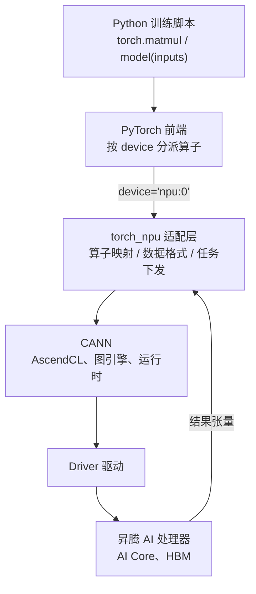

# 第 4 章 PyTorch 与 torch_npu

## 本章目标

1. 按官方版本配套表选定一组 TorchNPU / PyTorch / CANN / Python 版本，装好后用一段最小程序确认 `torch.npu.is_available()` 返回 `True`、`torch.npu.device_count()` 大于等于 1。
2. 写出一份跑在单张 NPU 上的完整训练脚本，说明脚本里 Tensor、loss、梯度、优化器、epoch、AMP 各自装的数据与形状。
3. 把一份 CUDA 风格的 PyTorch 代码按 API 对照表迁移到 NPU，说出算子支持度的查询途径与定位报错所用的环境变量。

## 先说结论

- torch_npu 是 PyTorch 的昇腾适配插件，Ascend 社区已把 Ascend Extension for PyTorch 与 torch_npu 统一更名为 TorchNPU。它的 pip 包名是 `torch-npu`，导入名是 `torch_npu`；`import torch_npu` 把 NPU 设备后端注册进 PyTorch，`torch.npu.*` 命名空间由此可用。
- TorchNPU、PyTorch、CANN、Python 之间存在一一配套关系。官方 26.1.0 版本说明里的一组组合是 PyTorch 2.12.0、TorchNPU 2.12.0、CANN 9.1.0、Python 3.10.x 至 3.13.x；安装前按配套表选定整组版本。
- 张量与模型搬到设备用 `.to('npu:0')` 或 `.npu()`；`torch.npu.synchronize()` 等待该设备上已下发的全部任务结束，计时前后都要调用。
- 混合精度用 `from torch_npu.npu import amp` 提供的 `amp.autocast()` 与 `amp.GradScaler()`；`ASCEND_LAUNCH_BLOCKING=1` 让算子同步执行，报错栈落在真正的调用点。
- 迁移主干是把 `torch.cuda.*` 换成 `torch.npu.*`，把 `backend='nccl'` 换成 `backend='hccl'`，把 `DataParallel` 换成 `DistributedDataParallel`。

## 张量、训练循环与设备迁移

### torch_npu 在调用链上的位置

NPU 指 Neural Processing Unit，神经网络处理单元，即专门执行矩阵与向量计算的昇腾 AI 处理器。CANN 指 Compute Architecture for Neural Networks，是位于驱动与上层框架之间的异构计算软件栈，对外提供 AscendCL（ACL，Ascend Computing Language）这套 C/C++ 接口。

Python 脚本调用 `torch.matmul` 时，PyTorch 前端按张量的 `device` 属性分派算子。`device` 为 `npu:0` 的张量被分派到 torch_npu 注册的后端实现，后者把这次算子调用翻译成 CANN 接口，经 GE（Graph Engine，图引擎，负责计算图融合与调度）与 Runtime（运行时，负责把任务排到设备上执行）排入 Device 的执行流，最终在昇腾 AI 处理器的 AI Core（芯片内的计算核心）上执行。torch_npu 处在「框架前端」与「CANN」之间的适配层：某个 PyTorch 算子对应哪个昇腾算子、张量以何种数据格式存放、任务下发到哪条流，都由它决定。它的输入是 PyTorch 前端的算子调用与 NPU 张量，输出是提交给 CANN 的任务和写回 HBM（High Bandwidth Memory，高带宽内存，即板载显存）的结果张量。PyTorch 前端的模型定义与自动求导逻辑保持原样。



### 版本配套与安装口径

官方 26.1.0 版本说明（2026 年 7 月发布）给出的配套表如下，表中每行都是官方声明的一组组合：

| TorchNPU 代码分支 | PyTorch 版本 | TorchNPU 版本 | 安装包版本 | CANN 版本 | Python 版本 |
|---|---|---|---|---|---|
| v2.7.1-26.1.0 | 2.7.1 | 26.1.0 | 2.7.1.post8 | 9.1.0 | 3.9.x–3.13.x |
| v2.9.0-26.1.0 | 2.9.0 | 26.1.0 | 2.9.0.post6 | 9.1.0 | 3.10.x–3.13.x |
| v2.10.0-26.1.0 | 2.10.0 | 26.1.0 | 2.10.0.post4 | 9.1.0 | 3.10.x–3.13.x |
| v2.11.0-26.1.0 | 2.11.0 | 26.1.0 | 2.11.0 | 9.1.0 | 3.10.x–3.13.x |
| v2.12.0-26.1.0 | 2.12.0 | 26.1.0 | 2.12.0 | 9.1.0 | 3.10.x–3.13.x |

数据来源是 Ascend/pytorch 仓库的 `docs/zh/release_notes.md`，查证于 2026-11-14。官方 26.0.0 版本说明另有一组 CANN 9.0.0 的组合（PyTorch 2.7.1 / 2.8.0 / 2.9.0 / 2.10.0）。固件、驱动与具体硬件型号的对应以 CANN 版本说明为准，换型号后这组配套要重新核对。

三个名字对应同一个插件的三个书写场合：`torch-npu` 是 PyPI 包名，`torch_npu` 是 import 名，wheel 文件名以 `torch_npu-` 开头。安装顺序是先装与硬件匹配的驱动、固件和 CANN，再 `source` CANN 的 `set_env.sh` 让 `LD_LIBRARY_PATH` 指向 CANN 库，然后装 PyTorch 的 CPU 版 wheel（`--index-url https://download.pytorch.org/whl/cpu`），最后装 `torch-npu`。PyTorch 官网 Start Locally 的 Compute Platform 已列出 Ascend NPU 选项，可作为选版本入口；离线环境则按昇腾社区《安装前准备》给出的 wget 命令下载对应 Python 版本与体系结构的两个 wheel 再 `pip3 install`。

### 后端读者要认识的八个对象

下表这些对象都活在 Host 侧的 Python 进程里，只有张量的数据体在需要时落到 Device 的 HBM 上。

| 对象 | 装的数据与形状 | 为什么需要 | 后端对照物 |
|---|---|---|---|
| Tensor | 带 `shape`、`dtype`、`device` 的多维数组，如 `[32, 128]` 的 fp32 输入、形状 `[]` 的标量 loss | 承载所有进入昇腾 AI 处理器的数据，`device` 决定算子分派到哪张卡 | 带 schema 的定长二维批处理缓冲区，额外多一个「所在设备」字段 |
| 模型与权重 | 模型是一张计算图；权重是图中各层的常驻参数矩阵，如线性层 `[out_features, in_features]` | 计算图定义算子顺序，权重提供可学习常量，前向计算即输入逐层与权重做矩阵乘 | 进程启动时装载的只读规则表，运行时由优化器改写 |
| batch size | 一个整数，决定输入张量第一维，如 `32` | 一次前向处理多少条样本，影响单步算力利用与显存占用 | 一次组批 RPC 里打包的记录数 |
| loss | 标量张量（形状 `[]`），由输出与标签经 `nn.CrossEntropyLoss` 等算出，且保留求导链路 | 给一次预测打一个可求导的错误评分，反向传播从它出发回推每个参数 | 一次请求的错误评分函数，附带一条可回溯的调用链 |
| 梯度 | 与每个权重同形状的一组张量，如线性层梯度 `[out_features, in_features]` | `loss.backward()` 沿调用链把误差反追到每个参数，指明各参数该往哪个方向调整 | 链路追踪里把一次总延迟归因到各跳、各 span 的责任分配 |
| 优化器 | 持有参数引用与逐参数状态，Adam 另存 `m`、`v` 两份同形状张量 | 按梯度与学习率执行参数更新，把「该改多少」变成实际的权重写入 | 带状态的调参守护进程，按归因结果增量更新配置 |
| epoch | 一个循环计数，代表训练集被完整扫过一遍 | 训练按轮重复，每轮遍历全部 batch | 全量批处理作业的一次 pass |
| AMP（Automatic Mixed Precision，自动混合精度） | 一组 dtype 策略，不装样本；`autocast` 上下文内把矩阵乘降到 fp16（Float 16）或 bf16（Brain Float 16），权重主副本仍为 fp32 | 降低矩阵乘的显存与耗时；`GradScaler` 放大 loss 以防 fp16 梯度下溢 | 按字段选精度的序列化，热字段低精度省带宽，关键字段保留高精度 |

`loss.backward()` 到 `optimizer.step()` 这一段，相当于把一次请求的错误评分沿调用链反追回去，给每个参与计算的参数标出责任份额，再由优化器把份额折算成对权重的一次写入。`torch.no_grad()` 或推理阶段会截断这条链，梯度不再产生，显存随之省下一份。

### 从 torch.cuda 迁移到 torch.npu

`import torch_npu` 之后，PyTorch 上会多出 `torch.npu` 命名空间，API 形状与 `torch.cuda` 对齐。下面这张表把后端概念与昇腾侧对应物列在一起：

| 后端概念 | 昇腾侧对应物 | 差异 |
|---|---|---|
| 进程启动时探测依赖是否就绪 | `torch.npu.is_available()`、`torch.npu.device_count()` | 探测的是驱动与 CANN 是否可用、可见几张卡 |
| 绑定监听网卡或 CPU 核 | `torch.npu.set_device(0)`、`ASCEND_RT_VISIBLE_DEVICES` | 绑定的是一张 NPU 及其 HBM，卡号由运行时可见设备列表决定 |
| 线程池提交异步任务后 `join()` | `torch.npu.synchronize()` | 等待的是设备执行流上的全部算子，Host 侧计时以此对齐 |
| 内存配额与峰值查询 | `torch.npu.memory_allocated()`、`torch.npu.max_memory_allocated()` | 统计对象是 HBM 上的张量分配 |
| 环境变量隔离可见资源 | `ASCEND_RT_VISIBLE_DEVICES` | 对应 `CUDA_VISIBLE_DEVICES` |
| 多进程组播后端 | `backend='hccl'`（HCCL，Huawei Collective Communication Library，集合通信库） | 集合通信走昇腾 HCCL，接口与 nccl 对齐 |

常用 API 的逐条替换：

| CUDA 写法 | NPU 写法 | 说明 |
|---|---|---|
| `torch.cuda.is_available()` | `torch.npu.is_available()` | 设备可用性 |
| `torch.cuda.device_count()` | `torch.npu.device_count()` | 卡数 |
| `torch.cuda.set_device(0)` | `torch.npu.set_device(0)` | 设置当前设备 |
| `torch.device('cuda:0')` | `torch.device('npu:0')` | 设备对象 |
| `.cuda()` / `.to('cuda:0')` | `.npu()` / `.to('npu:0')` | 张量与模型搬迁 |
| `torch.cuda.synchronize()` | `torch.npu.synchronize()` | 设备同步 |
| `torch.cuda.manual_seed_all(0)` | `torch.npu.manual_seed_all(0)` | 设备侧随机种子 |
| `torch.cuda.amp.autocast()` | `torch.npu.amp.autocast()` | 与 `from torch_npu.npu import amp` 的 `amp.autocast()` 等价 |
| `torch.cuda.amp.GradScaler()` | `torch.npu.amp.GradScaler()` | 同上，对应 `amp.GradScaler()` |
| `nn.DataParallel` | `nn.parallel.DistributedDataParallel` | 昇腾侧用分布式数据并行 |
| `backend='nccl'` | `backend='hccl'` | 分布式后端 |
| `pin_memory=True` | `pin_memory=False` | 昇腾侧不使用 pinned memory 机制 |

算子支持度按三条途径核对：一是昇腾社区文档中心按 CANN 版本发布的《算子清单 / 算子支持列表》，列出算子名、框架适配、数据类型与计算核心，配合《版本变更说明》看新增与限制；二是《PyTorch 适配指南》与 op-plugin 在线文档，看 PyTorch 原生算子到 NPU 算子的映射以及 dtype、shape 约束，torch_npu 的 wheel 也内置算子 docstring；三是写一段最小复现脚本，把待确认算子在 NPU 上跑一次前向与反向，以实际运行结果为准。`from torch_npu.contrib import transfer_to_npu` 能自动改写部分 CUDA 调用，改写结果仍需按上述途径核对。

定位报错所用的环境变量如下，取值与拼写依据昇腾社区 CANN 环境变量参考页：

| 变量 | 取值 | 作用 |
|---|---|---|
| `ASCEND_LAUNCH_BLOCKING` | `1` | 算子同步执行，报错栈落在真实调用点；默认 `0`，置 `1` 后性能下降 |
| `ASCEND_RT_VISIBLE_DEVICES` | 如 `0,1` | 限定进程可见的 NPU 卡号 |
| `PYTORCH_NPU_ALLOC_CONF` | `expandable_segments:True` | 显存分配器按可扩展段管理，缓解碎片 |
| `ASCEND_SLOG_PRINT_TO_STDOUT` | `1` | CANN 日志打到标准输出 |
| `TASK_QUEUE_ENABLE`、`COMBINED_ENABLE` | `0` / `1` / `2` | 算子下发队列与融合开关，调测时置 `0` 以缩小排查面 |

## 动手实操

### 安装命令

以 PyTorch 2.12.0 / TorchNPU 2.12.0 / CANN 9.1.0 / Python 3.11 这一组为例，环境为 Linux + bash：

```bash
# 前提：已安装与硬件匹配的驱动、固件与 CANN 9.1.0
source /usr/local/Ascend/cann/set_env.sh
pip3 install pyyaml setuptools
pip3 install torch==2.12.0 --index-url https://download.pytorch.org/whl/cpu
pip3 install torch-npu==2.12.0
python3 -c "import torch; import torch_npu; a = torch.randn(3, 4).npu(); print(a + a)"
```

最后一条的预期输出中，关键行是 `device='npu:0'`：

```
tensor([[-0.6066, 6.3385, 0.0379, 3.3356],
        [ 2.9243, 3.3134, -1.5465, 0.1916],
        [-2.1807, 0.2008, -1.1431, 2.1523]], device='npu:0')
```

数值随机，判定依据是末尾的 `device='npu:0'`。

### 最小可运行例子

文件路径 `npu_hello.py`：

```python
import time
import torch
import torch_npu

print("torch:", torch.__version__)
print("is_available:", torch.npu.is_available())
print("device_count:", torch.npu.device_count())

device = torch.device("npu:0")
a = torch.randn(2, 3, device=device)   # 直接在设备上创建
b = torch.ones(2, 3).to(device)         # 从 CPU 搬到设备
c = a + b
d = a @ b.t()
print("c.device:", c.device)
print("d.device:", d.device)

# 取回 CPU，与纯 CPU 结果对比
c_cpu, d_cpu = c.cpu(), d.cpu()
a_cpu, b_cpu = a.cpu(), b.cpu()
print("add 一致:", torch.allclose(c_cpu, a_cpu + b_cpu))
print("mm  一致:", torch.allclose(d_cpu, a_cpu @ b_cpu.t(), atol=1e-5))

# 计时前后各同步一次
torch.npu.synchronize()
t0 = time.perf_counter()
for _ in range(100):
    y = a @ b.t()
torch.npu.synchronize()
t1 = time.perf_counter()
print(f"100 次矩阵乘耗时: {(t1 - t0) * 1000:.2f} ms")
```

运行命令与示意输出（数值非实测，仅说明格式与判定依据）：

```bash
source /usr/local/Ascend/cann/set_env.sh
python3 npu_hello.py
```

```
torch: 2.12.0+cpu
is_available: True
device_count: 1
c.device: npu:0
d.device: npu:0
add 一致: True
mm  一致: True
100 次矩阵乘耗时: 12.37 ms
```

`torch.npu.is_available()` 检查驱动与 CANN 是否就绪、设备能否下发任务；`torch.npu.synchronize()` 阻塞 Host，直到该设备已下发的任务全部完成。算子默认异步下发，计时时若缺少第二个 `synchronize()`，读到的只是任务下发耗时，矩阵乘的执行时间被漏掉。

### 完整单卡训练脚本

数据为合成随机数，不访问外网。文件路径 `train_npu.py`：

```python
import time
import torch
import torch_npu
import torch.nn as nn
from torch_npu.npu import amp

torch.manual_seed(0)
torch.npu.manual_seed_all(0)
device = torch.device("npu:0")

# 合成数据：2048 条样本、每条 128 维特征、4 分类
N, IN_F, OUT_F, BATCH = 2048, 128, 4, 64
X = torch.randn(N, IN_F)
w_true = torch.randn(IN_F, OUT_F)
Y = (X @ w_true).argmax(dim=1)

model = nn.Sequential(
    nn.Linear(IN_F, 256),
    nn.ReLU(),
    nn.Linear(256, OUT_F),
).to(device)
criterion = nn.CrossEntropyLoss()
optimizer = torch.optim.Adam(model.parameters(), lr=1e-3)
scaler = amp.GradScaler()

steps_per_epoch = N // BATCH
epochs = 5
torch.npu.synchronize()
t_start = time.perf_counter()

for epoch in range(epochs):
    perm = torch.randperm(N)
    running_loss = torch.zeros((), device=device)
    for step in range(steps_per_epoch):
        idx = perm[step * BATCH:(step + 1) * BATCH]
        inputs = X[idx].to(device, non_blocking=True)
        labels = Y[idx].to(device, non_blocking=True)

        optimizer.zero_grad()
        with amp.autocast():
            outputs = model(inputs)
            loss = criterion(outputs, labels)
        scaler.scale(loss).backward()
        scaler.step(optimizer)
        scaler.update()
        running_loss += loss.detach()   # 累加张量，不在循环内触发隐式拷贝

    torch.npu.synchronize()
    print(f"epoch {epoch + 1}/{epochs}  loss={running_loss.item() / steps_per_epoch:.4f}")

torch.npu.synchronize()
t_end = time.perf_counter()
print(f"总耗时: {t_end - t_start:.2f} s")
print("峰值显存(MiB):", torch.npu.max_memory_allocated() // (1024 * 1024))
```

运行命令与示意输出（数值非实测，仅说明格式与判定依据）：

```bash
source /usr/local/Ascend/cann/set_env.sh
python3 train_npu.py
```

```
epoch 1/5  loss=1.2134
epoch 2/5  loss=0.7402
epoch 3/5  loss=0.4198
epoch 4/5  loss=0.2156
epoch 5/5  loss=0.1037
总耗时: 3.82 s
峰值显存(MiB): 312
```

判定依据是 5 行 epoch 输出齐全、loss 逐轮下降、末尾打印出耗时与显存峰值；具体数值随设备与随机状态波动。脚本用 `loss.detach()` 累加、在 epoch 末同步后取一次 `.item()`，把隐式拷贝收敛到一个明确的同步点；`scaler.scale(loss).backward()` → `scaler.step(optimizer)` → `scaler.update()` 的顺序与官方混合精度示例一致。支持 bf16 的型号可改用 `amp.autocast(dtype=torch.bfloat16)`，bf16 动态范围大，通常不需要 `GradScaler`；是否支持可用所用 TorchNPU 版本提供的 `is_bf16_supported()` 判断。

## 常见坑

| 现象 | 原因 | 处理 |
|---|---|---|
| 报 `Expected all tensors to be on the same device`，或算子悄悄在 CPU 上跑 | 模型 `.to(device)` 了，某个输入、标签或循环里新建的 `torch.zeros(...)` 漏搬，默认落在 CPU | 所有输入、标签、新建张量显式带 `device=device` 或 `.to(device)`；打印 `tensor.device` 核查 |
| 训练每步都很慢，profile 里出现大量小拷贝 | 循环里 `loss.item()`、`print(tensor)`、`.cpu().numpy()` 触发隐式 Device 到 Host 同步拷贝 | 用 `loss.detach()` 累加，epoch 末同步一次再取 `.item()`；打印放到循环外 |
| 报错指向某个 aten 算子，或精度异常 | 该 PyTorch 算子在当前 CANN / TorchNPU 版本没有 NPU 实现，回退 CPU 或降级精度 | 按算子支持清单核对，换成等价标准算子；必要时编写自定义 NPU 算子并注册进 torch_npu |
| 计时数值极小且不随 batch 变化 | 算子异步下发，未同步就停表，测到的是下发耗时 | 计时前后各调一次 `torch.npu.synchronize()` |
| loss 变 `nan` 或 `inf`，权重不再更新 | fp16 梯度下溢或溢出，缩放因子没跟上 | 保持 `scale / step / update` 顺序；改用 bf16 autocast；梯度裁剪前先 `scaler.unscale_(optimizer)` 再 `clip_grad_norm_` |
| 多进程训练时每张卡被重复占用、初始化报错 | 父进程已初始化 NPU 上下文后再 fork，或每个子进程重复执行全局初始化 | 用 `torchrun` 拉起、启动方法取 `spawn`；每个进程入口按 `local_rank` 调一次 `torch.npu.set_device(local_rank)`，DataLoader 的 worker 内不触碰 NPU |
| `DataLoader(..., pin_memory=True)` 报错或行为异常 | 昇腾侧 Host 到 Device 搬运不使用 pinned memory 机制 | 改为 `pin_memory=False` |

## 自测题

1. 环境：Atlas 800T A2 单卡，CANN 9.1.0，Python 3.11，PyTorch 2.12.0+cpu，torch-npu 2.12.0。写出确认插件可用的两条 `torch.npu.*` 调用及各自返回值的含义；若 `is_available()` 返回 `False`，列出两条先查的环境项。
2. 同一环境下，训练代码在循环内每步调用 `loss.item()` 打印，循环外只用一次 `time.perf_counter()` 起止计时。指出这段代码的两处计时问题，并写出修正后同步点的位置。
3. 承接上题，把 `with torch.cuda.amp.autocast():` 与 `torch.cuda.amp.GradScaler()` 迁到 NPU，写出对应的两行 NPU 写法，以及 `scale / backward / step / update` 的调用顺序。
4. 承接上题，原代码用 `nn.DataParallel` 且 `dist.init_process_group(backend='nccl')`。写出迁移后的对应物与后端字符串。
5. 承接上题，把 `pin_memory=True` 的 DataLoader 迁到该单卡环境，写出改动并说明原因。

## 自测题答案

1. `torch.npu.is_available()` 返回 `bool`，表示驱动与 CANN 是否就绪、设备能否下发任务；`torch.npu.device_count()` 返回 `int`，表示当前进程可见的 NPU 卡数，单卡应为 1。返回 `False` 时先查：CANN 的 `set_env.sh` 是否已 `source`（看 `LD_LIBRARY_PATH` 是否含 CANN 的 lib 路径）；驱动与固件是否装好、`npu-smi info` 能否列出设备，以及 `ASCEND_RT_VISIBLE_DEVICES` 是否把设备全部屏蔽。
2. 两处问题：循环内 `.item()` 每步触发一次隐式 Device 到 Host 同步拷贝，把设备执行时间混进计时且拖慢循环；计时段起止没有 `torch.npu.synchronize()`，测到的是下发耗时。修正：计时段开始前调一次 `torch.npu.synchronize()` 并记 `t0`，循环内改用 `loss.detach()` 累加、把 `.item()` 与打印移到循环外，计时段结束再调一次 `torch.npu.synchronize()` 后记 `t1`。
3. `with torch.npu.amp.autocast():`（或官方示例的 `from torch_npu.npu import amp` 后写 `with amp.autocast():`），`scaler = torch.npu.amp.GradScaler()`（或 `amp.GradScaler()`）。顺序：`optimizer.zero_grad()` → autocast 内算 `outputs` 与 `loss` → `scaler.scale(loss).backward()` → `scaler.step(optimizer)` → `scaler.update()`。
4. `nn.DataParallel` 换成 `nn.parallel.DistributedDataParallel`，每个进程按 `local_rank` 调 `torch.npu.set_device(local_rank)`；后端字符串由 `'nccl'` 换成 `'hccl'`。
5. 改成 `pin_memory=False`。昇腾侧 Host 到 Device 的搬运不使用 pinned memory 机制，置 `True` 会报错或行为异常。

## 参考来源

- [Release Notes（Ascend Extension for PyTorch 26.0.0 版本配套表）](https://www.hiascend.com/document/detail/en/Pytorch/2600/releasenote/docs/en/release_notes/release_notes.md) — 查证于 2026-11-14，支撑 CANN 9.0.0 与 PyTorch 2.7.1/2.8.0/2.9.0/2.10.0 的配套关系与 Python 版本范围。
- [Ascend/pytorch 版本说明 docs/zh/release_notes.md](https://github.com/Ascend/pytorch/blob/master/docs/zh/release_notes.md) — 查证于 2026-11-14，支撑 26.1.0 配套表（PyTorch 2.7.1/2.9.0/2.10.0/2.11.0/2.12.0、CANN 9.1.0、Python 3.10–3.13）与统一更名 TorchNPU 的说明。
- [昇腾社区《安装前准备》（Pytorch 2610）](https://www.hiascend.com/document/detail/zh/Pytorch/2610/installguide/swinstall/docs/zh/installation_guide/preparing_installation.md) — 查证于 2026-11-14，支撑 `source /usr/local/Ascend/cann/set_env.sh`、aarch64 + Python 3.13 的两个 wheel 安装命令与 `pip list | grep torch` 验证写法。
- [Ascend/pytorch 仓库 README（Installation / Quick Start）](https://github.com/Ascend/pytorch) — 查证于 2026-11-14，支撑 `pip install torch==2.12.0 --index-url https://download.pytorch.org/whl/cpu`、`pip install torch-npu==2.12.0`、依赖 pyyaml/setuptools 与最小验证示例。
- [昇腾社区《安装 torch_npu 插件》（Pytorch 600）](https://www.hiascend.com/document/detail/zh/Pytorch/600/configandinstg/instg/insg_0015.html) — 查证于 2026-11-14，支撑 `python3 -c "import torch;import torch_npu; a = torch.randn(3, 4).npu(); print(a + a)"` 的验证命令与含 `device='npu:0'` 的预期输出。
- [Adaptation Example (Typical Scenario)（混合精度训练示例）](https://www.hiascend.com/document/detail/en/Pytorch/2600/ptmoddevg/trainingmigrguide/FrameworkPTAdapter/26.0.0/en/pytorch_model_migration_fine_tuning/example_typical_scenario.md) — 查证于 2026-11-14，支撑 `from torch_npu.npu import amp`、`amp.GradScaler()`、`amp.autocast()` 与 `scale/backward/step/update` 顺序。
- [昇腾社区 CANN 环境变量参考（COMBINED_ENABLE / ASCEND_LAUNCH_BLOCKING）](https://www.hiascend.com/document/detail/zh/canncommercial/80RC22/apiref/envvar/envref_07_0049.html) — 查证于 2026-11-14，支撑 `ASCEND_LAUNCH_BLOCKING=1` 的拼写、同步执行的语义与性能影响。
- [TorchNPU 7.2.0 环境变量文档（Envir_009）](https://www.hiascend.com/document/detail/zh/Pytorch/720/comref/Envvariables/Envir_009.html) — 查证于 2026-11-14，支撑 `TASK_QUEUE_ENABLE`、`COMBINED_ENABLE` 与 `ASCEND_LAUNCH_BLOCKING` 的取值约束。
