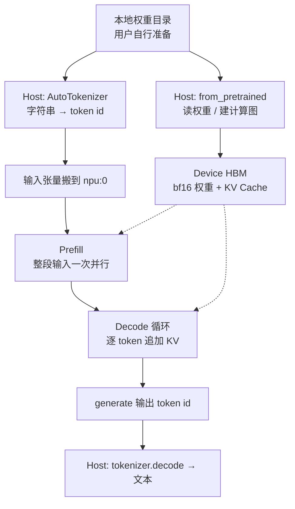

# 第 5 章 模型迁移与推理服务

## 本章目标

1. 用 transformers 在单张 NPU 上加载一份用户自备的开源中文模型权重，跑通一次文本生成，确认 `model.device` 为 `npu:0`。
2. 说清 token、分词器、KV Cache、Prefill、Decode 各自装什么数据，用权重与 KV Cache 的估算式算出给定模型在给定并发下的显存需求。
3. 用 vLLM-Ascend 拉起一个 OpenAI 兼容的 HTTP 推理服务，用 curl 调通，并用压测脚本给出 TTFT 与 TPOT 的分位数结果。

## 先说结论

- transformers 在 NPU 上加载模型的写法是 `AutoModelForCausalLM.from_pretrained(model_path, torch_dtype=torch.bfloat16, device_map="auto").to("npu:0")`，输入张量同样 `.to("npu:0")`，生成调用 `model.generate(**inputs, max_new_tokens=64)`；权重需用户自行下载到本地。
- token 是文本经分词器切出的基本单位；KV Cache 缓存历史 token 的 Key 与 Value；Prefill 处理整段输入并产出首个 token，Decode 逐个产出后续 token。
- 显存估算分两块：权重显存为 $\text{参数量} \times \text{每参数字节数}$，KV Cache 为 $2 \times L \times H_{kv} \times D \times S \times B \times b_{kv}$。上下文长度、并发序列数、KV Cache 精度是杠杆，层数与 KV 头数由模型结构决定。
- vLLM-Ascend 用 `vllm serve` 暴露 `/v1/chat/completions` 等 OpenAI 兼容端点；TTFT（Time To First Token，首 Token 延迟）与 TPOT（Time Per Output Token，每输出 Token 时延）分别量 Prefill 与 Decode 阶段的延迟。
- Decode 阶段每步读入全部权重与 KV Cache 却只算一个 token，算术强度低，耗时由 HBM 带宽约束；Prefill 阶段矩阵乘规模大，耗时由算力约束。

## 生成式推理的调用链与服务化

### 从一次文本生成看调用链

NPU 指 Neural Processing Unit，神经网络处理单元，即专门执行矩阵与向量计算的昇腾 AI 处理器；HBM 指 High Bandwidth Memory，高带宽内存，即板载显存。torch_npu 是 PyTorch 的昇腾适配插件，pip 包名 `torch-npu`，导入后 `torch.npu.*` 可用，`torch.npu.synchronize()` 等待设备任务结束。

transformers 在 Host 侧的 Python 进程里读权重、建计算图、分词、驱动生成循环。权重张量与 KV Cache（Key-Value Cache，缓存历史注意力中间结果）常驻 Device 的 HBM；分词在 CPU 上产出 `input_ids` 整数张量后搬到设备；每个 token 的算子经 torch_npu 下发到 CANN（Compute Architecture for Neural Networks，异构计算软件栈）。一次生成的输入是本地权重目录加一段字符串，输出是 token id 序列，由分词器解码成字符串。常驻张量与生成 loop 步数由框架决定，算子落到哪张卡由 `device` 决定。



### token、分词器与一次生成的两个阶段

token 是模型处理文本的基本单位，即分词后的词片段；中文里一个字、一个词或一个标点都可能切成多个 token，字符数不能直接换算。分词器（Tokenizer）是字符串与 token id 序列之间的映射表加切分算法，输出形状 `[1, S]` 的 `input_ids` 整数张量与 `attention_mask`，编解码须用同一份词表。KV Cache 装每层、每个历史 token 的 Key 与 Value 向量，随层数、KV 头数、序列长度增长。Prefill 阶段把整段输入一次并行处理完，算出全部输入 token 的 KV 并产出首个输出 token；Decode 阶段每步只处理一个新 token，把它的 KV 追加进缓存，再产出下一个 token。

| 后端概念 | 昇腾推理侧对应物 | 差异 |
|---|---|---|
| 序列化后的消息帧 / 切分后的日志记录 | token | 长度由分词器决定，一个汉字可能对应多个 id，字符数不能直接换算 |
| 编解码器 codec（字符串 ↔ 结构化数据） | 分词器 AutoTokenizer | 输出还带 `attention_mask`，编解码必须用同一份词表 |
| 首次全量建索引（一次性批量计算） | Prefill | 一次并行处理整段输入，产出首个 token 与全量 KV Cache |
| 之后增量追加 / 流式返回（SSE，Server-Sent Events，服务端逐块推送的流式响应） | Decode | 每步只算一个 token，把 KV 追加到缓存，逐块返回 |
| 会话级缓存 / 物化视图 | KV Cache | 按层、按头、按 token 增长，随并发与上下文长度线性膨胀 |

Decode 阶段更依赖显存带宽，可由算术强度看出。记权重参数量为 $P$、每参数字节数为 $b$，Decode 每步需从 HBM 读入约 $P \times b$ 字节的权重与整个 KV Cache，计算量约 $2P$ 次浮点运算，算术强度 $\frac{2P}{P \cdot b} = \frac{2}{b}$ FLOP/byte，bf16（Brain Float 16，一种 16 位浮点格式，$b=2$）时约为 1，远低于设备算力与带宽之比，耗时由读显存决定。Prefill 一次处理 $S$ 个输入 token，同一份权重被复用 $S$ 次，算术强度随 $S$ 增大，耗时由算力决定。用后端对照：Decode 每次只处理一条增量记录却要反复扫描整个常驻数据集，瓶颈在内存带宽；Prefill 是一次批量大计算，瓶颈在计算单元。算术强度为按理想读取量做的估算。

### 显存估算

下面两式均为估算。假设：权重与 KV Cache 全常驻单卡 HBM，不做卸载与张量并行分摊；统计原始张量字节数，不含分配器碎片、激活缓冲、算子 workspace、运行时开销与 PagedAttention 页表开销；权重与 KV Cache 均按 bf16 存，每元素 2 字节；$S$ 取输入与输出 token 数之和；$B$ 为同时活跃的独立请求数；GB 按 $10^9$ 字节、GiB 按 $2^{30}$ 字节列出。

$$M_w = P \times b$$

$$M_{kv} = 2 \times L \times H_{kv} \times D \times S \times B \times b_{kv}$$

$$M_{total} \approx M_w + M_{kv} + M_{act} + M_{runtime}$$

$P$ 为参数量；$b$ 为每参数字节数，bf16 / fp16 = 2、fp32 = 4、int8 = 1、int4 = 0.5；系数 2 表示 Key 与 Value 各一份；$L$ 为层数；$H_{kv}$ 为 KV 头数，GQA（Grouped-Query Attention，分组查询注意力）下小于注意力头数；$D$ 为每头维度；$S$ 为序列长度；$B$ 为并发序列数；$b_{kv}$ 为 KV 每元素字节数；$M_{act}$、$M_{runtime}$ 为激活缓冲与运行时开销，另计。

权重算例：7B 参数、bf16 权重，$M_w = 7 \times 10^{9} \times 2 = 1.4 \times 10^{10}$ 字节 = 14 GB ≈ 13.0 GiB。

KV Cache 算例：结构参数取公开资料中的 Qwen3-8B 配置（$L=36$、$H_{kv}=8$、$D=128$、$b_{kv}=2$、$B=1$、$S=8192$），按估算口径计算。每 token 每序列为 $2 \times 36 \times 8 \times 128 \times 2 = 147{,}456$ 字节 = 144 KiB；$S=8192$ 时为 $147{,}456 \times 8192 = 1{,}207{,}959{,}552$ 字节 ≈ 1.21 GB ≈ 1.125 GiB；$S$ 增到 32768 时约 4.5 GiB；$B=4$ 且各序列 8192 token 时同样约 4.5 GiB。

杠杆变量是 $S$（上下文长度，由 `--max-model-len` 与业务请求长度决定）、$B$（并发序列数，由 `--max-num-seqs` 决定）、$b$ 与 $b_{kv}$（权重量化与 KV Cache 量化，例如 int8 使相应项减半），以及张量并行卡数（把 $M_w$ 与 $M_{kv}$ 分摊到多卡）。非杠杆是 $L$、$H_{kv}$、$D$、$P$：选定模型后这些值固定，换模型才变；GQA 带来的 $H_{kv}$ 缩小是模型结构已有的收益，在既定模型上无法再调。PagedAttention 减少的是碎片浪费，不改变上面按 token 累加的原始需求量级。

### 推理服务化：vLLM-Ascend

昇腾侧的推理引擎包含 MindIE（Mind Inference Engine，华为面向昇腾的推理引擎）与 vLLM-Ascend。下面的命令基于 vLLM-Ascend，它是 vLLM 的昇腾插件，负责加载权重、调度请求并以 OpenAI 兼容协议提供 HTTP 接口。连续批处理按 token 步动态增删请求，PagedAttention 把 KV Cache 按页管理以减少显存浪费。

| 后端概念 | 昇腾推理侧对应物 | 差异 |
|---|---|---|
| 进程启动时装载只读配置 | 模型加载：`vllm serve` 启动时把权重读入 HBM | 权重是数十 GB 的只读大数组，装载一次常驻，显存占用固定 |
| 组批（batching） | 连续批处理 continuous batching + PagedAttention | 按 token 步动态增删请求，无需等齐一个 batch，缓存按页分配 |
| 接口延迟分位数（SLA，Service Level Objective，服务等级目标） | TTFT / TPOT 的 P50、P90、P99 分位数 | 指标按 Prefill / Decode 阶段拆分，且含排队时间 |
| 线程池 / 连接数限流 | `--max-num-seqs`、`--max-model-len` | 限的是同时活跃序列数与单序列长度，直接约束 KV Cache 容量 |
| 水平扩容多实例 | `--tensor-parallel-size`（TP，Tensor Parallelism，张量并行，切分一层内的矩阵） | 扩的是单模型切分到的卡数，权重与 KV 分摊到多卡 |

压测指标全称与含义：TTFT 为 Time To First Token，首 Token 延迟，从请求发出到收到第一个输出 token，含网络往返、排队等待与 Prefill 计算；TPOT 为 Time Per Output Token，每输出 Token 时延，Decode 阶段相邻输出 token 的平均间隔，$\text{TPOT} = \frac{\text{E2E} - \text{TTFT}}{N_{out} - 1}$，$N_{out}$ 为输出 token 数；ITL 为 Inter-Token Latency，相邻 token 间隔，口径与 TPOT 接近；E2E 为 End-to-End，端到端延迟，$\text{E2E} = \text{TTFT} + \text{TPOT} \times (N_{out} - 1)$。吞吐看 Output Token Throughput（每秒输出 token 数）与 QPS（Queries Per Second，每秒请求数）。P50 反映典型体验，P99 反映长尾抖动，服务 SLA 通常按 P99 约束。

## 动手实操

### 依赖清单与运行前提

文件路径 `requirements.txt`：

```
torch==2.12.0
torch-npu==2.12.0
transformers
accelerate
```

`torch` 与 `torch-npu` 按官方版本配套表选定整组版本，本例沿用 PyTorch 2.12.0 / TorchNPU 2.12.0 / CANN 9.1.0 / Python 3.10.x–3.13.x，配套表链接见本章参考来源。`transformers` 版本需覆盖所用模型的模型类；`device_map="auto"` 依赖 `accelerate`。

运行前提：权重需用户自行准备。从 Hugging Face Hub 或魔搭 ModelScope 把开源中文模型（例如 `Qwen/Qwen2.5-1.5B-Instruct`）的完整权重目录下载到本地，`model_path` 指向该目录；目录应含 `config.json`、权重分片与词表文件。运行环境不假定可访问外网。该卡至少要装下 bf16 权重，1.5B 模型约 3 GB，属估算。

### transformers 文本生成最小代码

文件路径 `infer_npu.py`：

```python
import time
import torch
import torch_npu
from transformers import AutoModelForCausalLM, AutoTokenizer

# 改成用户自行下载到本地的权重目录
model_path = "./models/Qwen2.5-1.5B-Instruct"
device = "npu:0" if torch.npu.is_available() else "cpu"

tokenizer = AutoTokenizer.from_pretrained(model_path)
model = AutoModelForCausalLM.from_pretrained(
    model_path,
    torch_dtype=torch.bfloat16,
    device_map="auto",
).to(device)
model.eval()
print("dtype:", model.dtype)
print("device:", model.device)

messages = [{"role": "user", "content": "用一句话介绍你自己。"}]
text = tokenizer.apply_chat_template(
    messages, tokenize=False, add_generation_prompt=True
)
inputs = tokenizer(text, return_tensors="pt").to(device)

torch.npu.synchronize()
t0 = time.perf_counter()
with torch.no_grad():
    outputs = model.generate(
        **inputs,
        max_new_tokens=64,
        do_sample=False,
    )
torch.npu.synchronize()
t1 = time.perf_counter()
print(f"生成耗时: {(t1 - t0) * 1000:.0f} ms")
print(tokenizer.decode(outputs[0], skip_special_tokens=True))
```

运行命令与示意输出（数值非实测，仅说明格式与判定依据）：

```bash
source /usr/local/Ascend/cann/set_env.sh
python3 infer_npu.py
```

```
dtype: torch.bfloat16
device: npu:0
生成耗时: 1842 ms
```

生成文本随权重与解码设置变化。单卡用 `.to("npu:0")` 最明确，`device_map="auto"` 适合多卡切分，两者并用时以 `.to(device)` 收口；输入张量须 `.to(device)`。`torch_dtype=torch.bfloat16` 让权重以 bf16 常驻，部分版本写作 `dtype`。`max_new_tokens` 限制输出长度，`do_sample=False` 便于复现。`model.generate` 前后各一次 `torch.npu.synchronize()`，计时才含 Decode 循环。

### vLLM-Ascend 服务化、curl 调用与压测

官方 Quickstart 支持的型号为 Atlas A2 训练系列与 Atlas 800I A2 推理系列，示例镜像 tag 为 `quay.io/ascend/vllm-ascend:v0.7.3.post1`。镜像 tag 迭代较快，以 vLLM-Ascend 官方 Quickstart 与镜像仓库的 tag 列表为准。下列容器命令显式带 `sudo`：

```bash
export DEVICE=/dev/davinci0
export IMAGE=quay.io/ascend/vllm-ascend:v0.7.3.post1
sudo docker run --rm \
  --name vllm-ascend \
  --device $DEVICE \
  --device /dev/davinci_manager \
  --device /dev/devmm_svm \
  --device /dev/hisi_hdc \
  -v /usr/local/dcmi:/usr/local/dcmi \
  -v /usr/local/bin/npu-smi:/usr/local/bin/npu-smi \
  -v /usr/local/Ascend/driver/lib64/:/usr/local/Ascend/driver/lib64/ \
  -v /usr/local/Ascend/driver/version.info:/usr/local/Ascend/driver/version.info \
  -v /etc/ascend_install.info:/etc/ascend_install.info \
  -v /root/.cache:/root/.cache \
  -p 8000:8000 \
  -it $IMAGE bash
```

在容器内启动服务。权重路径指向用户自行准备的本地目录；若环境可访问模型仓库，也可直接写仓库 id 并设 `VLLM_USE_MODELSCOPE=true` 走魔搭镜像：

```bash
export VLLM_USE_MODELSCOPE=true
vllm serve /path/to/Qwen2.5-0.5B-Instruct \
  --served-model-name qwen \
  --port 8000 \
  --max-model-len 4096 \
  --tensor-parallel-size 1 &
```

预期日志的关键行是 `Uvicorn running on http://0.0.0.0:8000`。服务启动后会暴露 `/v1/models`、`/v1/chat/completions`、`/v1/completions` 等 OpenAI 兼容端点。

curl 调用：

```bash
curl http://localhost:8000/v1/models

curl http://localhost:8000/v1/chat/completions \
  -H "Content-Type: application/json" \
  -d '{
    "model": "qwen",
    "messages": [{"role": "user", "content": "用一句话介绍昇腾 NPU"}],
    "max_tokens": 128,
    "temperature": 0.6,
    "stream": false
  }'
```

预期输出是 JSON，`choices[0].message.content` 含生成的中文文本，`usage` 给出 `prompt_tokens` 与 `completion_tokens`。用 OpenAI SDK 接入时，`base_url` 设为 `http://localhost:8000/v1`、`api_key` 设为 `EMPTY` 即可。

并发压测用 vLLM 自带的 `benchmark_serving`，新版也提供 `vllm bench serve` 等价入口：

```bash
python -m vllm.benchmarks.benchmark_serving \
  --backend openai-chat \
  --base-url http://127.0.0.1:8000 \
  --model qwen \
  --dataset-name random \
  --random-input-len 512 \
  --random-output-len 256 \
  --num-prompts 200 \
  --max-concurrency 8 \
  --request-rate inf \
  --percentile-metrics ttft,tpot,itl,e2el \
  --metric-percentiles 50,90,95,99 \
  --save-result \
  --result-dir ./bench_c8
```

`--max-concurrency` 依次取 1、2、4、8、16、32，每档换一个 `--result-dir`，得并发梯度曲线；`--request-rate inf` 表示尽快打满、测服务端极限，设固定 QPS 则观察排队延迟。输出含 Successful requests、Throughput (req/s)、TTFT 与 TPOT 的 p50/p95/p99，TTFT P99 与 TPOT P99 明显抬升处即 `--max-num-seqs` 上限。固定 `--random-input-len` 与 `--random-output-len` 以便横向对比。

## 常见坑

| 现象 | 原因 | 处理 |
|---|---|---|
| 加载或首请求报显存不足（OOM） | 权重 + KV Cache + 激活缓冲超过单卡 HBM，`--max-model-len` 与 `--max-num-seqs` 预留过大 | 调低这两个参数、调低 `--gpu-memory-utilization`，用权重量化或 KV Cache 量化，加大 `--tensor-parallel-size` 分摊 |
| 权重格式不支持或加载报字段缺失 | 权重格式、量化方式与引擎不匹配，或 `config.json`、权重分片、词表文件不齐 | 用引擎支持的权重格式与配套量化权重；核对目录里 `config.json`、全部分片与词表文件齐全 |
| 卡数不足导致初始化失败 | `--tensor-parallel-size` 大于可见卡数，或 `worldSize` 与实际卡数不符 | 按 `npu-smi info` 的实际卡数设置，`ASCEND_RT_VISIBLE_DEVICES` 与 TP 值对齐 |
| 上下文长度放大 KV Cache，显存被缓存吃满 | `--max-model-len` 从 4096 提到 32768，KV Cache 按 $S$ 线性增长 | 按业务真实长度设定；用本章估算式先算出增量，再决定并发上限 |
| 并发上来后吞吐涨了、延迟分位数变差 | `--max-num-seqs` 增大让更多请求进同一批，排队时间与每步调度量上升 | 用并发梯度压测找 SLA 拐点，按 TTFT / TPOT 的 P99 约束定上限 |
| `device_map="auto"` 报 `accelerate` 缺失或把层放到 CPU | 未装 `accelerate`，或自动切分把部分层留在 Host 内存 | 装上 `accelerate`；单卡场景直接用 `.to("npu:0")` 并打印 `model.device` 核查 |

## 自测题

1. 环境：Atlas 800I A2 单卡，CANN 9.1.0，PyTorch 2.12.0，torch-npu 2.12.0，transformers 与 accelerate 已装，本地权重目录 `./models/Qwen2.5-1.5B-Instruct`。写出把模型与输入都放到 `npu:0` 的两处关键代码，并说出 `device_map="auto"` 依赖的额外包。
2. 承接上题，模型 7B 参数、bf16 权重、36 层、8 个 KV 头、每头维度 128、KV Cache 用 bf16、单序列、输入与输出合计 8192 token。写出权重显存与 KV Cache 的估算算式与结果（GB 与 GiB 两种口径），并指出哪些变量是杠杆、哪些不是。
3. 承接上题，说明 Decode 阶段比 Prefill 阶段更依赖显存带宽的原因，写出算术强度的估算式。
4. 环境：vLLM-Ascend 服务已在 8000 端口、模型名 `qwen`。写出一条 curl 调用 `/v1/chat/completions` 的命令，并写出 TTFT 与 TPOT 的全称、含义与 TPOT 的计算式。
5. 承接上题，把 `--max-model-len` 从 4096 提到 32768、`--max-num-seqs` 从 8 提到 64。说出 KV Cache 与 SLA 指标各自的变化方向，并写出定位拐点的压测方法。

## 自测题答案

1. 模型侧 `AutoModelForCausalLM.from_pretrained(model_path, torch_dtype=torch.bfloat16, device_map="auto").to("npu:0")`；输入侧 `inputs = tokenizer(text, return_tensors="pt").to(device)`，其中 `device = "npu:0"`。`device_map="auto"` 依赖 `accelerate`。
2. 权重：$M_w = 7 \times 10^{9} \times 2 = 1.4 \times 10^{10}$ 字节 = 14 GB ≈ 13.0 GiB。KV Cache：每 token 每序列 $2 \times 36 \times 8 \times 128 \times 2 = 147{,}456$ 字节 = 144 KiB；$S=8192$、$B=1$ 时为 $147{,}456 \times 8192 = 1{,}207{,}959{,}552$ 字节 ≈ 1.21 GB ≈ 1.125 GiB。杠杆：$S$、$B$、每元素字节数 $b$ / $b_{kv}$、张量并行卡数。非杠杆：$L$、$H_{kv}$、$D$、$P$，选定模型后固定。以上均为估算，不含碎片、激活缓冲与运行时开销。
3. Decode 每步做一次矩阵向量乘，需从 HBM 读入约 $P \times b$ 字节权重与整个 KV Cache，计算量约 $2P$ 次浮点运算，算术强度 $\frac{2P}{P \cdot b} = \frac{2}{b}$ FLOP/byte，bf16 时约 1，远低于设备算力与带宽之比，耗时由读显存决定。Prefill 一次处理 $S$ 个输入 token，同一份权重被复用 $S$ 次做矩阵乘，算术强度随 $S$ 增大，耗时由算力决定。
4. `curl http://localhost:8000/v1/chat/completions -H "Content-Type: application/json" -d '{"model":"qwen","messages":[{"role":"user","content":"用一句话介绍昇腾 NPU"}],"max_tokens":128}'`。TTFT 为 Time To First Token，首 Token 延迟，从请求发出到收到第一个输出 token，含排队与 Prefill；TPOT 为 Time Per Output Token，每输出 Token 时延，Decode 阶段相邻输出 token 的平均间隔，$\text{TPOT} = \frac{\text{E2E} - \text{TTFT}}{N_{out} - 1}$。
5. `--max-model-len` 放大使 $S$ 变大、`--max-num-seqs` 放大使 $B$ 变大，KV Cache 按二者线性增长，显存吃紧；吞吐上升时排队变长，TTFT 与 TPOT 的 P99 抬升。定位拐点用 `benchmark_serving` 做并发梯度压测：`--max-concurrency` 取 1、2、4、8、16、32，固定输入输出长度，配 `--percentile-metrics ttft,tpot,itl,e2el --metric-percentiles 50,90,95,99`，每档单独 `--result-dir`，找 P99 明显抬升的档位定 `--max-num-seqs`。

## 参考来源

- [Ascend 文档 transformers 快速开始](https://ascend.github.io/docs/sources/transformers/quick_start.html) — 查证于 2026-11-14，支撑 `torch_dtype=torch.bfloat16`、`device_map="auto"`、`.to(device)` 的加载写法与 `dtype=torch.bfloat16`、`device=npu:0` 的预期输出。
- [Ascend/pytorch 版本说明 docs/zh/release_notes.md](https://github.com/Ascend/pytorch/blob/master/docs/zh/release_notes.md) — 查证于 2026-11-14，支撑本章沿用的 PyTorch 2.12.0 / TorchNPU 2.12.0 / CANN 9.1.0 / Python 3.10–3.13 版本配套表。
- [vLLM Ascend Quickstart（v0.7.3.post1）](https://vllm-ascend.readthedocs.io/en/v0.7.3.post1/quick_start.html) — 查证于 2026-11-14，支撑镜像 tag、docker 设备挂载清单、`-p 8000:8000`、`vllm serve`、`VLLM_USE_MODELSCOPE`、Uvicorn 日志与支持的 Atlas 型号。
- [Qwen3-30B-A3B-W8A8 API 接入参考（GitCode 博客）](https://blog.gitcode.com/a356b0efc0d13485aecad2a7f2e53b2f.html) — 查证于 2026-11-14，支撑 `vllm serve` 的 `--served-model-name`、`--port`、`--max-model-len`、`--tensor-parallel-size`、`/v1/models` 与 `/v1/chat/completions` 的 curl 示例、`api_key="EMPTY"`；属社区文章，参数以所用版本为准。
- [Benchmarking Terminology for Large Language Model Serving（IETF draft）](https://datatracker.ietf.org/doc/html/draft-gaikwad-llm-benchmarking-terminology) — 查证于 2026-11-14，支撑 TTFT、ITL、TPOT、E2E 的定义与 $\text{TPOT} = (\text{E2E} - \text{TTFT})/(N_{out}-1)$ 口径。
- [腾讯云《模型监控》](https://intl.cloud.tencent.com/zh/document/product/1300/78948) — 查证于 2026-11-14，支撑 TTFT = Time To First Token、TPOT = Time Per Output Token 的中文全称与监控指标口径。
- [火山方舟《模型接入指南（LLM）- 性能评测》](https://ark.volcengine.com/region:cn-beijing/docs/go-live-benchmark-guide) — 查证于 2026-11-14，支撑 TPOT 计算式、固定输入输出长度的对齐要求与 P50/P99 分位数口径。
- [KV Cache — the real inference memory bill（Hugging Face）](https://huggingface.co/spaces/shivamkole1969/ml-ai-engineer-academy/blob/main/content/tracks/07-llm-foundations/kv-cache.md) — 查证于 2026-11-14，支撑 KV Cache 估算式 $2 \times L \times H_{kv} \times D \times S \times B \times b_{kv}$ 及其「随上下文长度与并发线性增长」的估算性质。
- [How Much RAM and VRAM Do You Need（TechDecode，Qwen3-8B 算例）](https://www.techdecode.online/decode/local-ai-ram-vram) — 查证于 2026-11-14，支撑 36 层 / 8 KV 头 / 每头维度 128、每 token 144 KiB、8192 token 约 1.125 GiB、4 序列各 8192 约 4.5 GiB 的算例与「非实测 GPU 分配」的估算口径。
- [vLLM benchmark_serving 压测实践（CSDN）](https://blog.csdn.net/weixin_42576410/article/details/169242404) — 查证于 2026-11-14，支撑 `--percentile-metrics ttft,tpot,itl,e2el`、`--metric-percentiles`、`--max-concurrency` 并发梯度与 `--request-rate inf` 的用法。
