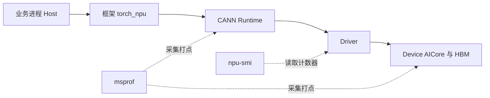

# 第 6 章 性能观测与调优

## 本章目标

- 能用 `npu-smi` 与 `msprof` 各自采集出一份性能数据，指出产出落在哪个目录，并从 `mindstudio_profiler_output/` 中找出算子耗时表与 Timeline。
- 能把 AICore 利用率、算子执行时长、显存占用、Host 到 Device 的数据搬运量、等待间隙这五个指标对应到后端 APM 中已有的概念，说出每个指标能证明什么、不能证明什么。
- 能用一个带同步点的对照实验复现搬运瓶颈，并按调优清单逐条给出改动位置与对应的可观测指标。

## 先说结论

- `npu-smi` 读驱动与设备计数器快照，回答「此刻昇腾 AI 处理器忙不忙」；`msprof`（MindStudio Profiling，性能采集工具）采集一次任务运行期间的算子事件与硬件计数器，回答「时间花在哪些算子上」。两者粒度不同，慢调用报告要同时用到。
- `msprof` 的产出落在 `--output` 指定目录下的 `PROF*_*XXX` 子目录，可读结果集中在其中的 `mindstudio_profiler_output/`：算子耗时看 `op_summary_*.csv` 与 `op_statistic_*.csv`，Timeline 看 `msprof_*.json`。
- 计时不加同步点，量到的是 Host 下发时间。算子在 Device 上按 Stream 异步执行，`time.perf_counter()` 直接收尾会漏掉排队与执行时间。
- AICore 利用率接近满载只说明矩阵计算单元处于执行状态，Host 到 Device 的数据搬运量与算子之间的等待间隙同样决定一次调用的端到端耗时。
- 动态 shape 会触发 GE（Graph Engine，图引擎，负责计算图融合、切分与调度下发）反复编译。编译缓存命中次数与算子下发次数比利用率更能解释这类耗时。

## 采集工具、指标与调优动作

### 6.1 两个工具在 Host 到 Device 调用链上的位置

昇腾 AI 处理器即 NPU（Neural Processing Unit，神经网络处理单元，专做矩阵与向量计算的处理器）；一张卡连同其显存与计算单元称 Device。一段计算从业务进程出发，经框架（`torch_npu`，Ascend Adapter for PyTorch，把张量与算子下发到昇腾设备的适配插件）、CANN（Compute Architecture for Neural Networks，位于驱动与框架之间的软件栈）的 Runtime（运行时）、Driver（驱动），落到 Device 的 AICore（AI Core，芯片内计算核心）与 HBM（High Bandwidth Memory，板载显存）。

| 工具 | 属于哪一层 | 由谁决定 | 输入 | 输出 |
|------|-----------|---------|------|------|
| `npu-smi`（NPU System Management Interface，设备状态查询命令行工具） | Driver 与设备计数器 | 驱动固件上报，工具只读 | 设备号、查询类型 `-t` | 利用率、显存、温度、功耗的即时值 |
| `msprof` | CANN Runtime 下发处与 Device 执行处打点 | CANN Profiling 组件采集开关 | 待运行的应用程序与采集参数 | 算子耗时表、Timeline、硬件计数器 CSV/JSON |



`npu-smi` 适合常驻巡检，`msprof` 适合针对一次慢调用做剖析，后者要把业务程序作为被采集对象重启一次。

### 6.2 npu-smi 的常用命令与参数

`npu-smi info` 给出全局表格，含设备号、名称、健康状态、功耗、温度。`watch -n 1 npu-smi info` 按秒刷新，用来观察训练过程中的波动。结构化查询用 `npu-smi info -t <type> -i <device_id> -c <chip_id>`，返回 `key:value` 格式，适合脚本解析；主表格的列宽与字段名随驱动版本变化，脚本里用 `awk` 解析容易失效。

| 命令 | 作用 |
|------|------|
| `npu-smi info -m` | 列出 NPU ID 与 Chip ID、Chip Name 的映射 |
| `npu-smi info -t common -i 0` | 批量取温度、功耗、AICore 频率、Aicore Usage Rate、HBM Usage Rate |
| `npu-smi info -t usages -i 0 -c 0` | 取 AICore、AIVector、AICPU 与带宽利用率 |
| `npu-smi info -t memory -i 0 -c 0` | 取显存容量、用量与占用率 |
| `npu-smi info -t proc-mem -i 0` | 取每个进程占用的显存 |
| `npu-smi info -t topo -i 0` | 取卡间互联拓扑 |
| `npu-smi info --help` | 列出当前驱动实际支持的 `-t` 取值 |

`-t` 取值集合随驱动版本变化，以本机 `npu-smi info --help` 为准。`-t common` 回显常见字段有 `Aicore Usage Rate(%)`、`HBM Usage Rate(%)`、`Aicore Freq(MHZ)`、`Temperature(C)`、`NPU Real-time Power(W)`。

### 6.3 msprof 的常用命令、参数与产出目录

`msprof` 有两种传入应用的方式。推荐把应用直接放在命令尾部：

```bash
msprof --output=./prof_out python3 train.py --epochs 1
```

也可以写成 `msprof --application="python3 train.py --epochs 1" --output=./prof_out`。当应用参数里有引号或特殊符号时，官方建议把命令写进 shell 脚本再用第一种方式传入。`--output` 指定存放路径，默认在应用所在目录；只采集系统数据时必选。`msprof` 的可执行文件通常位于 `Ascend/ascend-toolkit/latest/toolkit/tools/profiler/bin`。

| 参数 | 含义 | 备注 |
|------|------|------|
| `--output=<dir>` | 采集数据存放路径 | 优先级高于 `ASCEND_WORK_PATH` |
| `--application=<app>` | 以方法二传入应用及其参数 | 与方法一互斥 |
| `--help` | 参数帮助 | 取值集合以本机输出为准 |
| `--storage-limit=<size>` | 落盘目录允许的最大文件容量 | 防止长任务写满磁盘 |
| `--ai-core=on\|off` | AI Core 数据采集开关 | 缺省 `off` |
| `--aic-mode=task-based\|sample-based` | AI Core 采集粒度，按 task 或按固定周期采样 | 前提是 `--ai-core=on` |
| `--aic-freq=<hz>` | sample-based 下的采样频率 | 前提是 `--ai-core=on` |
| `--aic-metrics=<items>` | AI Core 性能指标采集项 | 常见取值含 `PipeUtilization`、`ArithmeticUtilization`、`Memory`、`Default`，随型号与版本不同 |
| `--sys-hardware-mem=on\|off` | 片上内存读写速率、LLC 带宽、组件内存占用等 | 缺省 `off` |
| `--task-time=on` | 任务调度耗时与算子耗时 | 输出到 `task_time_*.csv`、`op_summary_*.csv` |
| `--runtime-api=on` | Runtime API 数据，含 H2D/D2H 内存复制时延 | 缺省 `off` |

采集结束后，`--output` 目录下生成 `PROF*_*XXX` 目录（`*` 为时间戳与序号），可读结果全部集中在 `mindstudio_profiler_output/` 子目录：

```text
<output>/
└── PROF_000001_<timestamp>_<id>/
    ├── device_0/data/                  # 设备侧原始二进制数据
    ├── host/data/                      # Host 侧原始二进制数据
    └── mindstudio_profiler_output/
        ├── msprof_*.json               # Timeline 数据总表
        ├── step_trace_*.json           # 迭代轨迹，每轮迭代耗时
        ├── op_summary_*.csv            # AI Core / AI CPU 算子逐条数据
        ├── op_statistic_*.csv          # 算子调用次数与耗时统计
        ├── task_time_*.csv             # Task Scheduler 任务调度信息
        ├── fusion_op_*.csv             # 算子融合前后信息
        ├── api_statistic_*.csv         # CANN 层 API 执行耗时
        ├── prof_rule_0_*.json          # 自动调优建议
        └── README.txt
```

算子耗时表在 `op_summary_*.csv`（逐条算子类型、Shape、时长、利用率）与 `op_statistic_*.csv`（按类型汇总调用次数与总耗时）。Timeline（时间线，按时间排列的 kernel 起止记录）在 `msprof_*.json`，用 MindStudio Insight 或 Chrome 的 `chrome://tracing` 打开，看 kernel 起止与算子间空档；`step_trace_*.json` 与 `step_trace_*.csv` 给出每轮迭代耗时，用来区分首轮编译与稳态。单算子场景下没有 `step_trace_*` 与 `fusion_op_*` 文件。

### 6.4 五个指标与后端 APM 对照

| 指标 | 定义 | 能证明什么 | 不能证明什么 |
|------|------|-----------|-------------|
| AICore 利用率 | 矩阵计算单元（Cube Unit）在采样窗口内的执行时间占比 | 计算单元是否被调度到 | 端到端快慢、数据是否等 HBM |
| 算子执行时长 | 单个算子 kernel 在 Device 上的起止时间 | 热点算子与耗时分布 | 算子间空隙来自哪一层 |
| 显存占用 | HBM 中权重、激活、中间结果、通信缓冲的常驻字节数 | 是否接近容量、能否加大 batch | 算力是否有效使用 |
| Host 到 Device 搬运量 | PCIe 上 H2D / D2H 的字节数与次数 | 小算子来回拷贝的带宽消耗 | 拷贝是否带隐式同步 |
| 等待间隙 | Timeline 上相邻算子之间的空档 | Host 下发慢、同步等待、数据未就绪 | 空档属于哪个进程或 Stream |

后端 APM（Application Performance Monitoring，应用性能监控）里已有对应物，第三列给出差异：

| 后端概念 | 昇腾侧对应物 | 差异 |
|---------|-------------|------|
| 链路追踪 span | `op_summary_*.csv` 的一条算子记录，或 `msprof_*.json` 的一个 kernel 片段 | span 记录跨进程 RPC 与父子调用，算子记录单设备内 kernel；算子的前后关系由 GE 的图决定，业务代码里看不到 |
| CPU profiler（`perf`、`pprof`） | `msprof` 配 `--ai-core=on` 与 `--aic-metrics` | CPU profiler 采进程调用栈与指令，msprof 采 Runtime 打点与硬件计数器，粒度到 kernel 与 AICore 流水线 |
| GC 停顿、同步等待 | Timeline 上的等待间隙，以及 `torch.npu.synchronize()` 之类的同步点 | GC 由语言运行时触发，昇腾侧空档多来自 Host 下发节奏、显式同步与数据未就绪 |
| 连接池耗尽 | 显存不足（HBM 用尽触发分配失败） | 连接池是逻辑配额，可排队或超时；HBM 是物理字节，超了直接分配失败 |
| 服务 CPU 使用率 | `Aicore Usage Rate(%)` | CPU 使用率覆盖全部核心与系统调用，AICore 利用率只覆盖矩阵计算单元，向量单元与搬运单元另计 |

### 6.5 调优清单

| 改动 | 改动位置 | 可观测指标 |
|------|---------|-----------|
| 算子融合 | GE 图编译、`torch.compile`、MindSpeed 融合算子 | `op_summary_*.csv` 算子条数、`fusion_op_*.csv`、kernel 下发次数、HBM 读写字节 |
| 减少 Host 与 Device 同步 | 去掉循环内的 `.cpu()`、`.item()`、逐 step 打印，改用异步拷贝加 Event（事件，记录在流中的时间点，用于计时与跨流等待） | Timeline 等待间隙、`api_statistic_*.csv` 中同步类 API 次数、端到端耗时 |
| 数据加载与预取 | `DataLoader` 的 `num_workers`、预取队列、把下一批数据提前搬到 Device | Timeline 空隙、Host 侧 CPU 利用率、`step_trace_*.json` 每轮耗时 |
| 固定形状与编译缓存 | 输入 pad 到固定 shape、`.om` 模型（Offline Model，GE 编译出的离线模型，可被 AscendCL（ACL，Ascend Computing Language，CANN 的 C/C++ 编程接口）加载执行）、编译缓存目录 | 首轮与稳态耗时差、算子编译日志、`step_trace_*.csv` 前后迭代差 |
| 绑核与 NUMA 亲和性 | `taskset`、`numactl`、`CPU_AFFINITY_CONF` | H2D 带宽、Host 下发延迟、跨 NUMA 访存次数 |
| 通信与计算重叠 | DDP bucket 大小、梯度累加次数、把集合通信放到独立 Stream | Timeline 上通信段与计算段是否并行、等待间隙、HCCS 或 RoCE 带宽利用率 |

## 动手实操

### 前提

已安装 CANN Toolkit 与 `torch_npu`，版本以官方配套表为准。用 `source /usr/local/Ascend/ascend-toolkit/set_env.sh` 初始化环境，`npu-smi info` 能看到设备。张量通过 `.to("npu:0")` 从 Host 内存搬到 Device 的 HBM，算子调用异步下发到 Stream，要拿到真实完成时间必须放同步点。

### 脚本 `profiling_h2d_experiment.py`

```python
import os
import time
import torch
import torch_npu

DEVICE_ID = int(os.environ.get("NPU_DEVICE_ID", "0"))
device = torch.device(f"npu:{DEVICE_ID}")
torch.npu.set_device(DEVICE_ID)

ROUNDS = int(os.environ.get("ROUNDS", "200"))
WARMUP = int(os.environ.get("WARMUP", "20"))
SHAPE = (1024, 1024)  # float32，单张量 4 MiB


def sync():
    # 同步点：等待该 Device 上所有 Stream 的已下发任务完成
    torch.npu.synchronize(device)


def bench(fn, label):
    for _ in range(WARMUP):
        fn()
    sync()
    t0 = time.perf_counter()
    for _ in range(ROUNDS):
        fn()
    sync()
    t1 = time.perf_counter()
    total_ms = (t1 - t0) * 1e3
    print(
        f"{label}: rounds={ROUNDS} total={total_ms:.2f} ms "
        f"per_round={total_ms / ROUNDS:.3f} ms",
        flush=True,
    )
    return total_ms


state = {"x": torch.randn(SHAPE, dtype=torch.float32, device=device)}


def on_device():
    # 同样的加法，全程留在 Device
    state["x"] = state["x"] + 1.0


def ping_pong():
    # D2H：Device 到 Host，.cpu() 带隐式同步
    y = state["x"].cpu()
    # Host 侧 CPU 算子
    y = y + 1.0
    # H2D：Host 到 Device
    state["x"] = y.to(device)


if __name__ == "__main__":
    tensor_bytes = SHAPE[0] * SHAPE[1] * 4
    print(f"tensor_bytes={tensor_bytes} ({tensor_bytes / 1024 / 1024:.1f} MiB)")
    t_dev = bench(on_device, "device_only")
    t_h2d = bench(ping_pong, "host_device_ping_pong")
    print(f"ratio={t_h2d / t_dev:.2f}x")
```

### 计时方法

`bench()` 预热后同步一次，计时区间包住整个循环，循环结束处放 `torch.npu.synchronize(device)`，把排队与执行时间计入。`ping_pong` 里的 `.cpu()` 自带隐式同步，每轮让 Host 等 Device，这部分开销正是搬运路径要暴露的。也可用 `torch.npu.Event(enable_timing=True)` 在首尾打点，取 `elapsed_time` 量 Device 侧时间。

### 采集与运行

```bash
source /usr/local/Ascend/ascend-toolkit/set_env.sh
python3 profiling_h2d_experiment.py

msprof --output=./prof_h2d --ai-core=on \
  python3 profiling_h2d_experiment.py
```

采集后的核对路径：`./prof_h2d/PROF*_*XXX/mindstudio_profiler_output/` 下，`op_summary_*.csv` 看逐条算子耗时，`api_statistic_*.csv` 看 memcpy 类 API 的次数与耗时，`msprof_*.json` 里能看到 D2H 与 H2D 片段以及它们两侧的空隙。

### 示例数据与量级（估算，非实测）

输入：`SHAPE=(1024, 1024)`、`float32`、单张量 $S = 1024\times1024\times 4\ \text{B} = 4\ \text{MiB}$，`ROUNDS=200`，`WARMUP=20`。以下数字全部按假设推算，标注为估算。

设 PCIe 4.0 x16 单向理论带宽约 $32\ \text{GB/s}$，按有效带宽折减取 $B_{\text{PCIe}} \approx 16\ \text{GB/s}$；一次往返搬运 $2S$：

$$T_{\text{搬}} \approx \frac{2S}{B_{\text{PCIe}}} = \frac{2 \times 4\ \text{MiB}}{16\ \text{GB/s}} \approx 0.52\ \text{ms}$$

再计入每轮两次同步与 Host 侧算子下发开销 $L \approx 0.2\ \text{ms}$：

$$T_{\text{往返}} \approx 0.52 + 0.2 = 0.72\ \text{ms},\qquad 200\ \text{轮} \approx 144\ \text{ms}$$

设备内同样计算按 HBM 带宽 $B_{\text{HBM}} \approx 1\ \text{TB/s}$ 量级与 kernel 下发开销 $L_{\text{下发}} \approx 0.02\ \text{ms}$ 估算：

$$T_{\text{设备}} \approx \frac{2S}{B_{\text{HBM}}} + L_{\text{下发}} \approx 0.008 + 0.02 = 0.028\ \text{ms},\qquad 200\ \text{轮} \approx 5.6\ \text{ms}$$

两者相差一个数量级以上。预期输出形如：

```text
tensor_bytes=4194304 (4.0 MiB)
device_only: rounds=200 total=... ms per_round=... ms
host_device_ping_pong: rounds=200 total=... ms per_round=... ms
ratio=...x
```

上述带宽数值按假设推算，标注为估算，未引用官方公开规格，也未做实测；换型号或换 PCIe 拓扑后要用 `ascend-dmi --bw -t h2d` 与 `-t d2h` 重测。杠杆是 $S$、往返次数与同步次数，单次加法的算术量在两条路径里相同，不构成杠杆。

## 常见坑

| 现象 | 原因 | 处理 |
|------|------|------|
| `time.perf_counter()` 收尾打印耗时接近 0，与 `npu-smi` 观察到的忙碌时长对不上 | 算子异步下发，Host 计时只覆盖下发动作 | 计时前后加 `torch.npu.synchronize(device)`，或改用 `torch.npu.Event(enable_timing=True)` |
| 开启 `msprof` 后耗时上升，Timeline 形状变化 | 采集插入打点、落盘 I/O 与计数器读取，改变任务节奏 | 采集与不采集各跑一次对照；用 `--storage-limit` 限制落盘；按需只开必要开关 |
| AICore 利用率 90% 以上，端到端仍慢 | 利用率只反映矩阵单元执行占比，搬运与等待不计入 | 同看 `op_summary_*.csv` 读写字节、`api_statistic_*.csv` memcpy 次数、Timeline 等待间隙 |
| 首次迭代慢、后续变快，换 batch 又变慢 | 动态 shape 触发 GE 重编译与 tiling 重选，编译缓存未命中 | 固定形状、pad 到固定长度、开启编译缓存；用 `step_trace_*.json` 对比首轮与稳态 |

## 自测题

1. 一台 Atlas 800 训练服务器（8 张昇腾 AI 处理器），CANN 8.0.RC2，已装配套 `torch_npu`。执行 `msprof --output=/home/HwHiAiUser/prof_out python3 train.py` 后，算子耗时统计表与 Timeline 分别在哪个目录、哪些文件里？写出完整的相对路径与文件名通配符，并说出「算子被调了几万次」该查哪个文件。
2. 一段代码用 `time.perf_counter()` 包住 100 次 `x = x + 1.0`（`x` 在 `npu:0` 上），末尾未加同步，打印 0.8 ms；同期 `npu-smi info -t common -i 0` 显示 Aicore Usage Rate 持续 0%。解释两者为何不矛盾，并写出两种能拿到真实 Device 侧耗时的写法。
3. 张量 `shape=(2048, 2048)`、`float32`（单张量 16 MiB），PCIe 有效带宽按 16 GB/s 估算。单轮 D2H 加 H2D 往返的搬运耗时约多少？把同一计算改为设备内执行后主要剩下哪些开销？写出算式，并说明哪些数值是估算输入。
4. 采集报告里 Aicore Usage Rate 85%，`op_statistic_*.csv` 显示某 `Cast` 算子被调用 12000 次，Timeline 上算子之间大量细碎空隙。给出三条按优先级排序的调优动作，每条各写一个可观测指标。
5. 需要确认当前驱动支持哪些 `npu-smi` 的 `-t` 取值，以及限制一次 `msprof` 采集的磁盘用量，分别应查哪个命令与哪个参数？

## 自测题答案

1. 产出在 `/home/HwHiAiUser/prof_out/PROF*_*XXX/mindstudio_profiler_output/`。逐条算子耗时在 `op_summary_*.csv`，调用次数与耗时汇总在 `op_statistic_*.csv`，Timeline 在 `msprof_*.json`（MindStudio Insight 或 `chrome://tracing` 打开），迭代轨迹在 `step_trace_*.json` / `.csv`。「调了几万次」查 `op_statistic_*.csv`；融合前后看 `fusion_op_*.csv`，CANN 层 API 耗时看 `api_statistic_*.csv`。

2. 不矛盾。`x + 1.0` 只把任务异步下发到 Stream，Host 立即返回，0.8 ms 是 100 次下发的时间；Aicore Usage Rate 持续 0% 说明采样窗口内矩阵单元未被占用，任务仍在排队或采样错过了执行段，两者量的都不是 Device 真实执行时长。写法一：循环末尾加 `torch.npu.synchronize(device)`；写法二：`torch.npu.Event(enable_timing=True)` 在首尾 `record()`，取 `start.elapsed_time(end)` 得 Device 侧毫秒数。

3. 单张量 $S = 2048\times2048\times4\ \text{B} = 16\ \text{MiB}$，往返 $2S = 32\ \text{MiB}$：

$$\frac{2S}{B_{\text{PCIe}}} = \frac{32\ \text{MiB}}{16\ \text{GB/s}} \approx 2.0\ \text{ms}$$

加两次同步与下发开销约 $0.2\ \text{ms}$，单轮约 $2.2\ \text{ms}$。设备内执行时搬运量消失，剩下 kernel 下发开销与一次 HBM 读写 $2S$，按 $1\ \text{TB/s}$ 估算约 $0.03\ \text{ms}$。$16\ \text{GB/s}$、$1\ \text{TB/s}$ 等均为估算输入，换平台用 `ascend-dmi --bw` 重测；$S$ 与往返次数是杠杆，加法算术量不构成杠杆。

4. ① 清理冗余 `Cast` 并促成算子融合，看 `op_summary_*.csv` 算子条数与 `fusion_op_*.csv`；② 去掉循环内 `.cpu()` / `.item()` 与逐 step 打印，看 Timeline 等待间隙与 `api_statistic_*.csv` 同步 API 次数；③ 固定输入形状、开启编译缓存，看 `step_trace_*.json` 首轮与稳态耗时差。Aicore Usage Rate 85% 说明计算单元已被调度到，调优重点落在搬运与下发节奏。

5. 查 `-t` 取值用 `npu-smi info --help`，取值集合随驱动版本变化。限制磁盘用量用 `msprof` 的 `--storage-limit=<size>`，它指定落盘目录允许的最大文件容量。

## 参考来源

- [msprof 工具说明（CANN 商用版 5.0.4.6）](https://www.hiascend.com/document/detail/zh/canncommercial/5046/devtools/auxiliarydevtool/atlasprofilingtrain_16_0013.html) — 查证于 2026-11-14 — 支撑 `--output`、`--storage-limit`、`--ai-core`、`--aic-mode`、`--aic-freq` 与安装路径
- [采集、解析并导出性能数据（CANN 8.0.RC2）](https://www.hiascend.com/document/detail/zh/canncommercial/80RC2/devaids/auxiliarydevtool/aoerc_16_0100.html) — 查证于 2026-11-14 — 支撑 `PROF*_*XXX` 目录与产出文件清单
- [基本介绍（CANN 8.1.RC1.alpha002）](https://www.hiascend.com/document/detail/zh/CANNCommunityEdition/81RC1alpha002/devguide/appdevg/aclcppdevg/aclcppdevg_000119.html) — 查证于 2026-11-14 — 交叉确认默认采集文件
- [General Collection Commands（CANN 英文文档）](https://www.hiascend.com/document/detail/en/canncommercial/latest/devaids/profiling/atlasprofiling_16_1166.html) — 查证于 2026-11-14 — 支撑两种应用传入写法与 `--output` 优先级
- [msprof 性能数据采集命令全解（GitCode 博客）](https://blog.gitcode.com/06b48704fb39e8dbd84b17f839b4946a.html) — 查证于 2026-11-14 — 支撑 `--aic-metrics`、`--sys-hardware-mem`、`--task-time` 等参数
- [NPU状态监测指标文件（MindCluster）](https://www.hiascend.com/document/detail/zh/mindcluster/60rc2/faultdiag/faultdiagug/mindxdlFDUG020.html) — 查证于 2026-11-14 — 支撑 `-t common` 与利用率字段名
- [NPU 命令速查（cannbot-skills）](https://github.com/hicann/cannbot-skills/blob/master/ops/ascendc-env-check/references/npu_commands.md) — 查证于 2026-11-14 — 支撑 `-t` 的 `key:value` 格式
- [Host侧网络I/O利用率数据（CANN 8.0.RC1）](https://www.hiascend.cn/document/detail/zh/canncommercial/80RC1/devaids/auxiliarydevtool/atlasprofiling_16_0115.html) — 查证于 2026-11-14 — 支撑 `--runtime-api=on` 与用 Timeline 定位搬运
- [NPU拓扑感知与多卡通信带宽测试实践（昇腾社区论坛）](https://www.hiascend.com/forum/thread-0211205326746123886-1-1.html) — 查证于 2026-11-14 — 支撑 `ascend-dmi --bw` 与带宽参考量级（社区数值，非官方规格）
