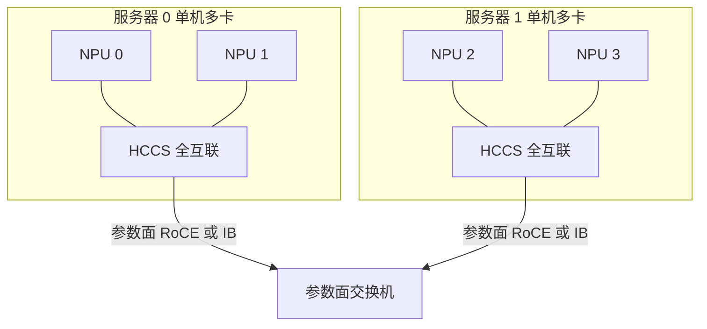

# 第 7 章 分布式训练

## 本章目标

- 能写出 HCCL 的 AllReduce、ReduceScatter、AllGather、Broadcast 四个集合通信原语的语义，用 LaTeX 公式算出每卡收发量与全网总流量，并对 $N=8$ 给出算例。
- 能说清单机多卡 HCCS 与多机参数面 RoCE/IB 的拓扑差异，指出跨机那段流量为何要单独核算。
- 能用 `torchrun` 在单机双卡上拉起一份合成数据的 DDP 脚本，写出 `init_process_group(backend="hccl")` 的完整参数、`rank` 与 `device` 的绑定写法及关键环境变量。
- 能按 $16\Psi$ 口径估算数据并行、张量并行、流水线并行下每卡的参数、梯度、优化器状态字节数，并指出哪些变量是杠杆。

## 先说结论

- HCCL（Huawei Collective Communication Library，华为集合通信库，CANN 之上的集合通信库）提供 AllReduce、ReduceScatter、AllGather、Broadcast 等原语。DDP（Distributed Data Parallel，各卡持有完整模型、分摊数据并同步梯度）的梯度同步默认走 AllReduce。
- 按 Ring 算法，AllReduce 每卡收发量为 $\frac{2(N-1)}{N}S$，全网总发送量为 $2(N-1)S$。把每卡流量当成全网总流量，会低估 $N$ 倍。
- HCCL 按 Server 内与 Server 间分级执行集合通信，机内走 HCCS，跨机走参数面 RoCE 或 InfiniBand。跨机那段受网卡带宽与交换机约束，机内 HCCS 的富余带宽无法补偿它。
- `torch_npu` 用 `backend="hccl"` 接入 PyTorch 分布式，`rank` 与 `device` 的绑定由 `LOCAL_RANK` 决定，`torch.npu.set_device()` 要在 `init_process_group()` 之前完成。
- 数据并行复制完整模型状态，混合精度 Adam 下每卡约 $16\Psi$ 字节。ZeRO（Zero Redundancy Optimizer，零冗余优化器，把重复保存的模型状态按 rank 分片）类优化按数据并行度切分这些状态，昇腾侧入口是 MindSpeed 的 `--use-distributed-optimizer` 与 DeepSpeed 分支。

## 集合通信、并行切分与多卡启动

### 7.1 HCCL 在调用链上的位置与四个原语

PyTorch 侧 `dist.all_reduce()` 按 `backend="hccl"` 找到 ProcessGroup 实现，把 NPU（神经网络处理单元，即昇腾 AI 处理器）张量指针与 shape、dtype 封装成 HCCL 通信域描述。HCCL 选定算法，拆成 Send/Recv 并翻译成 HCCS 或 RoCE 指令；对端写入预分配缓冲并触发归约回调。输入是各 rank 形状与 dtype 一致的 NPU 缓冲区，输出是写回各 rank 的归约或收集结果。

| 原语 | 语义 | 输入 | 输出 |
|------|------|------|------|
| AllReduce | 通信域内所有 rank 的输入按 op 归约（求和、最大值等）后，结果发到所有 rank 的输出 buffer | 每卡 $S$ 字节 | 每卡 $S$ 字节的完整归约结果 |
| ReduceScatter | 所有 rank 输入归约后，按 rank 编号均匀分散到各 rank 的输出 buffer，每个 rank 拿到 $1/N$ 份 | 每卡 $S$ 字节 | 每卡 $S/N$ 字节 |
| AllGather | 所有 rank 的输入按 rank id 重新排序拼接，结果发到所有 rank | 每卡 $S/N$ 字节 | 每卡 $S$ 字节 |
| Broadcast | 把 root 节点的数据发到通信域内其他 rank | root 持有 $S$ 字节 | 每卡 $S$ 字节 |

后端系统里已有对应物，第三列给出差异：

| 后端概念 | 昇腾侧对应物 | 差异 |
|---------|-------------|------|
| 多实例广播（配置中心向所有实例下发一份配置） | HCCL Broadcast，以及 AllGather、AllReduce 的结果分发阶段 | 后端广播走业务 RPC 落到进程内存，Broadcast 走 HCCS/RoCE 且数据直接落在 NPU HBM |
| 分片汇总（MapReduce 的 reduce 结果按 key 落到不同 reducer） | HCCL ReduceScatter | 后端按 key 哈希分片，各片大小可不同；ReduceScatter 按 rank 编号等分，每份字节数严格相同 |
| 全量汇总后回写（各实例上报指标，聚合后把全局值下发） | HCCL AllReduce | 后端常由中心节点聚合；Ring AllReduce 无中心节点，每卡既是发送方也是接收方 |
| RPC 请求与响应 payload | 一次集合通信的张量缓冲区 $S$ | 后端 payload 大小随意；集合通信要求各 rank 缓冲区形状与 dtype 一致，否则建链或执行报错 |

### 7.2 每卡收发量与全网总流量

记号：$N$ 为 rank 数；$S$ 为归约或收集后的「逻辑全量数据」字节数。在 AllReduce 与 ReduceScatter 中，$S$ 也是每个 rank 的输入缓冲区大小；在 AllGather 中，每个 rank 的输入是 $S/N$，输出才是 $S$。按 Ring 算法，把数据切成 $N$ 块，每块 $S/N$，相邻 rank 之间逐块传递：

- ReduceScatter 用 $N-1$ 步，每卡发送 $\frac{(N-1)}{N}S$，链路接收同量，最终只保留 $S/N$。
- AllGather 用 $N-1$ 步，每卡发送 $\frac{(N-1)}{N}S$，链路接收同量，最终持有 $S$。
- AllReduce 等于 ReduceScatter 加 AllGather，每卡发送与接收各为 $\frac{2(N-1)}{N}S$。
- Broadcast 按链式或树式实现，root 累计发送 $(N-1)S$，每个非 root rank 接收 $S$。

全网总发送量是所有 rank 发送量之和。AllReduce 为 $N\times\frac{2(N-1)}{N}S = 2(N-1)S$；ReduceScatter、AllGather、Broadcast 均为 $(N-1)S$。每卡流量决定单卡链路压力，全网总流量决定交换机与参数面带宽压力，两者在容量规划里分开列。

$N=8$、$S = 1\ \text{GiB}$ 的算例（Ring 算法估算）：

| 原语 | 每卡发送 | 每卡接收 | 每卡输出 | 全网总发送 |
|------|---------|---------|---------|-----------|
| AllReduce | $1.75$ GiB | $1.75$ GiB | $1$ GiB | $14$ GiB |
| ReduceScatter | $0.875$ GiB | $0.875$ GiB | $0.125$ GiB | $7$ GiB |
| AllGather | $0.875$ GiB | $0.875$ GiB | $1$ GiB | $7$ GiB |
| Broadcast | root $7$ GiB | 非 root 各 $1$ GiB | $1$ GiB | $7$ GiB |

$$\frac{2(N-1)}{N}S = \frac{2\times 7}{8}\times 1\ \text{GiB} = 1.75\ \text{GiB},\qquad 2(N-1)S = 2\times 7\times 1\ \text{GiB} = 14\ \text{GiB}$$

以上为估算，假设单一通信域、无分级、无压缩、各 rank 缓冲区等大。HCCL 按 Server 内与 Server 间分级执行：AllReduce 三阶段为 Server 内 ReduceScatter、Server 间 AllReduce、Server 内 AllGather；ReduceScatter 为 Server 间、Server 内，AllGather 为 Server 内、Server 间。分级后机间链路承担跨机必需的分片，机内 HCCS 承担其余，因此 $2(N-1)S$ 是总量口径，机间实际流量按拓扑再拆一次。

### 7.3 单机多卡与多机的拓扑差异

单机多卡：服务器内多张昇腾 AI 处理器通过 HCCS（Huawei Cache Coherence System，华为缓存一致性系统，服务器内多卡间的高速互联链路）全互联，任意两卡通信不经 CPU 与 PCIe 交换机，带宽数百 GB/s 量级。`npu-smi info -t topo -i 0` 看拓扑，`ascend-dmi --bw -t p2p -ds 0 -dd 1` 测点到点带宽。

多机：跨服务器走参数面网络，用 RoCE（RDMA over Converged Ethernet，基于融合以太网的远程直接内存访问）或 InfiniBand（IB），常见 100 到 400 Gbps 量级，每卡直出网络接口。参数面与业务面、存储面分开组网，带宽受网卡、交换机、PFC 流控与 CPU 中断亲和性约束。`hccn_tool -i <id> -roce_test ...` 验证 RoCE 带宽，`hccl_test` 的 `all_reduce_test` 测集合通信带宽。



跨机单独核算的理由：分级执行把一次 AllReduce 拆成机内、机间、机内三段，机间每次 Send/Recv 都占用 RoCE 带宽与交换机端口，构成端到端耗时下界之一；机内 HCCS 带宽再高也不会替机间段搬运数据。后端里同机房走共享内存或 loopback、跨机房走专线，专线带宽与延迟同样单独规划。

### 7.4 torch_npu 分布式初始化与环境变量

`init_process_group` 的写法：

```python
dist.init_process_group(
    backend="hccl",
    init_method="env://",
    rank=rank,
    world_size=world_size,
    timeout=datetime.timedelta(seconds=1800),
)
```

`backend="hccl"` 选择昇腾侧通信后端；`init_method="env://"` 表示从 `MASTER_ADDR`、`MASTER_PORT`、`RANK`、`WORLD_SIZE` 读取会合信息，此时 `rank` 与 `world_size` 也可省略；`timeout` 显式给出；HCCL 建链等待另由 `HCCL_CONNECT_TIMEOUT` 控制。

`rank` 与 `device` 的绑定：

```python
local_rank = int(os.environ.get("LOCAL_RANK", 0))
rank = int(os.environ.get("RANK", 0))
world_size = int(os.environ.get("WORLD_SIZE", 1))
torch.npu.set_device(local_rank)              # 先绑定，再初始化通信域
device = torch.device(f"npu:{local_rank}")
```

`torch.npu.set_device()` 放在 `init_process_group()` 之前，保证 HCCL 建链时进程已经绑定到对应 NPU。缺少这一步时多个进程默认使用 0 号卡，会互相抢占同一 Device。

关键环境变量（拼写均按官方文档核对）：

| 环境变量 | 功能 | 配置示例 |
|---------|------|---------|
| `HCCL_IF_IP` | root 通信网卡 IP，只支持 Host 网卡、单个 IP；不配时按「docker/lo 以外网卡字典序升序 → docker → lo」选取 | `export HCCL_IF_IP=10.10.10.1` |
| `HCCL_WHITELIST_DISABLE` | 是否校验通信白名单；`1` 关闭（缺省）、`0` 开启 | `export HCCL_WHITELIST_DISABLE=1` |
| `HCCL_WHITELIST_FILE` | 白名单 JSON 路径，格式 `{"host_ip": ["ip1"], "device_ip": []}` | `export HCCL_WHITELIST_FILE=/home/test/whitelist` |
| `HCCL_CONNECT_TIMEOUT` | 设备间建链超时，单位秒，缺省 `120` | `export HCCL_CONNECT_TIMEOUT=1800` |
| `HCCL_EXEC_TIMEOUT` | 集合通信算子执行超时，单位秒 | `export HCCL_EXEC_TIMEOUT=3600` |
| `HCCL_SOCKET_IFNAME` | HCCL socket 网卡名，所有节点必须一致 | `export HCCL_SOCKET_IFNAME=enp194s0f0` |
| `HCCL_IF_BASE_PORT` | 跨节点基础端口，需预留自该端口起的 16 个端口 | `export HCCL_IF_BASE_PORT=60000` |
| `HCCL_BUFFSIZE` | 通信缓冲区大小，单位字节 | `export HCCL_BUFFSIZE=2147483648` |
| `HCCL_OP_EXPANSION_MODE` | 通信算法展开位置，`AIV` 使用 Vector Core | `export HCCL_OP_EXPANSION_MODE=AIV` |

HCCL 建议用 `60000-60015` 端口段收集集群信息，操作系统侧用 `sudo sysctl -w net.ipv4.ip_local_reserved_ports=60000-60015` 预留。该端口段属于 HCCL，`MASTER_PORT` 属于 PyTorch rendezvous，两者不同。

### 7.5 三种切分的显存账

训练时一张卡常驻的除权重外，还有梯度、优化器状态（Adam 的一阶动量与二阶方差）与激活。混合精度下参数与梯度用 2 字节（fp16/bf16），优化器用 fp32 保存主权重、动量与方差。设 $\Psi$ 为参数量，ZeRO 论文给出的口径是：

$$M_{\text{DDP}} = \underbrace{2\Psi}_{\text{fp16 参数}} + \underbrace{2\Psi}_{\text{fp16 梯度}} + \underbrace{4\Psi}_{\text{fp32 主权重}} + \underbrace{4\Psi}_{\text{动量}} + \underbrace{4\Psi}_{\text{方差}} = 16\Psi$$

| 切分 | 切什么 | 每卡模型状态字节数（估算） | 引入的通信 |
|------|-------|--------------------------|-----------|
| 数据并行 DP（度 $d$） | 切训练数据，每卡完整模型副本 | $16\Psi$；ZeRO-1 分片优化器状态后 $4\Psi + \frac{12\Psi}{d}$；ZeRO-3 全分片 $\frac{16\Psi}{d}$ | 梯度 AllReduce，ZeRO-3 另加参数 AllGather |
| 张量并行 TP（度 $t$） | 切一层内的矩阵，Attention 与 MLP 的投影按列或按行拆 | $\frac{16\Psi}{t}$，未切分的 LayerNorm 与 embedding 项另计 | 每层前向与反向的 AllReduce，或 ReduceScatter 加 AllGather |
| 流水线并行 PP（度 $p$） | 切模型的层，每卡约 $\frac{L}{p}$ 层 | $\frac{16\Psi}{p}$，含 embedding 与 head 的首尾 stage 略高 | stage 之间点对点发送激活，1F1B 调度带 bubble |

杠杆变量：$\Psi$、切分度 $d/t/p$、精度组合（bf16/fp16 与 fp32 优化器状态）、ZeRO stage、激活重计算、micro-batch 数、序列长度与 batch size。不构成杠杆的变量：HBM 容量由型号决定；HCCS 与 RoCE 带宽只改变耗时，不改变常驻字节数；$t$ 与 $p$ 在字节公式里是分母。

算例（估算，$\Psi = 7\times 10^9$，混合精度 Adam，$16\Psi$ 口径，$1\ \text{GiB} = 2^{30}\ \text{B}$）：

$$16\Psi = 16 \times 7\times10^9\ \text{B} = 112\times10^9\ \text{B} \approx 104.3\ \text{GiB}$$

| 配置 | 算式 | 每卡估算 |
|------|------|---------|
| 纯 DDP | $16\Psi$ | $\approx 104.3$ GiB |
| ZeRO-1，$d=8$ | $4\Psi + \frac{12\Psi}{8} = 5.5\Psi = 38.5\times10^9$ B | $\approx 35.9$ GiB |
| ZeRO-3，$d=8$ | $\frac{16\Psi}{8} = 2\Psi = 14\times10^9$ B | $\approx 13.0$ GiB |
| TP $t=2$ 加 ZeRO-1 $d=4$（共 8 卡） | $\frac{5.5\Psi}{2} = 19.25\times10^9$ B | $\approx 17.9$ GiB |
| PP $p=4$ 加 ZeRO-1 $d=2$（共 8 卡） | $\frac{5.5\Psi}{4} = 9.625\times10^9$ B | $\approx 9.0$ GiB |

全部为估算，假设：不含激活、通信缓冲、workspace 与碎片；fp16 参数与梯度加 fp32 优化器状态；TP 忽略 LayerNorm 与 embedding；PP 忽略首尾 stage 差异与 bubble。ZeRO-3 把常驻显存压到 $\frac{16\Psi}{d}$ 的代价是通信量约为 DDP 的 1.5 倍（reduce-scatter 加两次 all-gather），用通信换显存。

### 7.6 MindSpeed、Megatron 适配与 ZeRO 入口

MindSpeed Core 是面向昇腾设备的大模型加速库。在 Megatron-LM 的 `pretrain_gpt.py` 里，`import torch` 下新增一行即可接入：

```python
import torch
import mindspeed.megatron_adaptor   # 新增代码行
from functools import partial
```

MindSpeed 与 Megatron-LM 组合的仓库 README 配套表（查证于 2026-11-14）：Mcore `0.12.1`、CANN `9.0.0`、PyTorch `2.7.1`、TorchNPU `26.0.0`、Python `3.10.x`。软件栈迭代快，动手前以仓库[版本配套表](https://gitcode.com/Ascend/MindSpeed/blob/master/docs/zh/release_notes_core.md)为准，硬件型号适用关系以该表为准。这套配套针对 MindSpeed 与 Megatron-LM 组合，与第 4、5 章基础框架的配套表分属不同软件栈，两组版本号各有官方出处，分别按对应配套表选一组使用。安装与切换分支命令（仓库原文）：

```bash
git clone https://gitee.com/ascend/MindSpeed.git
pip install -e MindSpeed
git clone https://github.com/NVIDIA/Megatron-LM.git
cd Megatron-LM && git checkout core_v0.12.1
```

MindSpeed 用 `--optimization-level` 选择官方加速层级（基础功能兼容、亲和性增强、加速特性使能），各特性在脚本里加参数使能。ZeRO 类显存优化在昇腾侧有三个入口：

- `--use-distributed-optimizer`（MindSpeed 分布式优化器）：把优化器状态按 DP 度分片，用 ReduceScatter 局部更新梯度、AllGather 汇总权重，对应 ZeRO-1。
- MindSpeed-LLM 的 `deepspeed` 分支支持 ZeRO-1 与 ZeRO-2；只需要 ZeRO-1 时不必引入 DeepSpeed，直接设 `--use-distributed-optimizer`。
- 仓库入口：[Ascend/MindSpeed](https://gitcode.com/Ascend/MindSpeed/)、[Ascend/MindSpeed-LLM](https://gitcode.com/Ascend/MindSpeed-LLM)、[Ascend/MindSpeed-MM](https://gitcode.com/Ascend/MindSpeed-MM)、[NVIDIA/Megatron-LM](https://github.com/NVIDIA/Megatron-LM)、[cann/hccl](https://gitcode.com/cann/hccl)。

## 动手实操

### 前提

一台服务器装两张昇腾 AI 处理器，已安装 CANN Toolkit、PyTorch 与 `torch_npu`，版本以官方配套表为准。张量通过 `.to("npu:0")` 从 Host 内存搬到 Device 的 HBM，算子异步下发到 Stream，读取标量值会让 Host 阻塞到已下发任务完成。合成数据不依赖外部数据集，用于验证通信域与梯度同步链路，不验证收敛。

### 脚本 `ddp_synthetic.py`

```python
import os
import argparse
import datetime
import torch
import torch.distributed as dist
import torch_npu
from torch.nn.parallel import DistributedDataParallel as DDP


def main():
    parser = argparse.ArgumentParser()
    parser.add_argument("--epochs", type=int, default=3)
    parser.add_argument("--steps", type=int, default=20)
    parser.add_argument("--batch", type=int, default=32)
    parser.add_argument("--dim", type=int, default=128)
    args = parser.parse_args()

    local_rank = int(os.environ.get("LOCAL_RANK", 0))
    rank = int(os.environ.get("RANK", 0))
    world_size = int(os.environ.get("WORLD_SIZE", 1))

    torch.npu.set_device(local_rank)              # 先绑定 Device
    device = torch.device(f"npu:{local_rank}")

    dist.init_process_group(
        backend="hccl",
        init_method="env://",
        rank=rank,
        world_size=world_size,
        timeout=datetime.timedelta(seconds=1800),
    )

    # 通信域自检：把各 rank 的编号求和，2 卡时结果应为 1
    t = torch.tensor([rank], dtype=torch.int32, device=device)
    dist.all_reduce(t)
    expected = world_size * (world_size - 1) // 2
    if int(t.item()) != expected:
        raise RuntimeError(f"all_reduce mismatch: {int(t.item())} != {expected}")
    print(f"rank={rank} world_size={world_size} allreduce_sum={expected}", flush=True)

    torch.manual_seed(1234)                       # 各进程模型初值一致
    model = torch.nn.Sequential(
        torch.nn.Linear(args.dim, 256),
        torch.nn.ReLU(),
        torch.nn.Linear(256, args.dim),
    ).to(device)
    ddp_model = DDP(model, device_ids=[local_rank])
    optimizer = torch.optim.SGD(ddp_model.parameters(), lr=0.01)
    loss_fn = torch.nn.MSELoss()

    g = torch.Generator().manual_seed(4321 + rank)
    for epoch in range(args.epochs):
        total = 0.0
        for step in range(args.steps):
            x = torch.randn(args.batch, args.dim, generator=g).to(device)
            target = torch.sin(x)
            optimizer.zero_grad()
            out = ddp_model(x)
            loss = loss_fn(out, target)
            loss.backward()                       # DDP 在此触发梯度 AllReduce
            optimizer.step()
            total += loss.item()
        if rank == 0:
            print(f"epoch={epoch} mean_loss={total / args.steps:.6f}", flush=True)

    dist.destroy_process_group()


if __name__ == "__main__":
    main()
```

### 双卡启动命令

```bash
source /usr/local/Ascend/ascend-toolkit/set_env.sh
export MASTER_ADDR=127.0.0.1
export MASTER_PORT=29500
export HCCL_CONNECT_TIMEOUT=1800
export HCCL_WHITELIST_DISABLE=1
export HCCL_IF_BASE_PORT=60000
sudo sysctl -w net.ipv4.ip_local_reserved_ports=60000-60015

torchrun --nnodes=1 --nproc_per_node=2 --node_rank=0 \
  --master_addr=$MASTER_ADDR --master_port=$MASTER_PORT \
  ddp_synthetic.py --epochs 3 --steps 20
```

`torchrun` 为每个进程注入 `LOCAL_RANK`、`RANK`、`WORLD_SIZE`。大集群场景可用官方推荐的 `torch_npu_run`，它是 `torchrun` 针对集群建链的改进版。

### 预期输出的关键行

```text
rank=1 world_size=2 allreduce_sum=1
rank=0 world_size=2 allreduce_sum=1
epoch=0 mean_loss=...
epoch=1 mean_loss=...
epoch=2 mean_loss=...
```

两个进程各占一张卡，`npu-smi info -t proc-mem -i 0` 与 `-i 1` 应各见一个进程。都落在 0 号卡说明 `set_device(local_rank)` 缺失。`allreduce_sum=1` 是通信域建通的直接证据。

## 常见坑

| 现象 | 原因 | 处理 |
|------|------|------|
| 两个进程都报显存不足，或都占用 0 号卡 | 缺少 `torch.npu.set_device(local_rank)`，HCCL 建链时绑定到同一 Device | 在 `init_process_group()` 前调用 `set_device(local_rank)`，用 `npu-smi info -t proc-mem` 核对 |
| `init_process_group()` 卡住后报建链超时 | `HCCL_CONNECT_TIMEOUT` 缺省 120 秒，多卡或跨机启动不同步时不够 | 调大 `HCCL_CONNECT_TIMEOUT` 与 `HCCL_EXEC_TIMEOUT`，各节点同时拉起，核对 `MASTER_ADDR` / `MASTER_PORT` |
| 跨机带宽远低于标称，部分卡无流量 | `HCCL_IF_IP` 选到 docker 或 lo 网卡，`HCCL_SOCKET_IFNAME` 各节点不一致，端口段未预留 | 把 `HCCL_IF_IP` 设为参数面 IP，统一 `HCCL_SOCKET_IFNAME`，用 `sysctl` 预留端口段，`hccn_tool -i <id> -roce_test` 验证 |
| 某节点报算子不支持或集合通信挂起 | 各节点 CANN、驱动、`torch_npu`、MindSpeed 版本不一致 | 使用同一镜像，按官方版本配套表对齐；启动前打印 `npu-smi info -t board` 与 `pip show torch_npu` |
| 参数面容量规划低估，交换机成瓶颈 | 把每卡收发量当成全网总流量，少乘了 $N$ | 单卡按 $\frac{2(N-1)}{N}S$、总量按 $2(N-1)S$ 核算，两列分开列 |

## 自测题

1. 单机 8 卡（$N=8$），一次 AllReduce 的逻辑全量数据 $S=512\ \text{MiB}$，按 Ring 算法估算每卡发送字节数与全网总发送字节数，并说明两个数字相差 8 倍关系的来源。
2. 两台 Atlas 800 训练服务器各 8 卡，共 16 卡做数据并行。说明 HCCL 分级执行一次 AllReduce 时哪几段走 HCCS、哪一段走参数面 RoCE，以及机内带宽为何无法抵消机间瓶颈。
3. 用 `torchrun --nproc_per_node=2` 在单机双卡拉起训练，写出 `local_rank`、`rank`、`world_size` 的来源，`set_device()` 与 `init_process_group()` 的先后顺序，以及 `backend` 与 `init_method` 的取值。
4. 7B 参数模型、混合精度 Adam、$16\Psi$ 口径、DP 度 8，分别估算纯 DDP 与 ZeRO-1（仅分片优化器状态）下每卡模型状态字节数，写出算式与 GiB 换算，并列出三项该估算未计入的显存开销。
5. 一次跨机训练报 HCCL 建链超时，同时观测到流量只走 docker 网卡。写出至少三个要检查或修改的环境变量或系统配置，并注明控制超时与端口段的具体拼写。

## 自测题答案

1. 每卡发送量

$$\frac{2(N-1)}{N}S = \frac{2\times7}{8}\times 512\ \text{MiB} = 896\ \text{MiB}$$

全网总发送量

$$2(N-1)S = 2\times7\times 512\ \text{MiB} = 7168\ \text{MiB} = 7\ \text{GiB}$$

总量等于每卡量乘 $N=8$。每卡公式的分母 $N$ 来自「切成 $N$ 块、每块 $S/N$」，求总量时 $N$ 个 rank 相加把分母约掉，两个数字恰好相差 $N$ 倍。

2. AllReduce 分三段：Server 内 ReduceScatter 走 HCCS，Server 间 AllReduce 走参数面 RoCE 或 IB，Server 内 AllGather 走 HCCS 把结果铺开。机间每次 Send/Recv 占用 RoCE 带宽与交换机端口，构成端到端耗时下界之一；HCCS 只负责机内搬运，机内带宽再高也不替机间段搬数据，跨机段须按参数面带宽单独核算。

3. `local_rank`、`rank`、`world_size` 分别由 `os.environ.get("LOCAL_RANK", 0)`、`("RANK", 0)`、`("WORLD_SIZE", 1)` 读取，由 `torchrun` 注入。顺序是先 `torch.npu.set_device(local_rank)` 并构造 `device = torch.device(f"npu:{local_rank}")`，再 `dist.init_process_group(...)`。`backend="hccl"`，`init_method="env://"`；用 `env://` 时 `rank` 与 `world_size` 可省略。

4. $\Psi = 7\times10^9$，$16\Psi = 112\times10^9\ \text{B} \approx 104.3\ \text{GiB}$。ZeRO-1（$d=8$）：

$$4\Psi + \frac{12\Psi}{8} = 5.5\Psi = 38.5\times10^9\ \text{B} \approx 35.9\ \text{GiB}$$

未计入的开销：激活与中间结果、HCCL 通信缓冲与 workspace、显存碎片，以及 LayerNorm 与 embedding 未切分部分。

5. ① `HCCL_IF_IP` 设为参数面 Host 网卡 IP；② `HCCL_SOCKET_IFNAME` 各节点统一为参数面网卡名；③ 调大 `HCCL_CONNECT_TIMEOUT`（缺省 120 秒）与 `HCCL_EXEC_TIMEOUT`；④ `sudo sysctl -w net.ipv4.ip_local_reserved_ports=60000-60015` 预留端口段并核对 `HCCL_IF_BASE_PORT`。控制建链超时的是 `HCCL_CONNECT_TIMEOUT`，控制端口段起点的是 `HCCL_IF_BASE_PORT`。

## 参考来源

- [HCCL 接口简介（CANN Community 8.0.0.alpha002）](https://www.hiascend.com/document/detail/zh/CANNCommunityEdition/800alpha002/apiref/hcclapiref/hcclcpp_07_0003.html) — 查证于 2026-11-14 — 支撑四个集合通信原语语义
- [HCCL 概述：分级通信原理（CANN 8.1.RC1.alpha001）](https://www.hiascend.com/document/detail/zh/CANNCommunityEdition/81RC1alpha001/devguide/hccl/hcclug/hcclug_000002.html) — 查证于 2026-11-14 — 支撑 Server 内/间分级与三阶段流程
- [RANK_TABLE_FILE 与 HCCL 环境变量（CANN 商用版 6.0.1）](https://www.hiascend.com/document/detail/zh/canncommercial/601/modeldev/tfmigr2/tfmigr2_000133.html) — 查证于 2026-11-14 — 支撑环境变量拼写与缺省值
- [单机多卡场景（Ascend Extension for PyTorch 文档）](https://www.hiascend.com/document/detail/zh/Pytorch/700/ptmoddevg/trainingmigrguide/PT_LMTMOG_0021.html) — 查证于 2026-11-14 — 支撑 `backend="hccl"`、`torchrun`、端口预留与 DDP 写法
- [MindSpeed 仓库](https://gitcode.com/Ascend/MindSpeed/) — 查证于 2026-11-14 — 支撑版本配套表、安装命令与 `megatron_adaptor`
- [分布式优化器（MindSpeed 使用指导）](https://www.hiascend.com/document/detail/zh/Pytorch/60RC2/modthirdparty/asdevguide/mindspeed_0010.html) — 查证于 2026-11-14 — 支撑 `--use-distributed-optimizer`
- [MindSpeed-LLM ZeRO-1/2/3 说明](https://gitee.com/ascend/MindSpeed-LLM/tree/2d26c211ad360155e9d251da4fec9de839da40ac) — 查证于 2026-11-14 — 支撑 deepspeed 分支与 ZeRO-1 入口
- [4D Parallelism and Memory Consumption Estimator（arXiv:2411.06465）](https://arxiv.org/pdf/2411.06465) — 查证于 2026-11-14 — 支撑 $16\Psi$ 与 TP / PP 显存公式
- [ZeRO 分级显存与通信量对照](https://aiwiki.ai/wiki/zero_optimization) — 查证于 2026-11-14 — 支撑 ZeRO-1/2/3 每卡公式与 1.5 倍通信量
- [昇腾 NPU 环境变量配置指南（ROLL 文档）](https://alibaba.github.io/ROLL/zh-Hans/docs/User%20Guides/Hardware%20Support/ascend_npu_env_config) — 查证于 2026-11-14 — 支撑 `HCCL_SOCKET_IFNAME` 等变量拼写
