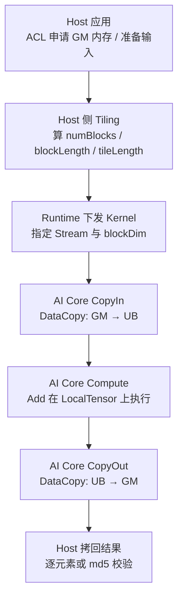

# 第 8 章 Ascend C 自定义算子

## 本章目标

1. 说清 Host 侧 Tiling 与 Device 侧 Kernel 的分工，指出一次 Add 算子执行的输入、输出、中间缓冲分别落在 GM、UB、L0 的哪一层。
2. 逐文件编译运行一个完整 Add 算子工程，用 CPU 仿真与 NPU 真机两种模式各验证一次输出，说出 `soc_version` 取值的依据。
3. 把该算子注册进 PyTorch，写出 `torch.ops` 调用与版本核对命令，解释 `TORCH_LIBRARY_FRAGMENT` 与 `TORCH_LIBRARY_IMPL` 各自决定什么。

## 先说结论

- Ascend C 算子分成 Host 侧与 Device 侧两段代码。Host 侧的 Tiling 计算决定把大数组切成多少块、每块多大、交给几个 AI Core 并行处理；Device 侧的 Kernel 在 AI Core 上执行 CopyIn、Compute、CopyOut 三段流水。
- Tiling 之所以必要，是因为 Unified Buffer（UB，片上高速缓存）容量远小于 Global Memory（GM，板载显存，HBM：High Bandwidth Memory，高带宽内存）。按块处理大数组，块大小受片上缓存容量限制，装不下整块数据的计算必须分块循环。
- Vector 计算的数据通路是 GM → UB → Vector 单元 → UB → GM；Cube 计算的数据通路是 GM → L1 → L0A / L0B → Cube 单元 → L0C → GM。Add 属于 Vector 计算，只用 UB。
- TPipe 统一管理片上缓冲，TQue 用 EnQue / DeQue 表达「搬运完成后才能计算」的依赖，GlobalTensor 指向 GM，LocalTensor 指向 UB，DataCopy 在两者之间成块搬运，Add 在 LocalTensor 上执行逐元素加法。
- 算子工程编译时要指定与实卡一致的 `soc_version`；注册进 PyTorch 走 torch_npu 自定义算子路径，用 `TORCH_LIBRARY_FRAGMENT` 声明 schema，用 `TORCH_LIBRARY_IMPL` 注册 `PrivateUse1` 设备实现。

## 编程模型与算子工程

### 一次算子执行落在调用链哪一层

NPU 指 Neural Processing Unit，神经网络处理单元，本教程中即专门执行矩阵与向量计算的昇腾 AI 处理器。CANN 指 Compute Architecture for Neural Networks，是位于驱动与上层框架之间的异构计算软件栈，对外提供 AscendCL（ACL，Ascend Computing Language）这套 C/C++ 接口。一次自定义算子调用从业务进程出发，经 Runtime（运行时，负责把任务排到设备上执行）把核函数与参数下发到 Device，最终在 AI Core 上执行；驱动负责让操作系统访问物理卡。自定义算子代码处在「被下发任务」一层：框架或 ACL 应用决定何时调用，Runtime 决定排到哪条 Stream，Kernel 决定数据搬运与计算。

一次 Add 算子执行的输入是两个 GM 上的张量 `x`、`y`，输出是 GM 上的张量 `z`。中间缓冲有三处：从 GM 搬进 UB 的 `xLocal`、`yLocal`，在 UB 上算出的 `zLocal`，以及 TQue 队列为双缓冲额外占用的另一组 UB 空间。GM 上的三块内存由 Host 侧 ACL 申请，UB 上的缓冲由 Device 侧 TPipe 分配。

| 后端概念 | 昇腾侧对应物 | 差异 |
|---|---|---|
| 进程向线程池提交一批任务 | Host 向多个 AI Core 下发一个 Kernel | 后端线程读同一份内存；AI Core 各有独立 UB，靠 GM 交换数据 |
| 有界队列做生产者 / 消费者同步 | TQue 的 EnQue / DeQue | 队列元素是需要同步的数据块，同步由硬件事件完成 |
| 多级 CPU 缓存 L1 / L2 / L3 | GM / L1 / L0A / L0B / L0C / UB | 昇腾各级缓存由 DataCopy 显式搬运，缓存行不自动填充 |
| 批处理按 chunk 读大文件 | Tiling 按 Tile 分块处理大数组 | chunk 大小通常由 IO 缓冲决定，Tile 大小由 UB 容量硬约束 |
| 一次 RPC 合并多个下游调用 | 算子融合把多个算子合成一个 Kernel | 融合省下 GM 往返读写次数，RPC 合并省下网络往返次数 |



### 为什么框架已有算子还要自己写

算子库（预先实现并优化好的算子集合）覆盖了常见计算，剩下三类场景要自己写 Kernel：框架尚未内置的新激活函数（如 SwiGLU、GeGLU）、稀疏计算（MoE 路由、稀疏注意力）、以及低精度推理里的特殊量化逻辑。第三类更常见的动机是算子融合：把「矩阵乘 + 偏置加 + 激活」三步合成一个 Kernel，中间结果留在 UB，直接写回 GM。后端对照是合并多次 RPC 为一次批量调用；算子融合省下每一步把中间张量写回 GM 再读回来的带宽与时延。融合由写 Kernel 的人决定，输入输出仍是框架传入的张量。

### AI Core 内部：Cube 单元、Vector 单元与多级存储

AI Core 是芯片内的计算核心。分离架构把 AI Core 拆成矩阵计算单元（AI Cube，AIC）与向量计算单元（AI Vector，AIV）两个独立核，各自带 Scalar 单元负责控制流与地址计算，AIC 与 AIV 之间通过 GM 传递数据。Cube 单元专做矩阵乘累加，数据从 L0A / L0B 读入、结果写入 L0C；Vector 单元做逐元素运算与归约，工作在 UB 上。AIC 的内存单元有 GM、L1、L0A、L0B、L0C；AIV 的内存单元只有 GM 与 UB。昇腾社区《Ascend C 简介》给出的典型数据流是：Vector 计算走 `GM-UB-[Vector]-UB-GM`，Cube 计算走 `GM-L1-L0A/L0B-[Cube]-L0C-FixPipe-GM`。

| 存储 / 单元 | 所在位置 | 由谁管理 | 装什么 |
|---|---|---|---|
| GM（HBM，High Bandwidth Memory） | 片外显存 | Host 侧 ACL 申请 | 算子输入 `x`、`y`、输出 `z`，容量大、延迟高 |
| L1 Buffer | AIC 片上 | DataCopy 显式搬运 | Cube 计算的输入矩阵分块 |
| L0A / L0B / L0C | AIC 片上 | Cube 指令读写 | 矩阵乘的左 / 右操作数与累加结果 |
| Unified Buffer（UB） | AIV 片上 | TPipe / TQue 分配 | Vector 计算的输入、输出、中间缓冲 |

Cube 单元是脉动阵列，一次完成一块矩阵乘累加；Vector 单元对 UB 内连续元素执行 SIMD（Single Instruction Multiple Data）指令。Add 只用到 Vector 通路，因此这个工程不触及 L0 与 L1。

### Tiling：按块处理大数组

Tiling 指把大数组切成适配片上缓存的小块再分块循环处理，由 Host 侧的 Tiling 函数决定。后端系统里「按块处理大数组，块大小受片上缓存容量限制」是同一件事：读一个超过内存的大文件时按固定 chunk 循环读，chunk 超过缓冲区就要溢出；UB 是容量固定的片上缓冲，一个 Tile 连同它的输入、输出、双缓冲副本必须全部放得下。

Host 侧 Tiling 的输入是总元素数 `totalLength`、芯片的 UB 容量与 AI Core 数量，输出是三元组 `numBlocks`（启用几个核）、`blockLength`（每核处理多少元素）、`tileLength`（每次循环处理多少元素）。一次估算（假设 half 占 2 字节、每条队列开 `bufferNum` 块双缓冲、输入两条队列加输出一条队列共 3 条，UB 容量记为 `ubSize`）：

$$
\text{tileLength} \le \left\lfloor \frac{\text{ubSize}}{\text{bufferNum} \times 3 \times \text{sizeof}(\text{half})} \right\rfloor
$$

该式是估算，给出容量上界，写明假设：双缓冲深度取 2、队列数取 3、忽略 TQue 元数据开销；`ubSize` 属官方公开规格，不同资料给出单 AI Core 约 192 KB 与约 2 MB 两种口径，按具体芯片的官方规格取值，见参考来源。杠杆变量是 `tileLength` 与 `bufferNum`，二者都直接乘进占用量；`totalLength` 不进入 UB 占用公式，只决定循环次数。工程里再取一个更小的 Tile（官方 Add 样例为 256 个 half，占 $256 \times 2 \times 3 \times 2 = 3072$ 字节）以拉开搬运与计算的流水重叠，并把取值向 32 字节对齐取整，见「常见坑」。

标准算子工程（框架调用方式）用一组宏定义 Tiling 结构体，Host 填充、Kernel 取回。头文件 `register/tilingdata_base.h` 提供结构体定义与注册宏，`BEGIN_TILING_DATA_DEF` / `TILING_DATA_FIELD_DEF` / `END_TILING_DATA_DEF` / `REGISTER_TILING_DATA_CLASS` 这组名字见 Ascend C《TilingData 结构注册》文档；`GET_TILING_DATA` 系列宏见 CANN 8.0.0《Ascend C APIs》文档：

```cpp
#include "register/tilingdata_base.h"
namespace optiling {
BEGIN_TILING_DATA_DEF(AddCustomTilingData)
  TILING_DATA_FIELD_DEF(uint32_t, totalLength);
  TILING_DATA_FIELD_DEF(uint32_t, blockLength);
  TILING_DATA_FIELD_DEF(uint32_t, tileLength);
END_TILING_DATA_DEF;
REGISTER_TILING_DATA_CLASS(AddCustom, AddCustomTilingData)
} // namespace optiling
// Kernel 侧取回：GET_TILING_DATA(tilingData, tiling);
// 指定结构体：GET_TILING_DATA_WITH_STRUCT(AddCustomTilingData, tilingData, tiling);
```

Kernel 直调工程不经过框架下发 Tiling，改由 Host 算好后把参数直接传给核函数；动手实操给出这条路径的结构体与计算逻辑。

### 核心类型与 API

GlobalTensor 与 LocalTensor 是 Ascend C 两类操作数：前者指向 GM，用 `SetGlobalBuffer` 绑定地址；后者指向 UB，由 TQue 的 `AllocTensor` 申请。TPipe 是管理片上缓冲资源的框架，`InitBuffer` 为队列分配内存。TQue 用 `QuePosition::VECIN` 与 `QuePosition::VECOUT` 区分搬入与搬出队列，模板第二参数是队列深度，深度 2 即双缓冲。`GetBlockIdx()` 返回当前核号，用于给每个核切分自己那段 GM 地址。

| API / 类型 | 作用 | 所在侧 |
|---|---|---|
| `TPipe::InitBuffer(que, num, bytes)` | 为 TQue 分配 `num` 块、每块 `bytes` 字节的 UB | Device |
| `GlobalTensor<T>::SetGlobalBuffer(ptr, len)` | 把 GM 指针与长度包装成 GlobalTensor | Device |
| `TQue<QuePosition::VECIN, 2>` | 搬入队列，深度 2 | Device |
| `LocalTensor<T> = que.AllocTensor<T>()` | 从队列申请一块 LocalTensor | Device |
| `DataCopy(dst, src, count)` | GM 与 UB 之间成块搬运 | Device |
| `Add(dst, src0, src1, count)` | Vector 逐元素加法 | Device |
| `que.EnQue(t) / que.DeQue<T>()` | 入队 / 出队，表达数据就绪依赖 | Device |
| `que.FreeTensor(t)` | 归还缓冲 | Device |
| `GetBlockIdx() / GetBlockNum()` | 当前核号 / 总核数 | Device |
| `GET_TILING_DATA` 系列宏 | Kernel 取回 Host 下发的 Tiling 结构 | Device |
| `platform_ascendc::PlatformAscendCManager` | Host 查询 UB 容量与核数 | Host |

三段式流水的骨架（`xGm`、`yGm`、`zGm` 已绑定）：

```cpp
__aicore__ inline void Process() {
    for (int32_t i = 0; i < tileNum; i++) {
        LocalTensor<half> xLocal = inQueueX.AllocTensor<half>();
        LocalTensor<half> yLocal = inQueueY.AllocTensor<half>();
        DataCopy(xLocal, xGm[i * tileLength], tileLength);   // GM → UB
        DataCopy(yLocal, yGm[i * tileLength], tileLength);
        inQueueX.EnQue(xLocal); inQueueY.EnQue(yLocal);

        LocalTensor<half> xIn = inQueueX.DeQue<half>();
        LocalTensor<half> yIn = inQueueY.DeQue<half>();
        LocalTensor<half> zLocal = outQueueZ.AllocTensor<half>();
        Add(zLocal, xIn, yIn, tileLength);                    // UB 上计算
        outQueueZ.EnQue<half>(zLocal);
        inQueueX.FreeTensor(xIn); inQueueY.FreeTensor(yIn);

        LocalTensor<half> zOut = outQueueZ.DeQue<half>();
        DataCopy(zGm[i * tileLength], zOut, tileLength);     // UB → GM
        outQueueZ.FreeTensor(zOut);
    }
}
```

### 注册进 PyTorch 的路径

torch_npu 是让 PyTorch 把张量和算子下发到昇腾设备的适配插件。自定义算子注册走 PyTorch C++ Extension：用 `TORCH_LIBRARY_FRAGMENT(EXTENSION_MODULE_NAME, m)` 的 `m.def("add(Tensor x, Tensor y) -> Tensor")` 声明算子 schema，用 `TORCH_LIBRARY_IMPL(EXTENSION_MODULE_NAME, Meta, m)` 注册 `add_meta`（只做形状与类型推导，返回 `torch::empty_like(x)`），用 `TORCH_LIBRARY_IMPL(EXTENSION_MODULE_NAME, PrivateUse1, m)` 注册 `add_npu`（NPU 设备实现）。`PrivateUse1` 是 PyTorch 为第三方私有设备保留的分发键，输入张量在 NPU 上时自动分派到 `add_npu`。Host 侧取当前 NPU 流用 `c10_npu::getCurrentNPUStream()`，启动核函数用 `add_kernel<T><<<numBlocks, nullptr, stream>>>(...)`，按 dtype 分发用 `AT_DISPATCH_SWITCH`，提交用 `at_npu::native::OpCommand::RunOpApi`。Python 侧调用 `torch.ops.ascend_ops.add(x, y)`。

## 动手实操

执行前提：已安装 CANN Toolkit（含 Ascend C 编译链）与配套驱动，`npu-smi info`（npu-smi 全称 NPU System Management Interface，设备状态查询工具）能看到 Health 为 OK 的卡；Python 3.8 以上并装有 numpy。所有命令以 Linux + bash 为准，`set_env.sh` 路径按实际安装位置调整。

工程目录 `add_custom_project/`，文件组织对齐官方 `Ascend/samples` 仓库的 `operator/AddCustomSample/KernelLaunch` 直调样例（完整官方工程用 `git clone https://gitee.com/ascend/samples.git` 获取作对照）：

```
add_custom_project/
├── CMakeLists.txt
├── requirements.txt
├── op_kernel/add_custom.cpp
├── op_host/add_custom_tiling.h
├── op_host/add_custom_tiling.cpp
├── op_host/main.cpp
└── scripts/
    ├── gen_data.py
    ├── verify_result.py
    └── run.sh
```

**文件 `op_kernel/add_custom.cpp`**（Device 侧 Kernel，三段式，含尾块处理）：

```cpp
#include "kernel_operator.h"
using namespace AscendC;

constexpr int32_t BUFFER_NUM = 2;   // 双缓冲深度

class KernelAdd {
public:
    __aicore__ inline KernelAdd() {}
    __aicore__ inline void Init(GM_ADDR x, GM_ADDR y, GM_ADDR z,
                                uint32_t blockLength, uint32_t tileLength) {
        blockLength_ = blockLength;
        tileLength_  = tileLength;
        // 每个核按核号切分自己那一段 GM
        xGm.SetGlobalBuffer((__gm__ half*)x + blockLength * GetBlockIdx(), blockLength);
        yGm.SetGlobalBuffer((__gm__ half*)y + blockLength * GetBlockIdx(), blockLength);
        zGm.SetGlobalBuffer((__gm__ half*)z + blockLength * GetBlockIdx(), blockLength);
        pipe.InitBuffer(inQueueX, BUFFER_NUM, tileLength * sizeof(half));
        pipe.InitBuffer(inQueueY, BUFFER_NUM, tileLength * sizeof(half));
        pipe.InitBuffer(outQueueZ, BUFFER_NUM, tileLength * sizeof(half));
    }
    __aicore__ inline void Process() {
        for (uint32_t off = 0; off < blockLength_; off += tileLength_) {
            uint32_t n = (off + tileLength_ > blockLength_)
                         ? (blockLength_ - off) : tileLength_;   // 尾块长度
            CopyIn(off, n); Compute(n); CopyOut(off, n);
        }
    }
private:
    __aicore__ inline void CopyIn(uint32_t off, uint32_t n) {
        LocalTensor<half> xLocal = inQueueX.AllocTensor<half>();
        LocalTensor<half> yLocal = inQueueY.AllocTensor<half>();
        DataCopy(xLocal, xGm[off], n);
        DataCopy(yLocal, yGm[off], n);
        inQueueX.EnQue(xLocal); inQueueY.EnQue(yLocal);
    }
    __aicore__ inline void Compute(uint32_t n) {
        LocalTensor<half> xLocal = inQueueX.DeQue<half>();
        LocalTensor<half> yLocal = inQueueY.DeQue<half>();
        LocalTensor<half> zLocal = outQueueZ.AllocTensor<half>();
        Add(zLocal, xLocal, yLocal, n);
        outQueueZ.EnQue<half>(zLocal);
        inQueueX.FreeTensor(xLocal); inQueueY.FreeTensor(yLocal);
    }
    __aicore__ inline void CopyOut(uint32_t off, uint32_t n) {
        LocalTensor<half> zLocal = outQueueZ.DeQue<half>();
        DataCopy(zGm[off], zLocal, n);
        outQueueZ.FreeTensor(zLocal);
    }
    TPipe pipe;
    TQue<QuePosition::VECIN, BUFFER_NUM> inQueueX, inQueueY;
    TQue<QuePosition::VECOUT, BUFFER_NUM> outQueueZ;
    GlobalTensor<half> xGm, yGm, zGm;
    uint32_t blockLength_, tileLength_;
};

extern "C" __global__ __aicore__ void add_custom(
    GM_ADDR x, GM_ADDR y, GM_ADDR z, uint32_t blockLength, uint32_t tileLength) {
    KernelAdd op;
    op.Init(x, y, z, blockLength, tileLength);
    op.Process();
}
```

**文件 `op_host/add_custom_tiling.h`**（Tiling 结构体与计算函数声明）：

```cpp
#ifndef ADD_CUSTOM_TILING_H
#define ADD_CUSTOM_TILING_H
#include <cstdint>

struct AddCustomTiling {
    uint32_t numBlocks;     // 启用的 AI Core 数
    uint32_t blockLength;   // 每核处理的元素数
    uint32_t tileLength;    // 每次循环处理的元素数
};

// totalLength 为总元素数；ubSize 为单核 UB 字节数；coreNum 为可用 AIV 核数
AddCustomTiling CalcAddTiling(uint32_t totalLength, uint64_t ubSize, uint32_t coreNum);
#endif
```

**文件 `op_host/add_custom_tiling.cpp`**（Host 侧 Tiling 计算，公式见正文）：

```cpp
#include "add_custom_tiling.h"
#include <algorithm>

AddCustomTiling CalcAddTiling(uint32_t totalLength, uint64_t ubSize, uint32_t coreNum) {
    constexpr uint32_t BUFFER_NUM = 2;                // 双缓冲
    constexpr uint32_t QUEUE_NUM  = 3;                // x / y / z 三条队列
    constexpr uint32_t ELEM_BYTES = sizeof(uint16_t); // half 占 2 字节
    constexpr uint32_t ALIGN_ELEMS = 16;              // 32 字节对齐 / 2 字节
    constexpr uint32_t MAX_TILE_LENGTH = 256;         // 官方样例取值，兼顾流水重叠
    constexpr uint32_t MIN_ELEMS_PER_CORE = 1024;

    // 估算：UB 容量给出 tileLength 上界，再按样例上限与对齐取整
    uint64_t ubCap = ubSize / (BUFFER_NUM * QUEUE_NUM * ELEM_BYTES);
    uint32_t tileLength = static_cast<uint32_t>(
        std::min<uint64_t>(ubCap, MAX_TILE_LENGTH)) / ALIGN_ELEMS * ALIGN_ELEMS;
    tileLength = std::max(tileLength, ALIGN_ELEMS);

    uint32_t numBlocks = std::min(coreNum,
        (totalLength + MIN_ELEMS_PER_CORE - 1) / MIN_ELEMS_PER_CORE);
    numBlocks = std::max(numBlocks, 1u);
    uint32_t blockLength = (totalLength + numBlocks - 1) / numBlocks;

    return AddCustomTiling{numBlocks, blockLength, tileLength};
}
```

**文件 `op_host/main.cpp`**（Host 侧 ACL 调用、数据准备、同步与验证；CPU 仿真分支由 `__CCE_KT_TEST__` 宏切换，`GM_ADDR`、`__global__`、`__aicore__` 与 `<<<>>>` 启动语法由 CANN Ascend C 编译链提供）：

```cpp
#include "acl/acl.h"
#include "add_custom_tiling.h"
#include <cstdint>
#include <cstdio>
#include <vector>

constexpr uint32_t TOTAL_LENGTH = 8 * 2048;
constexpr size_t   BYTE_SIZE    = TOTAL_LENGTH * sizeof(uint16_t);

static bool ReadBin(const char* path, void* buf, size_t n) {
    FILE* f = fopen(path, "rb");
    if (!f) return false;
    size_t r = fread(buf, 1, n, f);
    fclose(f);
    return r == n;
}
static bool WriteBin(const char* path, const void* buf, size_t n) {
    FILE* f = fopen(path, "wb");
    if (!f) return false;
    size_t w = fwrite(buf, 1, n, f);
    fclose(f);
    return w == n;
}

// 与 op_kernel/add_custom.cpp 中核函数签名一致
extern "C" __global__ __aicore__ void add_custom(
    GM_ADDR x, GM_ADDR y, GM_ADDR z, uint32_t blockLength, uint32_t tileLength);

#ifdef __CCE_KT_TEST__
// CPU 仿真：ICPU_RUN_KF / GmAlloc / GmFree / SetKernelMode 由 CANN tikicpulib 提供
int32_t main() {
    AddCustomTiling t = CalcAddTiling(TOTAL_LENGTH, 192 * 1024, 8);
    uint8_t* x = (uint8_t*)AscendC::GmAlloc(BYTE_SIZE);
    uint8_t* y = (uint8_t*)AscendC::GmAlloc(BYTE_SIZE);
    uint8_t* z = (uint8_t*)AscendC::GmAlloc(BYTE_SIZE);
    ReadBin("./input/input_x.bin", x, BYTE_SIZE);
    ReadBin("./input/input_y.bin", y, BYTE_SIZE);
    AscendC::SetKernelMode(KernelMode::AIV_MODE);
    ICPU_RUN_KF(add_custom, t.numBlocks, x, y, z, t.blockLength, t.tileLength);
    WriteBin("./output/output_z.bin", z, BYTE_SIZE);
    printf("Kernel executed (cpu sim). numBlocks=%u blockLength=%u tileLength=%u\n",
           t.numBlocks, t.blockLength, t.tileLength);
    AscendC::GmFree((void*)x); AscendC::GmFree((void*)y); AscendC::GmFree((void*)z);
    return 0;
}
#else
int32_t main() {
    int32_t deviceId = 0;
    aclInit(nullptr);
    aclrtSetDevice(deviceId);
    aclrtStream stream;
    aclrtCreateStream(&stream);

    std::vector<uint8_t> xHost(BYTE_SIZE), yHost(BYTE_SIZE), zHost(BYTE_SIZE, 0);
    if (!ReadBin("./input/input_x.bin", xHost.data(), BYTE_SIZE) ||
        !ReadBin("./input/input_y.bin", yHost.data(), BYTE_SIZE)) {
        printf("[ERROR] input bin not found, run scripts/gen_data.py first\n");
        return 1;
    }
    void *xDev, *yDev, *zDev;
    aclrtMalloc(&xDev, BYTE_SIZE, ACL_MEM_MALLOC_HUGE_FIRST);
    aclrtMalloc(&yDev, BYTE_SIZE, ACL_MEM_MALLOC_HUGE_FIRST);
    aclrtMalloc(&zDev, BYTE_SIZE, ACL_MEM_MALLOC_HUGE_FIRST);
    aclrtMemcpy(xDev, BYTE_SIZE, xHost.data(), BYTE_SIZE, ACL_MEMCPY_HOST_TO_DEVICE);
    aclrtMemcpy(yDev, BYTE_SIZE, yHost.data(), BYTE_SIZE, ACL_MEMCPY_HOST_TO_DEVICE);

    // UB 容量与核数由 platform_ascendc 平台接口取得；此处按样例口径给 192KB / 8 核
    AddCustomTiling t = CalcAddTiling(TOTAL_LENGTH, 192 * 1024, 8);
    add_custom<<<t.numBlocks, nullptr, stream>>>(
        (GM_ADDR)xDev, (GM_ADDR)yDev, (GM_ADDR)zDev, t.blockLength, t.tileLength);
    aclrtSynchronizeStream(stream);

    aclrtMemcpy(zHost.data(), BYTE_SIZE, zDev, BYTE_SIZE, ACL_MEMCPY_DEVICE_TO_HOST);
    WriteBin("./output/output_z.bin", zHost.data(), BYTE_SIZE);
    printf("Kernel executed. numBlocks=%u blockLength=%u tileLength=%u\n",
           t.numBlocks, t.blockLength, t.tileLength);

    aclrtFree(xDev); aclrtFree(yDev); aclrtFree(zDev);
    aclrtDestroyStream(stream);
    aclrtResetDevice(deviceId);
    aclFinalize();
    return 0;
}
#endif
```

两个分支共用 `CalcAddTiling`，CPU 仿真用 `ICPU_RUN_KF`，NPU 真机用 `<<<numBlocks, nullptr, stream>>>` 启动，`stream` 来自 `aclrtCreateStream`。核函数启动入口的确切签名随 CANN 版本变化，以官方 samples 仓库同目录的头文件与 CMakeLists.txt 为准。

**文件 `scripts/gen_data.py`**（生成 half 输入与 golden）：

```python
import os
import numpy as np

TOTAL_LENGTH = 8 * 2048
os.makedirs("input", exist_ok=True)
os.makedirs("output", exist_ok=True)
rng = np.random.default_rng(42)
x = rng.uniform(-1.0, 1.0, TOTAL_LENGTH).astype(np.float16)
y = rng.uniform(-1.0, 1.0, TOTAL_LENGTH).astype(np.float16)
x.tofile("input/input_x.bin")
y.tofile("input/input_y.bin")
(x + y).astype(np.float16).tofile("output/golden.bin")
print("generated 16384 float16 elements for x, y and golden")
```

**文件 `scripts/verify_result.py`**（逐元素比对）：

```python
import sys
import numpy as np

z = np.fromfile(sys.argv[1], dtype=np.float16)
golden = np.fromfile(sys.argv[2], dtype=np.float16)
if z.shape != golden.shape:
    print("FAILED: shape mismatch", z.shape, golden.shape)
    sys.exit(1)
if np.array_equal(z, golden):
    print("PASSED! All", z.size, "elements verified. Add operator executed successfully.")
else:
    diff = np.max(np.abs(z.astype(np.float32) - golden.astype(np.float32)))
    print("FAILED: max abs diff =", float(diff))
    sys.exit(1)
```

**文件 `requirements.txt`**：

```
numpy>=1.21
```

**文件 `CMakeLists.txt`**（变量名与官方 samples 的 run.sh 对齐；Ascend C 编译链细节以官方仓库同目录文件为准）：

```cmake
cmake_minimum_required(VERSION 3.5.1)
project(add_custom CXX C)
set(SOC_VERSION "Ascend910B" CACHE STRING "目标芯片型号")
set(ASCEND_CANN_PACKAGE_PATH "/usr/local/Ascend/ascend-toolkit/latest" CACHE PATH "CANN Toolkit 路径")
include_directories(
    ${ASCEND_CANN_PACKAGE_PATH}/include
    ${ASCEND_CANN_PACKAGE_PATH}/compiler/ascendc/include
    ${CMAKE_SOURCE_DIR}/op_host
)
link_directories(${ASCEND_CANN_PACKAGE_PATH}/lib64)
# Device 侧 Kernel 由 CANN 的 Ascend C 编译器（bisheng）按 --npu-arch 编译，
# Ascend910B 对应 dav-2201；编译目标与链接细节对齐官方 samples 的 CMakeLists.txt
add_executable(add_custom
    op_host/main.cpp
    op_host/add_custom_tiling.cpp
    op_kernel/add_custom.cpp
)
target_link_libraries(add_custom ascendcl runtime)
```

**文件 `scripts/run.sh`**（加载环境变量、cmake 编译、生成数据、运行、校验）：

```bash
#!/bin/bash
set -e
source /usr/local/Ascend/ascend-toolkit/set_env.sh
RUN_MODE=${1:-cpu}          # cpu | npu
SOC_VERSION=${2:-Ascend910B}
cd "$(dirname "$0")/.."
rm -rf build && mkdir -p build
cmake -B build -DSOC_VERSION=${SOC_VERSION} \
      -DASCEND_CANN_PACKAGE_PATH=/usr/local/Ascend/ascend-toolkit/latest
cmake --build build -j
python3 scripts/gen_data.py
./build/add_custom
python3 scripts/verify_result.py output/output_z.bin output/golden.bin
```

编译与运行命令（官方 samples 一键脚本的等价写法）：

```bash
cd add_custom_project
python3 -m pip install -r requirements.txt
# CPU 仿真，不依赖真机
bash scripts/run.sh cpu Ascend910B
# NPU 真机
bash scripts/run.sh npu Ascend910B

# 官方样例仓库（Kernel 直调）一键脚本的写法
bash run.sh add_custom Ascend910B AiCore cpu
bash run.sh add_custom Ascend910B AiCore npu

# 手动 CMake 配置（指定 soc_version）
cmake .. -DCMAKE_CXX_COMPILER=g++ -Dsoc_version=Ascend910B \
         -DASCEND_PATH=/usr/local/Ascend/ascend-toolkit/latest
make -j$(nproc)
```

`SOC_VERSION` 取值按工具链口径分开看，以官方版本配套表与实卡型号为准。官方 samples 早期 `run.sh` 的 `soc_version` 参数取 `Ascend910 / Ascend910B / Ascend310P`（`core_type` 取 `AiCore / VectorCore`，`run_mode` 取 `cpu / npu`）；官方 samples 仓库 `AddKernelInvocationDynamic/run.sh` 的 `-v/--soc-version` 允许 `Ascend910A Ascend910B Ascend310B1 Ascend310B2 Ascend310B3 Ascend310B4 Ascend310P1 Ascend310P3 Ascend910B1 Ascend910B2 Ascend910B3 Ascend910B4`，`-r/--run-mode` 取 `cpu / sim / npu`。ops-nn 的 Fast Kernel Launch 用环境变量 `NPU_SOC_VERSION=ascend910b / ascend910_93 / ascend950`，对应芯片编译参数 `--npu-arch=dav-2201`（Ascend910B）。ATC（Ascend Tensor Compiler，模型转换工具）用 `--soc_version=Ascend310` 一类的取值。换型号后 `--npu-arch`、UB 容量与核数都要重新取值。

预期输出的关键行：

```
generated 16384 float16 elements for x, y and golden
Kernel executed. numBlocks=8 blockLength=2048 tileLength=256
PASSED! All 16384 elements verified. Add operator executed successfully.
```

官方样例用 `md5sum output/*.bin` 加 `verify_result.py` 校验，CPU 仿真输出还会出现 `Running in cpu mode...` 与 `Kernel compiled successfully.`。

注册进 PyTorch 用 ops-nn 仓库 `examples/fast_kernel_launch_example` 的 Fast Kernel Launch 工程（`TORCH_LIBRARY_FRAGMENT` / `TORCH_LIBRARY_IMPL(Meta, PrivateUse1)` / `torch.ops.ascend_ops.add` 见正文）。命令：

```bash
export NPU_SOC_VERSION=ascend910b
python3 -m pip install -r requirements.txt
python3 -m build --wheel -n
python3 -m pip install dist/*.whl --force-reinstall --no-deps
python3 -c "import torch, torch_npu; print(torch.__version__); print(torch_npu.__version__)"
```

Python 侧调用：

```python
import torch, torch_npu, ascend_ops
x = torch.randn(10, 32, dtype=torch.float32).npu()
y = torch.randn(10, 32, dtype=torch.float32).npu()
z = torch.ops.ascend_ops.add(x, y)
assert torch.allclose((x + y).cpu(), z.cpu(), rtol=1e-6)
print("Verification successful!")
```

## 常见坑

| 现象 | 原因 | 处理 |
|---|---|---|
| 非对齐输入结果错乱或搬运报错 | half 需 32 字节对齐，Tile 元素数未按 16 的倍数取整 | `tileLength` 按 `ALIGN_ELEMS=16` 向下取整，Cube 类算子 M/N/K 按 16 倍数对齐 |
| 尾块读越界、最后几个元素随机 | `totalLength` 不能整除 `tileLength`，循环按整块长度搬运 | 用 `DataCopyPad` 或按 `min(tileLength, blockLength-off)` 计算尾块长度 `n` |
| 编译通过、运行报 UB 申请失败 | 三条队列 × 双缓冲 × `tileLength` 超过单核 UB 容量 | 按 UB 容量公式减小 `tileLength` 或 `BUFFER_NUM`，UB 容量按实卡官方规格取值 |
| 输入输出数值全错或类型报错 | Host 按 float32 生成、Kernel 按 half 读取，dtype 不一致 | 两侧统一 `half`/`float16`，`gen_data.py` 用 `astype(np.float16)`，校验用同 dtype |
| NPU 真机报 `ACL_ERROR_RT_SOC_VERSION` 或指令非法 | 编译用的 `soc_version` 与实卡不一致，`--npu-arch` 选错 | `npu-smi info` 确认型号，按配套表重设 `NPU_SOC_VERSION` 与 `--npu-arch` |
| `libascendcl.so: cannot open shared object file` 或 `aclInit failed` | 未加载 CANN 工具链环境变量，`LD_LIBRARY_PATH` 未含 `lib64` | 先 `source /usr/local/Ascend/ascend-toolkit/set_env.sh`，核对 `latest` 路径拼写 |

## 自测题

1. 一台 Atlas A2 训练服务器（Ascend910B，8 个 AI Core，单核 UB 192 KB），`totalLength=16384`、dtype 为 float16、双缓冲 `BUFFER_NUM=2`、三条队列。按正文的估算公式，`tileLength` 的上界是多少个元素？要向 32 字节对齐时取多少？
2. 同一工程把 `run.sh` 的 `RUN_MODE` 从 `cpu` 改成 `npu`，但 `SOC_VERSION` 仍写成 `Ascend310P1`，而实卡是 Ascend910B。列出至少两个会出现的现象，并给出定位命令。
3. 一个 Add 算子有输入 `x`、`y` 与输出 `z`，分别说明三者在 GM 上由谁申请、搬进 UB 后对应哪些 LocalTensor、双缓冲在 UB 上额外占用几块空间。
4. 把 `TORCH_LIBRARY_IMPL(EXTENSION_MODULE_NAME, Meta, m)` 里的 `add_meta` 删掉只保留 `PrivateUse1` 注册，用 `torch.compile` 跑 `torch.ops.ascend_ops.add(x, y)` 会缺哪一类信息？`add_meta` 的输入输出是什么？
5. 写出注册进 PyTorch 后核对 torch、torch_npu 版本是否配套的一条命令，并说明 `import ascend_ops` 失败时先检查哪个文件。

## 自测题答案

1. `ubSize=192*1024=196608` 字节，`196608 / (2*3*2) = 16384` 个元素为上界。half 占 2 字节、32 字节对齐即 16 个元素，`16384 / 16 * 16 = 16384`。该式是估算，忽略 TQue 元数据开销；UB 容量属官方公开规格，按实卡取值。工程代码里再用 `MAX_TILE_LENGTH=256` 取更小值以拉开流水重叠，故 `CalcAddTiling` 返回 `tileLength=256`。
2. 现象一：编译产物带 `Ascend310P1` 的 `--npu-arch`，在 Ascend910B 上下发时报指令非法或 `ACL_ERROR_RT_SOC_VERSION`。现象二：NPU 侧 Tiling 按 310P 的核数取值，`numBlocks` 与实卡不符，输出校验 `FAILED`。定位命令：`npu-smi info` 看实卡型号、`echo $NPU_SOC_VERSION` 看编译目标、`bash scripts/run.sh npu Ascend910B` 重编。
3. `x`、`y`、`z` 三块 GM 内存由 Host 侧 `aclrtMalloc` 申请，地址经 `aclrtMemcpy` 拷入。搬进 UB 后对应 `xLocal`、`yLocal`、`zLocal` 三个 LocalTensor。双缓冲给 `inQueueX`、`inQueueY`、`outQueueZ` 各开 2 块，共 6 块 UB 空间。
4. 缺形状与类型推导信息。`add_meta` 输入是两个张量 `x`、`y`，输出是 `torch::empty_like(x)` 得到的空张量，只声明输出 shape 与 dtype、不做计算；`torch.compile`、AutoGrad、AclGraph 依赖它在执行前获知输出空间。
5. 命令 `python3 -c "import torch, torch_npu; print(torch.__version__); print(torch_npu.__version__)"`。`import ascend_ops` 失败先检查 Python 包目录里是否存在 `_C.abi3.so`（C++ 扩展共享库）；缺失时重跑 `python3 -m pip install dist/*.whl --force-reinstall --no-deps`。

## 参考来源

- [Ascend C 简介（CANN 社区版 8.1.RC1）](https://www.hiascend.com/document/detail/zh/CANNCommunityEdition/81RC1beta1/opdevg/Ascendcopdevg/atlas_ascendc_10_53.html) — 查证于 2026-11-14，支撑 AIC/AIV 分离架构、Cube/Vector 数据流与 GM/L1/L0/UB 存储层次
- [Ascend C APIs（CANN 商用版 8.0.0）](https://www.hiascend.com/document/detail/en/canncommercial/800/apiref/ascendcopapi/atlasascendc_api_07_0261.html) — 查证于 2026-11-14，支撑 TPipe/TQue/TBuf/GET_TILING_DATA 等 API 名称与功能
- [Ascend C API 列表（CANN 社区版 8.5.0.alpha002）](https://www.hiascend.com/document/detail/zh/CANNCommunityEdition/850alpha002/API/ascendcopapi/atlasascendc_api_07_651.html) — 查证于 2026-11-14，支撑 DataCopy、AllocTensor/FreeTensor、EnQue/DeQue 的接口名
- [Ascend C 入门（上海交通大学 HPC 入门指南）](https://xflops.sjtu.edu.cn/hpc-start-guide/ascend/ascend-c/) — 查证于 2026-11-14，支撑 add_custom 核函数全量源码与 CUDA 对照
- [手写 Add 算子从编译到真机验证全流程（华为云论坛）](https://developer.huawei.com/home/forum/ascend/thread-02200221708716711299-1-1.html) — 查证于 2026-11-14，支撑三段式、Tiling 策略、CMake 配置、run.sh 参数与预期输出
- [官方 samples 仓库 AddKernelInvocationDynamic/run.sh（Gitee）](https://gitee.com/ascend/samples/blob/8e50f6a1497e96ae7cd4b9098136ead633c05571/operator/AddCustomSample/KernelLaunch/AddKernelInvocationDynamic/run.sh) — 查证于 2026-11-14，支撑 SOC_VERSION 完整取值、cmake 参数与 md5 校验流程
- [Fast Kernel Launch：Ascend C 与 PyTorch Extension（ops-nn 示例解读）](http://www.hqwc.cn/a/1915713.html) — 查证于 2026-11-14，支撑 TORCH_LIBRARY_FRAGMENT/TORCH_LIBRARY_IMPL、`torch.ops.ascend_ops.add`、`NPU_SOC_VERSION` 与 `--npu-arch=dav-2201`
- [基于 CANN 官方 Sample 仓复现 Ascend C 算子案例](https://www.tahou.com/article/193290594802937861) — 查证于 2026-11-14，支撑 sample 目录结构、Kernel 直调 `run.sh` 参数与 CMake 手动编译命令
- [TilingData 结构注册（Ascend C Utils API）](http://asc.gitcode.com/api/Utils-API/Tiling_data_structure_register/TilingData_struct_register.html) — 查证于 2026-11-14，支撑 `BEGIN_TILING_DATA_DEF` / `END_TILING_DATA_DEF` / `REGISTER_TILING_DATA_CLASS` 的准确写法
- [更多样例：GET_TILING_DATA（Ascend C SIMD API）](http://asc.gitcode.com/api/SIMD-API/adv_api/math_compute/more_examples.html) — 查证于 2026-11-14，支撑 `GET_TILING_DATA(tilingData, tiling)` 在核函数里的用法
