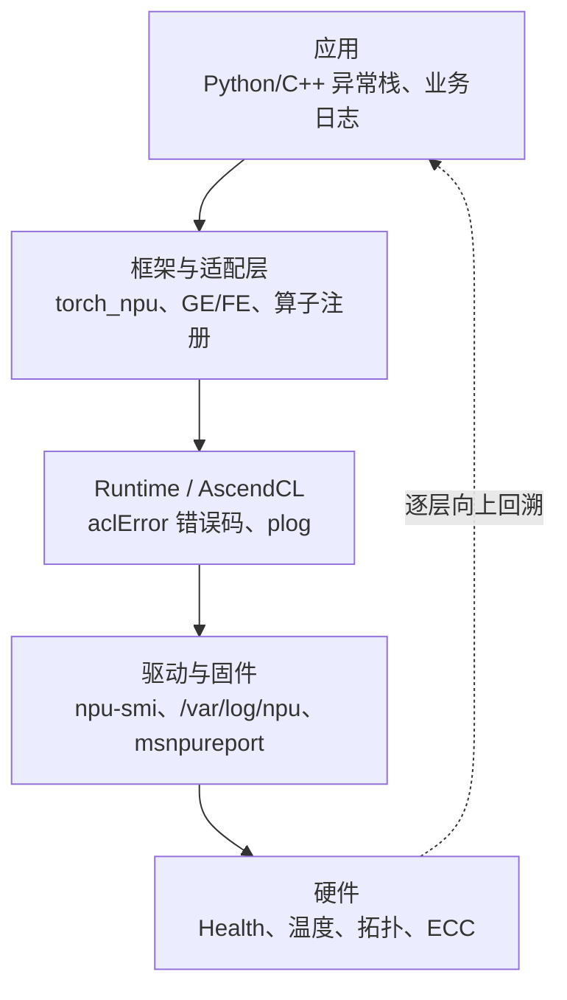

# 第 9 章 故障排查与速查手册

## 本章目标

1. 按「应用 / 框架与适配层 / Runtime / 驱动与固件 / 硬件」五层说出每层可观测信号与对应工具，把一条报错定位到具体层。
2. 打开详细日志、找到 plog 与 device 侧日志、用 `msaccucmp.py` 完成一次逐层精度比对，并把问题缩小到最小复现。
3. 按典型错误清单处理至少八类报错，写出提交问题时应收集的最小信息模板。

## 先说结论

- CANN 应用类日志默认只记 ERROR 级。`export ASCEND_GLOBAL_LOG_LEVEL=0` 打开 DEBUG，`=1` 打开 INFO；`ASCEND_SLOG_PRINT_TO_STDOUT=1` 把日志打到屏幕，`ASCEND_PROCESS_LOG_PATH` 改落盘目录。
- plog（Host 侧日志）落在 `$HOME/ascend/log/[run|debug]/plog/plog-pid_yyyymmddtttttttt.log`，`$HOME/ascend/log` 是应用类日志默认根目录。device 侧日志用 `/usr/local/Ascend/driver/tools/msnpureport` 收回到 Host 再查看；`/var/log/npu/slog` 与 `/var/log/npu/driver` 存系统侧日志。
- 定位按调用链逐层缩小：应用看异常栈，框架与适配层看算子注册与版本，Runtime 看 `aclError` 错误码与 plog，驱动与固件看 `npu-smi info` 与 device 日志，硬件看 Health、温度与拓扑。
- 精度问题用 ptdbg_ascend 注册 hook 逐层 dump，用 `python3 msaccucmp.py compare -m <npu_dump> -g <golden_dump> -out <out_dir>` 比对，按余弦相似度与最大绝对误差找出网络执行顺序里第一个不达标的 API。
- 版本配套是高频根因。torch、torch_npu、CANN、驱动固件按官方版本配套表整组核对，CANN 升级后重新用 ATC 转换离线模型，避免沿用旧 `.om` 文件。

## 分层定位、错误清单与速查表

### 按调用链分层定位

NPU 指 Neural Processing Unit，神经网络处理单元，本教程中即昇腾 AI 处理器。CANN 指 Compute Architecture for Neural Networks，是位于驱动与上层框架之间的异构计算软件栈，对外提供 AscendCL（ACL，Ascend Computing Language）这套 C/C++ 接口。GE 指 Graph Engine，图引擎，负责计算图融合与调度；Runtime 指运行时，负责把 Host 下发的任务排到设备上执行；HCCL（Huawei Collective Communication Library，集合通信库）提供多卡之间的 AllReduce、AllGather 原语。

官方《故障处理流程》给出的日志分析方法叫「至上而下」：先看 plog 确认 Host 侧报错，再看 device 日志确认 Device 侧报错，按业务流程逐步缩小到底层故障现象。这与后端链路追踪按 span 逐跳排查同构。

| 后端概念 | 昇腾侧对应物 | 差异 |
|---|---|---|
| 应用日志与 APM span | plog / device 日志 | CANN 日志按组件（GE、FE、RTS）分目录，且默认级别为 ERROR |
| 进程退出码与 errno | `aclError` 错误码（如 207018、507000） | 错误码是 CANN 自定义编号，需查 aclError 对照表 |
| 依赖库加载检查 `ldd` | `ldd` 查 `libascendcl.so` / `libhccl.so` | 库路径依赖 `set_env.sh` 注入的 `LD_LIBRARY_PATH` |
| 健康检查接口 `/healthz` | `npu-smi info` 的 Health 列 | Health 直接反映驱动与固件能否枚举到卡 |
| 容器设备映射检查 | `ls /dev/davinci*` | 昇腾需要映射多个设备节点与 driver 目录 |



| 层 | 可观测信号 | 工具 | 由谁决定 |
|---|---|---|---|
| 应用 | `RuntimeError`、`NotImplementedError`、进程退出无输出 | Python 日志、`pystack`、`tee` 重定向 | 业务脚本、训练框架入口 |
| 框架与适配层 | `import torch_npu` 失败、算子注册失败、`torch.ops` 命名空间缺算子 | `python3 -c "import torch, torch_npu; print(...)"`、算子支持列表 | PyTorch 与 torch_npu 版本配套 |
| Runtime / CANN | `aclError` 错误码、`ACL stream synchronize failed` | plog、`ASCEND_GLOBAL_LOG_LEVEL`、`ASCEND_LAUNCH_BLOCKING=1`（让算子同步执行，报错栈落在真正的调用点） | ACL 接口调用顺序与资源状态 |
| 驱动与固件 | device 日志、`NPU device count is 0` | `npu-smi info`、`msnpureport`、`/var/log/npu/slog` | 驱动与固件版本、设备节点权限 |
| 硬件 | Health 非 OK、温度超阈值、拓扑异常、显存占用 | `npu-smi info -t board -i 0`、`-t temperature`、`-t usages`、`-t topo`、`ascend-dmi -i` | 物理卡状态与散热 |

### 错误码与日志位置

日志分三处。应用类日志默认根目录为 `$HOME/ascend/log`，标准态部署下 `debug/` 子目录按组件划分：`device-{0-7}` 是各张卡的 Device 侧日志，`plog/` 是 Host 侧日志，含 GE、FE、RTS 等组件。官方《故障处理流程》给出的 plog 路径写法为 `/root/ascend/log/[run|debug]/plog/plog-pid_yyyymmddtttttttt.log`，其中 `pid` 是进程号、后段是时间戳；进程号可从框架的 DEBUG 日志里取。系统侧日志在 `/var/log/npu/slog/host-0/` 与 `/var/log/npu/driver/host-0/`。

| 环境变量 | 取值 | 作用 |
|---|---|---|
| `ASCEND_GLOBAL_LOG_LEVEL` | `0` DEBUG、`1` INFO、`2` WARNING、`3` ERROR、`4` NULL（不输出） | 设置日志级别，默认 `3` |
| `ASCEND_SLOG_PRINT_TO_STDOUT` | `1` | 日志同时打到屏幕 |
| `ASCEND_PROCESS_LOG_PATH` | 有读写权限的目录 | 改应用类日志落盘目录 |
| `GLOG_v` | `0` DEBUG、`1` INFO、`2` WARNING、`3` ERROR | MindSpore / Lite 侧日志级别 |
| `ASCEND_LAUNCH_BLOCKING` | `1` | 算子同步执行，报错栈落在调用点 |

打开更详细日志的命令（`export` 只在当前终端生效，需要重新执行任务才生效）：

```bash
export ASCEND_GLOBAL_LOG_LEVEL=0
export ASCEND_SLOG_PRINT_TO_STDOUT=1
export ASCEND_PROCESS_LOG_PATH=$HOME/npu_debug_log
# 关闭采集
unset ASCEND_GLOBAL_LOG_LEVEL ASCEND_SLOG_PRINT_TO_STDOUT ASCEND_PROCESS_LOG_PATH
```

device 侧日志用驱动自带工具收回 Host（具体参数按 `msnpureport --help` 与实机版本为准）：

```bash
sudo /usr/local/Ascend/driver/tools/msnpureport
```

`aclError` 是 CANN 定义的返回码，查《aclError》文档对照。常用值：

| 错误码 | 宏名 | 含义 |
|---|---|---|
| 207018 | `ACL_ERROR_RT_DEVICE_OOM` | Device 侧内存耗尽 |
| 207019 | `ACL_ERROR_RT_FEATURE_NOT_SUPPORT_UPDATE_OP` | 当前驱动版本不支持更新该算子 |
| 507000 | `ACL_ERROR_RT_INTERNAL_ERROR` | runtime 模块内部错误 |
| 507001 | `ACL_ERROR_RT_TS_ERROR` | Device 上 task scheduler 内部错误 |
| 507002 | `ACL_ERROR_RT_STREAM_TASK_FULL` | stream 上的 task 数量满 |
| 507008 | `ACL_ERROR_RT_SOC_VERSION` | 获取 soc version 失败 |
| 507018 | — | `ACL stream synchronize failed`，流同步失败 |
| ERR02200 | — | HCCL `DIST call hccl api failed` |

### 典型错误清单

| 现象 | 根因 | 定位命令 | 处理动作 |
|---|---|---|---|
| `NPU device count is 0`、`device not found`、`aclrtSetDevice failed` | 驱动未装好、容器未映射 `/dev/davinci*`、`ASCEND_RT_VISIBLE_DEVICES` 设错 | `npu-smi info`；`ls /dev/davinci*`；`echo $ASCEND_RT_VISIBLE_DEVICES` | 重装驱动固件；`docker run` 映射设备节点、driver 与 firmware 目录；按物理卡号设置可见卡 |
| 升级 CANN 后老 `.om` 加载报版本不兼容、接口符号不匹配 | 驱动 / 固件 / CANN / torch_npu 不在同一组配套表 | `npu-smi info`；`cat /usr/local/Ascend/ascend-toolkit/latest/version.cfg`；对照官方版本配套表 | 按配套表整组重装，勿只升一个包；重新用 `atc` 转换离线模型 |
| `ImportError: libascendcl.so: cannot open shared object file`、`libhccl.so` 缺失 | 未加载 `set_env.sh`；`LD_LIBRARY_PATH` 把 `latest` 写成 `current`；`sudo` 丢环境 | `ldd ./main \| grep ascend`；`echo $LD_LIBRARY_PATH`；`ls $ASCEND_HOME_PATH/lib64` | `source /usr/local/Ascend/ascend-toolkit/set_env.sh`；修正路径；用 `sudo -E` 保留环境 |
| `malloc device memory failed`、错误码 207018 | batch 过大、内存碎片、张量未释放、频繁 H2D 拷贝 | `npu-smi info -t usages -i 0`；`npu-smi info` 看 Memory | 减小 batch；开启激活重计算；排查未释放张量与循环内拷贝 |
| `NotImplementedError`、算子报「不支持」 | 用了 CUDA 专属算子或自定义 CUDA kernel；torch 与 torch_npu 版本不匹配 | 查算子支持列表；plog 看 GE/FE 报错；`python3 -c "import torch, torch_npu; print(torch.__version__, torch_npu.__version__)"` | 换成昇腾支持的算子组合；必要时用 Ascend C 写自定义算子；整组对齐版本 |
| loss 为 NaN、NPU 输出与 CPU 基线偏差大 | 混合精度溢出、算子实现差异、随机性未固定、数据预处理补边 | `ptdbg_ascend` dump；`msaccucmp.py compare` 看余弦相似度与最大绝对误差 | 固定 seed 与 dropout、统一 FP32 基线、逐层找第一个不达标 API、用等价 API 替代 |
| `ERR02200 DIST call hccl api failed`、`Init plugin so failed, ret = 1343225860`、多卡握手卡死 | `rank_table.json` 错误、网卡未绑定到对应 NPU、通信端口不通 | `export ASCEND_SLOG_PRINT_TO_STDOUT=1` 看 HCCL ERROR 日志；`npu-smi info -t topo`；检查 rank_table | 用 `hccl_tools.py` 重新生成 rank_table；单机两卡先跑通；清理残留训练进程 |
| 多卡训练初始化 hang、部分 rank 报 invalid device ordinal | `NPROC_PER_NODE` 与 `ASCEND_RT_VISIBLE_DEVICES` 数量不匹配、残留进程占卡 | `echo $ASCEND_RT_VISIBLE_DEVICES`；`npu-smi info` 看 Process id；`pystack` 看各 rank 栈 | 两个变量对齐（如 `0,1,2,3` 配 4）；`kill` 残留进程；单卡验证通过再扩多卡 |
| 迭代耗时翻倍、NPU 利用率长期偏低、温度过高降频 | 数据加载慢、小算子过多、频繁 `numpy()` / `item()` 同步、图模式未开、散热降频 | `msprof --output=./prof_data python3 train.py`；`msprof --export=on --output=./prof_data`；`npu-smi info -t temperature -i 0` | 按算子耗时分布定位瓶颈；批量下发任务再统一同步；开图模式；检查散热 |

### 精度问题定位流程

精度问题的输入是「同一模型在 CPU / GPU 与 NPU 上输出不一致」，输出是「第一个不符合精度标准的 API 及其代码行」。ptdbg_ascend 是 PyTorch 精度工具，通过在模型中注册 hook，跟踪计算图里 API 的前向与反向输入、输出，做整网 API 粒度的数据 dump、溢出检测与精度比对。它按余弦相似度与最大绝对误差两个指标定位，余弦相似度偏低一般代表可能存在问题。控制变量写清楚：两侧模型参数、超参数、原始输入相同，固定 dropout 随机性。

张量落盘与比对涉及下列工具。dump 数据的落盘路径按 `ASCEND_DUMP_PATH` > `ASCEND_WORK_PATH` > 配置文件 `dump_path` > 当前目录 的优先级取值，可用 `acldumpGetPath` 接口查询生效路径。落盘后的 OM dump 数据转成 npy，用于整网比对：

```bash
# 1. OM 侧的 dump 二进制转 npy
python3 /usr/local/Ascend/ascend-toolkit/latest/tools/operator_cmp/compare/msaccucmp.py convert \
  -d /path/to/result/${timestamp}/dump_data/1/${model_name}/1/0/ -out /path/to/npy

# 2. NPU dump 与 CPU/GPU golden dump 整网比对
python3 msaccucmp.py compare -m <npu_dump_dir> -g <golden_dump_dir> -out <out_dir>
```

`msaccucmp.py` 位于 CANN Toolkit 的 `tools/operator_cmp/compare/` 目录，`compare` 子命令的 `-m` 是昇腾侧 dump 目录、`-g` 是标杆侧 npy 目录、`-out` 是结果目录，`convert` 子命令的 `-d` 是 dump 文件夹、`-out` 是已存在的输出目录。比对后按「先结构、后数值」读结果：先确认 shape、dtype、format、min/max 以及是否出现 NaN / Inf，再比较数值差异。MindSpore 侧对应 TroubleShooter，改图截取单算子用 msit 的 `debug surgeon`。

缩小到最小复现按四步收敛：固定 `seed` 与权重、让 CPU 与 NPU 共享同一份输入；把整网比对收敛到第一个不达标 API；用单算子模型（构造或截取得到）在完全相同输入下复现，融合算子要在 CPU 侧拆成对应的多个小算子；dump 出问题 API 的调用栈，回溯到具体代码行做单 API 复现。这样交给支持方的信息只含一个算子、一组输入、一个期望值。

### 速查表

常用命令：

| 命令 | 用途 |
|---|---|
| `npu-smi info` | 看设备列表、Health、显存、功耗、Process id |
| `npu-smi info -t board -i 0` | 看物理槽位与逻辑设备号对应 |
| `npu-smi info -t usages -i 0` / `-t temperature` / `-t topo` | 看占用、温度、拓扑 |
| `watch -n 1 npu-smi info` | 每秒刷新监控 |
| `msprof --output=./prof_data python3 train.py` | 采集性能数据 |
| `msprof --export=on --output=./prof_data` | 解析并导出 PROF_XXX 报告 |
| `atc --model=./model.onnx --framework=5 --output=./model --soc_version=Ascend310 --input_shape="input:1,3,224,224" --log=info` | ONNX 转 `.om` 离线模型 |
| `atc --help` / `atc --help=--soc_version` | 查参数 |
| `ascend-dmi -i` / `-C` / `-g` | 深度查询设备、芯片与组件概要 |
| `ldd ./main` / `md5sum output/*.bin` | 查动态库依赖 / 校验算子输出 |
| `msnpureport` | device 侧日志收回 Host |

npu 相关环境变量：`ASCEND_GLOBAL_LOG_LEVEL`、`ASCEND_SLOG_PRINT_TO_STDOUT`、`ASCEND_PROCESS_LOG_PATH`、`ASCEND_RT_VISIBLE_DEVICES`、`ASCEND_HOME_PATH`、`ASCEND_HOME`、`ASCEND_TOOLKIT_HOME`、`ASCEND_OPP_PATH`、`LD_LIBRARY_PATH`、`ASCEND_DUMP_PATH`、`ASCEND_WORK_PATH`、`ASCEND_LAUNCH_BLOCKING`、`TE_PARALLEL_COMPILER`。`ASCEND_RT_VISIBLE_DEVICES` 指定进程可见的卡号，容器内从 0 开始重新编号。

术语中英对照：

| 中文 | 英文 / 缩写 |
|---|---|
| 昇腾 AI 处理器 | NPU / Ascend AI Processor |
| 主机侧 / 设备侧 | Host / Device |
| 异构计算软件栈 | CANN |
| C/C++ 编程接口 | AscendCL / ACL |
| 运行时 / 执行流 | Runtime / Stream |
| 图引擎 / 离线模型 | GE / .om |
| 集合通信库（HCCL，Huawei Collective Communication Library） | HCCL |
| 高带宽内存 HBM（High Bandwidth Memory）/ 统一缓存 UB（Unified Buffer） | HBM / UB |
| 系统管理接口 npu-smi（NPU System Management Interface）/ 性能采集工具 msprof（MindStudio Profiling） | npu-smi / msprof |
| 模型转换工具 ATC（Ascend Tensor Compiler）/ 精度比对工具 msaccucmp.py | ATC / msaccucmp.py |

延伸阅读链接（均查证于 2026-11-14）：

- [故障处理流程](https://www.hiascend.com/document/detail/zh/canncommercial/80RC22/developmentguide/maintenref/troubleshooting/troubleshooting_180.html) — 日志分析与 plog 路径
- [aclError 错误码](https://www.hiascend.com/document/detail/zh/CANNCommunityEdition/910/others/fvsearch/aclcppdevg_03_1345_3.html) — 错误码对照
- [PrecisionDebugger 模块（ptdbg_ascend）](https://www.hiascend.com/document/detail/zh/canncommercial/700/modeldevpt/ptmigr/AImpug_000184.html) — 逐层精度比对
- [精度比对命令行（msaccucmp.py）](https://www.hiascend.com/document/detail/zh/CANNCommunityEdition/80RC2alpha002/devaids/auxiliarydevtool/atlasaccuracy_16_0068.html) — `compare` 参数
- [Ascend Extension for PyTorch Release Notes](https://www.hiascend.com/document/detail/en/Pytorch/2600/releasenote/docs/en/release_notes/release_notes.md) — 版本配套表
- [msProf 工具使用案例（GitHub）](https://github.com/kali20gakki/msprof/blob/master/docs/zh/best_practices/basic_cases.md) — `msprof --output` 与 `msprof --export=on` 写法
- [om 精度问题定位手段](https://hwcomputing.csdn.net/69d5c51b54b52172bc67a9b9.html) — `msaccucmp.py convert -d -out` 与 msit 改图工具
- [CANN Runtime adump 精度调试指南](https://openrokid.csdn.net/6aa91df56186240f423c726a.html) — `ASCEND_DUMP_PATH` 优先级与 `acldumpGetPath`
- [MindSpore Distributed Parallel FAQ](https://www.mindspore.cn/docs/en/r2.7.1//faq/distributed_parallel.html) — `rank_table.json`、`hccl_tools.py` 与 HCCL 初始化报错

## 动手实操

一次完整排障按「收集信息 → 打开日志 → 复现 → 比对 → 收敛」执行。以下命令以 Linux + bash 为准，需要读驱动日志的地方用 `sudo`。

**文件 `collect_info.sh`**（报问题前一次性收集的最小信息模板）：

```bash
#!/bin/bash
set -e
OUT=${1:-./npu_issue_bundle}
mkdir -p "$OUT"

# 1. 版本与型号
npu-smi info                                  > "$OUT/01_npu_smi.txt" 2>&1
sudo npu-smi info -t board -i 0               > "$OUT/02_board.txt" 2>&1
cat /usr/local/Ascend/ascend-toolkit/latest/version.cfg > "$OUT/03_cann_version.txt" 2>&1
python3 -c "import torch, torch_npu; print('torch', torch.__version__); print('torch_npu', torch_npu.__version__)" \
                                              > "$OUT/04_framework.txt" 2>&1
ls /dev/davinci*                              > "$OUT/05_devices.txt" 2>&1
env | grep -E 'ASCEND|LD_LIBRARY_PATH'        > "$OUT/06_env.txt" 2>&1

# 2. 打开详细日志并重跑复现脚本，日志同时落盘与打屏
export ASCEND_GLOBAL_LOG_LEVEL=0
export ASCEND_SLOG_PRINT_TO_STDOUT=1
export ASCEND_PROCESS_LOG_PATH="$OUT/plog"
python3 "$OUT/reproduce.py"                   > "$OUT/07_reproduce.log" 2>&1

# 3. 收回 device 侧日志（参数按实机 --help）并归档应用类日志
sudo /usr/local/Ascend/driver/tools/msnpureport
cp -r "$HOME/ascend/log/debug/plog/." "$OUT/host_plog/" 2>/dev/null || true

echo "bundle written to $OUT"
```

**文件 `reproduce.py`**（最小复现脚本模板；固定随机性、写明期望与实际输出）：

```python
import os
import numpy as np
import torch
import torch_npu

os.environ["ASCEND_LAUNCH_BLOCKING"] = "1"
torch.manual_seed(42)
np.random.seed(42)

x = torch.randn(2, 8, dtype=torch.float32)
y = torch.randn(2, 8, dtype=torch.float32)
expected = (x + y).numpy()                       # CPU 期望值

x_npu, y_npu = x.npu(), y.npu()
actual = (x_npu + y_npu).cpu().numpy()          # NPU 实际值

print("torch      :", torch.__version__)
print("torch_npu  :", torch_npu.__version__)
print("npu_available:", torch.npu.is_available())
print("npu_count  :", torch.npu.device_count())
print("expected   :", expected.flatten()[:4])
print("actual     :", actual.flatten()[:4])
print("max_abs_err:", float(np.max(np.abs(expected - actual))))
np.testing.assert_allclose(actual, expected, rtol=1e-3, atol=1e-3)
print("PASSED")
```

执行前提：已 `source /usr/local/Ascend/ascend-toolkit/set_env.sh`，`npu-smi info` 能看到卡。把 `reproduce.py` 放到 `npu_issue_bundle/` 下再运行：

```bash
python3 -m pip install numpy torch torch-npu   # 版本按官方配套表整组选定
cp reproduce.py npu_issue_bundle/
bash collect_info.sh ./npu_issue_bundle
```

提交问题时应当收集五项：① 版本（`npu-smi info` 版本、`version.cfg`、torch / torch_npu 版本、驱动固件版本）；② 型号（板卡名、`ascend-dmi -i`）；③ 日志（`$OUT/07_reproduce.log`、`host_plog/`、`msnpureport` 收回的 device 侧日志，以及 `ASCEND_GLOBAL_LOG_LEVEL=0` 下重跑的完整日志）；④ 复现脚本（上面的 `reproduce.py`，固定 seed、单算子、单一变量）；⑤ 期望与实际输出（`expected` 与 `actual` 两组数值及 `max_abs_err`）。预期输出关键行：

```
torch      : 2.6.0
torch_npu  : 2.6.0.post5
npu_available: True
npu_count  : 1
expected   : [ 0.412 -0.983  1.244  0.077]
actual     : [ 0.412 -0.983  1.244  0.077]
max_abs_err: 0.0
PASSED
bundle written to ./npu_issue_bundle
```

示例版本号按实际环境打印，取自 CANN 8.5.0 / PyTorch 2.6.0 / TorchNPU 2.6.0.post5 的公开配套组合。

## 常见坑

| 现象 | 原因 | 处理 |
|---|---|---|
| 进程退出但标准输出没有报错 | 应用类日志默认 ERROR 级，底层错误不打印到标准输出 | `export ASCEND_GLOBAL_LOG_LEVEL=0`、`export ASCEND_SLOG_PRINT_TO_STDOUT=1`，查 `$HOME/ascend/log/debug/plog/` |
| 按网帖路径找不到日志文件 | 落盘目录受 `ASCEND_PROCESS_LOG_PATH` 与运行用户影响，plog 文件名里的 pid 与时间戳每次不同 | `ls $HOME/ascend/log/debug/plog/` 按 pid 匹配；dump 路径用 `acldumpGetPath` 查生效值 |
| 加 `sudo` 后报动态库找不到 | root 读 `/root/.bashrc`，普通用户配的 `LD_LIBRARY_PATH` 不生效 | 用 `sudo -E` 保留环境，或在 root 环境重新 `source set_env.sh` |
| 容器重启后日志丢失 | 应用类日志在容器内，未挂载到宿主机，且无老化机制 | `docker run -v` 把日志目录挂出，或把 `ASCEND_PROCESS_LOG_PATH` 指向挂载卷 |
| 改了环境变量下次任务仍是旧日志级别 | `export` 只生效于执行界面，需重新执行任务才生效 | 把 export 写进启动脚本；任务结束 `unset ASCEND_GLOBAL_LOG_LEVEL` 调回默认 |
| 调试几天后磁盘被写满 | DEBUG / INFO 日志量大，应用类日志不会自动老化 | 用系统 `logrotate` 切分；生产环境把 `ASCEND_GLOBAL_LOG_LEVEL` 调回 `3` |

## 自测题

1. 一台 Ascend910B 训练服务器，CANN 8.0.RC2.2，训练进程 pid 为 2727419。写出打开 INFO 级日志并把日志打到屏幕的两条 `export` 命令，再写出该进程 plog 文件名的匹配模式（含目录）。
2. 运行 `./main` 报 `ImportError: libascendcl.so: cannot open shared object file`。写出三条定位命令，并给出对应的一条处理动作。
3. NPU 推理输出与 CPU 基线偏差过大，`npu_dump/` 与 `golden_dump/` 两个目录已就绪。写出用 `msaccucmp.py` 做整网比对的完整命令，再写出判断「第一个不达标 API」用到的两个指标。
4. 四卡训练在初始化阶段报 `ERR02200 DIST call hccl api failed`。列出三个检查点，各配一条命令或操作。
5. `aclrtMalloc` 返回 207018。写出该错误码的宏名、含义、一条定位命令与一条处理动作。

## 自测题答案

1. `export ASCEND_GLOBAL_LOG_LEVEL=1`（1 为 INFO，0 为 DEBUG），`export ASCEND_SLOG_PRINT_TO_STDOUT=1`。plog 匹配模式为 `$HOME/ascend/log/debug/plog/plog-2727419_*.log`（官方写法里的目录为 `$HOME/ascend/log/[run|debug]/plog/`）。
2. 定位：`ldd ./main | grep ascend` 看链接到哪个库；`echo $LD_LIBRARY_PATH` 看路径是否含 `ascend-toolkit/latest/lib64`；`ls $ASCEND_HOME_PATH/lib64/libascendcl.so` 看库是否存在。处理：`source /usr/local/Ascend/ascend-toolkit/set_env.sh`，并把误写为 `current` 的路径改回 `latest`；用 `sudo` 时改 `sudo -E`。
3. 命令 `python3 msaccucmp.py compare -m npu_dump/ -g golden_dump/ -out out_dir`（`-m` 为昇腾侧 dump 目录，`-g` 为标杆 npy 目录）。两个指标是余弦相似度与最大绝对误差；按网络执行顺序取第一个不符合精度标准的 API。
4. 检查点一：`export ASCEND_SLOG_PRINT_TO_STDOUT=1` 后重跑，看 HCCL 的 ERROR 日志。检查点二：`npu-smi info -t topo` 看拓扑与设备健康，并确认 `ASCEND_RT_VISIBLE_DEVICES=0,1,2,3` 与 `NPROC_PER_NODE=4` 一致。检查点三：检查 `rank_table.json`，用 `hccl_tools.py` 重新生成，并 `kill` 残留训练进程后先跑单机两卡。
5. 宏名 `ACL_ERROR_RT_DEVICE_OOM`，含义为 Device 侧内存耗尽。定位命令 `npu-smi info -t usages -i 0` 看显存占用。处理动作：减小 batch 或开启激活重计算，并排查未释放张量与循环内的频繁拷贝。

## 参考来源

- [故障处理流程（CANN 商用版 8.0.RC2.2）](https://www.hiascend.com/document/detail/zh/canncommercial/80RC22/developmentguide/maintenref/troubleshooting/troubleshooting_180.html) — 查证于 2026-11-14，支撑至上而下日志分析法、plog 路径写法、`ASCEND_GLOBAL_LOG_LEVEL` 与 `msnpureport`
- [分配内存失败 / CANN 日志参考（昇腾社区）](https://www.hiascend.com/document/detail/zh/mindsdk/730/indexn/indexug/mxindexfrug_0552.html) — 查证于 2026-11-14，支撑 `$HOME/ascend/log` 默认路径、`ASCEND_GLOBAL_LOG_LEVEL` 五级取值与 `ASCEND_PROCESS_LOG_PATH`
- [aclError 错误码（CANN 社区版 9.1.0）](https://www.hiascend.com/document/detail/zh/CANNCommunityEdition/910/others/fvsearch/aclcppdevg_03_1345_3.html) — 查证于 2026-11-14，支撑 207018、207019、507000、507008 等错误码的宏名与含义
- [MindSpore Lite 问题定位相关日志获取](https://discuss.mindspore.cn/t/topic/1442) — 查证于 2026-11-14，支撑 `GLOG_v`、`ASCEND_SLOG_PRINT_TO_STDOUT`、`plog` 命名与 `~/ascend/log/debug` 目录结构
- [准备离线模型 dump 数据文件 / msaccucmp.py compare 参数（CANN 社区版 8.0.RC2）](https://www.hiascend.com/document/detail/zh/CANNCommunityEdition/80RC2alpha002/devaids/auxiliarydevtool/atlasaccuracy_16_0068.html) — 查证于 2026-11-14，支撑 `compare -m -g -out` 命令行格式与工具安装目录
- [PrecisionDebugger 模块 / ptdbg_ascend（CANN 商用版 7.0.0）](https://www.hiascend.com/document/detail/zh/canncommercial/700/modeldevpt/ptmigr/AImpug_000184.html) — 查证于 2026-11-14，支撑 hook 逐层 dump、余弦相似度与最大绝对误差定位流程
- [数据处理：数据集与基准一致（昇腾社区）](https://www.hiascend.com/document/detail/zh/canncommercial/5046/modeldev/tfmigr/tfmigr_tfprecision_0011.html) — 查证于 2026-11-14，支撑 `msaccucmp.py compare` 整网比对与单层数据比对分析
- [昇腾系列产品和常用命令介绍](https://hwcomputing.csdn.net/6a0a700b10ee7a33f273478a.html) — 查证于 2026-11-14，支撑 `npu-smi`、`atc --framework=5`、`msprof`、`/var/log/npu/slog` 与 `/var/log/npu/driver` 命令写法
- [LLaMA-Factory FAQ（昇腾文档）](https://ascend.readthedocs.io/zh-cn/latest/sources/llamafactory/faq.html) — 查证于 2026-11-14，支撑 507018 与 HCCL `ERR02200` 报错现象
- [ms-swift NPU Support（GitHub）](https://github.com/PraMamba/ms-swift/blob/main/docs/source_en/BestPractices/NPU-support.md) — 查证于 2026-11-14，支撑 `ASCEND_RT_VISIBLE_DEVICES` / `NPROC_PER_NODE` 匹配、HCCL 排障与版本配套检查
